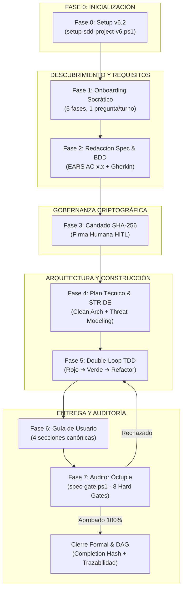
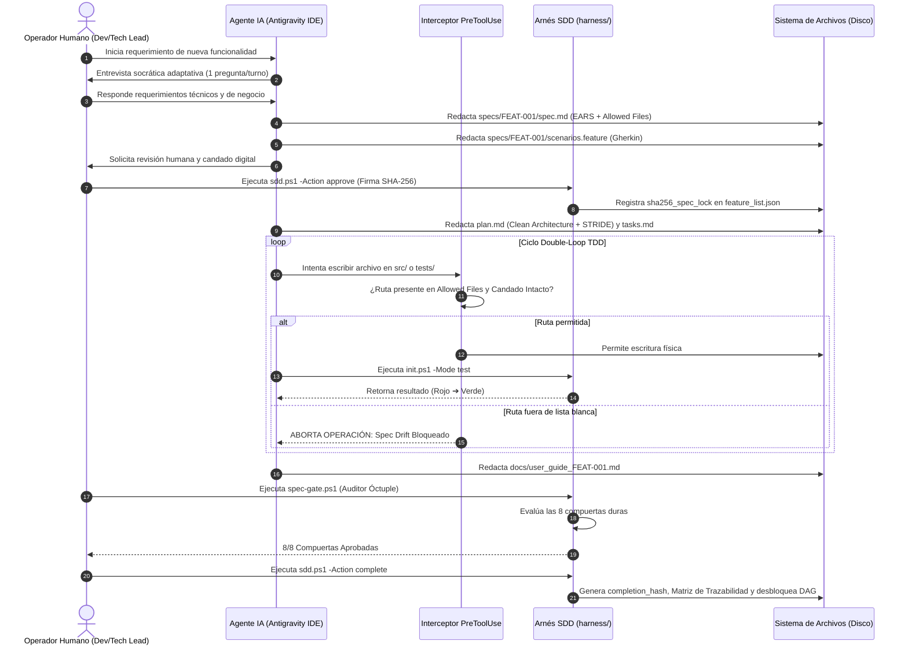

# LIBRO BLANCO Y DOCUMENTO MAESTRO: FRAMEWORK SDD v6.2

## Specification-Driven Development (Enterprise Security, CI/CD Governance & Interactive Dashboard Edition)

### Marco de Gobernanza, Arquitectura Limpia, Candado Criptográfico y Ciberseguridad Defensiva para el Desarrollo con Agentes de Inteligencia Artificial

---


*Figura 1: Blueprint Arquitectónico y Gobernanza Integral de SDD v6.2 Enterprise Security Edition ([Ver imagen en alta resolución](file:///C:/Users/salvador.velasco/.gemini/antigravity/brain/0bd088a9-655d-47e1-8c50-119b59e34fd8/sdd_v6_architecture_blueprint_1793299430129.jpg))*

---

## 1. Resumen Ejecutivo y Visión General

### 1.1. El Dilema del Desarrollo con Inteligencia Artificial

La incorporación de modelos de lenguaje grande (LLMs) y agentes autónomos de codificación en entornos empresariales y gubernamentales promete multiplicar la velocidad de entrega de software hasta por tres. Sin embargo, su adopción libre o no gobernada genera graves anomalías:

1. **Spec Drift (Dispersión de Requisitos):** El agente de IA tiende a agregar funcionalidad no solicitada, reescribir APIs sin autorización y modificar archivos ajenos a su alcance.
2. **Vulnerabilidades y Brechas OWASP:** Inyección SQL por concatenación de texto, credenciales o llaves de API hardcodeadas en repositorios, y dependencias con vulnerabilidades críticas (CVEs).
3. **Pruebas Falsas (Fake Tests):** Pruebas simuladas con `pass`, aserciones triviales (`assert True == True`) o decoradores `@pytest.mark.skip` que generan reportes de cobertura 100% fraudulentos.
4. **Pérdida de Trazabilidad Institucional:** Imposibilidad de justificar ante auditorías internas o externas (como el Órgano Interno de Control o la Auditoría Superior de la Federación) el origen, justificación y autorización de cada línea de código.

### 1.2. El Paradigma SDD: "La Especificación Manda"

El Framework **Specification-Driven Development (SDD)** nace para erradicar el caos agéntico, transformando el desarrollo asistido por IA en un proceso **determinista, auditable, matemáticamente verificable y blindado por diseño**.

> [!IMPORTANT]
> **Axioma Rector de SDD v6.2:**
> Ninguna línea de código de producción puede existir en la carpeta `src/` sin:
> 1. Una especificación formal previa aprobada (redactada en sintaxis EARS y BDD Gherkin).
> 2. Un candado criptográfico **SHA-256** firmado formalmente por un operador humano (*Human-in-the-Loop*).
> 3. Aislamiento estricto de capas en Clean Architecture pura.
> 4. Verificación algorítmica de accesibilidad WCAG 2.1 AA ($\ge 4.5:1$).
> 5. Modelado preventivo de amenazas **STRIDE** y aprobación de las 8 compuertas del **Auditor Óctuple**.

---


*Figura 2: Procedimiento Operativo de Creación de Aplicaciones en 9 Estaciones — SDD v6.2 Enterprise Security Edition ([Ver imagen en alta resolución](file:///C:/Users/salvador.velasco/.gemini/antigravity/brain/0bd088a9-655d-47e1-8c50-119b59e34fd8/sdd_v6_procedimiento_operativo_final_1793300113391.jpg) | [Abrir en Visor Web Pantalla Completa](file:///D:/.antigravity/sdd-projects/ver_infografia.html))*

---

## 2. Los 8 Pilares Fundamentales de SDD v6.2

El framework se erige sobre seis cimientos innegociables integrados en el arnés de ejecución:

| # | Pilar | Mecanismo de Control | Beneficio Clave |
| :-: | :--- | :--- | :--- |
| **1** | **Spec-First & Anti-Drift** | Lista blanca `Allowed Files` + Interceptor físico `PreToolUse` | Cero cambios fuera de alcance; protección de sistemas legados. |
| **2** | **BDD Bidireccional Riguroso** | EARS (`AC-x.x`) $\longleftrightarrow$ Gherkin (`@AC-x.x`) $\longleftrightarrow$ Tests | Cobertura real 1:1 verificable de reglas de negocio. |
| **3** | **Clean Architecture Políglota** | 4 capas puras (`domain`, `application`, `infra`, `presentation`) | Desacoplamiento total; código portátil y mantenible. |
| **4** | **UI/UX Pro Max** | Tokens JSON + WCAG 2.1 AA ($\ge 4.5:1$) + 5 estados | Inclusión ciudadana por algoritmo; cero colores arbitrarios. |
| **5** | **Criptografía HITL & DAG** | Firma SHA-256 humana + Grafo de dependencias (`depends_on`) | Control de cambios inmutable; prevención de cuellos de botella. |
| **6** | **Secure Coding & OWASP (v6.2)** | Modelado STRIDE en plan.md + Tríada Letal + `verify-security.ps1` | Ciberseguridad por diseño; protección de datos sensibles. |

```text
┌────────────────────────────────────────────────────────────────────────────────────────────────────────┐
│                                    LOS 6 PILARES DE SDD v6.2                                           │
├──────────────────────────┬──────────────────────────┬──────────────────────────┬───────────────────────┤
│ 1. Spec-First &          │ 2. BDD Bidireccional     │ 3. Clean Architecture    │ 4. UI/UX Pro Max      │
│    Anti-Drift            │    Riguroso              │    Políglota Estricta    │    Matemática         │
│    • Allowed Files       │    • Sintaxis EARS       │    • Dominio 100% puro   │    • WCAG 2.1 AA      │
│    • PreToolUse Hook     │    • Gherkin @AC-x.x     │    • Inversión (DIP)     │    • Tokens semánticos│
│    • Cero cambios extra  │    • Trazabilidad 1:1    │    • Polyglot presets    │    • 5 estados UI     │
├──────────────────────────┴──────────────────────────┼──────────────────────────┴───────────────────────┤
│ 5. Criptografía HITL & Gobernanza DAG               │ 6. Secure Coding, STRIDE & OWASP (NUEVO v6.2)    │
│    • Candado SHA-256 Human-in-the-Loop              │    • Modelado STRIDE obligatorio en plan.md      │
│    • Grafo acíclico de dependencias (depends_on)    │    • Detección de la Tríada Letal                │
│    • Completion Hash inmutable                      │    • Escaneo de secretos, SAST y CVEs            │
└─────────────────────────────────────────────────────┴──────────────────────────────────────────────────┘
```

### Detalle de Pilares Críticos:

#### Pilar 1: Spec-First & Perímetro Cerrado (Anti-Drift)

Cada funcionalidad define en su `spec.md` la sección `## 5. Allowed Files`. En Google Antigravity IDE, el hook [`PreToolUse`](file:///D:/.antigravity/sdd-projects/.agents/hooks.json) intercepta llamadas a herramientas como `write_file` o `edit_file`. Si la ruta que el modelo intenta tocar no está en la lista blanca, la llamada es abortada físicamente antes de ejecutarse en el disco.

#### Pilar 3: Clean Architecture Políglota

El código de producción reside estrictamente en cuatro anillos concéntricos:

- **`src/domain/`:** Entidades y reglas de negocio puras. Prohibido importar frameworks o bases de datos.
- **`src/application/`:** Casos de uso e interfaces (puertos).
- **`src/infrastructure/`:** Implementaciones concretas (adaptadores de BD, clientes REST, repositorios).
- **`src/presentation/`:** Interfaces de usuario (UI web/móvil) o controladores de consola (CLI).

> [!NOTE]
> SDD v6.2 es totalmente políglota. Es compatible con Python, TypeScript/Node, C# .NET, Go, Rust, Flutter y stacks empresariales como **Spring Boot Java 21 + Angular 21 + PostgreSQL 17**.

#### Pilar 6: Ciberseguridad Defensiva y Modelado STRIDE (Novedad v6.2)

El archivo `plan.md` incorpora la sección obligatoria `## 5. Security & Threat Modeling (STRIDE / OWASP Sinks)`. En ella se analizan las seis amenazas canónicas:

- **S**poofing (Suplantación de identidad).
- **T**ampering (Manipulación no autorizada de datos).
- **R**epudiation (Repudio o falta de trazabilidad).
- **I**nformation Disclosure (Fuga o divulgación de información confidencial).
- **D**enial of Service (Denegación de servicio o consumo de recursos).
- **E**levation of Privilege (Escalamiento de privilegios).

Asimismo, el arnés alerta inmediatamente ante la **Tríada Letal**: la coincidencia en un mismo componente de *Datos Privados/Sensibles + Entrada de Datos Externa No Confiable + Capacidad de Exfiltración por Red*.

---

## 3. Topología Canónica del Proyecto SDD v6.2

Todo repositorio gobernado por SDD v6.2 posee la siguiente estructura física estandarizada:

```text
<RAÍZ_DEL_PROYECTO>/
├── .github/                                # Integración Continua en GitHub
│   └── workflows/
│       └── sdd-gate.yml                    # Pipeline de gobernanza y auditoría en PRs
├── .gitlab-ci.yml                          # Pipeline de gobernanza para GitLab CI
├── .agents/                                # Gobernanza agéntica para Google Antigravity IDE
│   ├── hooks.json                          # Hooks SessionStart, PreToolUse y PostToolUse
│   └── skills/                             # 16 Habilidades operativas canónicas
│       ├── sdd-orchestrator/               # Orquestador del flujo y transición de fases
│       ├── sdd-onboard/                    # Entrevista socrática interactiva
│       ├── sdd-constitution/               # Guardián de las 10 leyes inmutables
│       ├── sdd-specify/                    # Redacción formal EARS y contratos
│       ├── sdd-clarify/                    # Detección adversarial de ambigüedades
│       ├── sdd-ui-ux/                      # Tokens y accesibilidad matemática
│       ├── sdd-design-system/              # Gestión de variables y paletas
│       ├── sdd-preview-design/             # Generador de visualización HTML de diseño
│       ├── sdd-plan/                       # Planificación técnica y arquitectura
│       ├── sdd-tasks/                      # Desglose de tareas con grafo DAG
│       ├── sdd-implement/                  # Ciclo TDD bajo interceptor físico
│       ├── sdd-secure-coding/              # [NUEVO v6.2] OWASP, STRIDE y Trust Boundaries
│       ├── sdd-user-guide/                 # Generador de manual operativo de 4 secciones
│       ├── sdd-validate/                   # Auditoría de compuertas duras
│       ├── sdd-change-spec/                # Gestión controlada de cambios a specs
│       └── sdd-reverse-spec/               # Extracción de specs en código legado (brownfield)
├── .specify/                               # Memoria persistente y plantillas del proyecto
│   ├── memory/
│   │   ├── constitution.md                 # 10 Leyes inmutables del proyecto
│   │   └── feature_list.json               # Backlog gobernado como Grafo DAG (depends_on)
│   ├── design-system/
│   │   └── design-tokens.json              # Tokens atómicos de diseño (WCAG 2.1 AA)
│   ├── templates/
│   │   ├── spec.template.md                # Plantilla maestra de especificación EARS
│   │   ├── scenarios.template.feature      # Plantilla Gherkin con etiquetas @AC-x.x
│   │   ├── plan.template.md                # Plantilla de arquitectura con sección STRIDE
│   │   └── tasks.template.md               # Plantilla de desglose de tareas TDD
│   └── harness-config.json                 # Configuración del stack tecnológico y comandos
├── harness/                                # Arnés de automatización, seguridad y auditoría
│   ├── init.ps1                            # Diagnóstico de salud y ejecución de pruebas
│   ├── verify-security.ps1                 # [NUEVO v6.2] Escáner de secretos, SAST y CVEs
│   ├── sdd.ps1                             # CLI central (backlog, candado SHA-256, cierre)
│   ├── spec-gate.ps1                       # Auditor Óctuple (8 compuertas duras)
│   ├── preview-design.ps1                  # Renderizador interactivo del design system
│   ├── dashboard.ps1                       # Generador del Dashboard Web y Visor DAG
│   └── pr-summary.ps1                      # [NUEVO v6.2] Generador del resumen de Pull Request
├── specs/                                  # Especificaciones formales por funcionalidad
│   └── <feature_id>/                       # Carpeta individual de cada feature
│       ├── spec.md                         # Requisitos EARS y lista blanca Allowed Files
│       ├── scenarios.feature               # Escenarios Gherkin ejecutables
│       ├── plan.md                         # Plan técnico con Clean Architecture y STRIDE
│       └── tasks.md                        # Grafo de tareas TDD ordenadas por dependencias
├── src/                                    # Código fuente puro en Clean Architecture
│   ├── domain/                             # Entidades y lógica central puras
│   ├── application/                        # Casos de uso e interfaces
│   ├── infrastructure/                     # Adaptadores de BD, APIs y frameworks
│   └── presentation/                       # Controladores UI / CLI desacoplados
├── tests/                                  # Suites de prueba automatizadas
│   ├── unit/                               # Pruebas unitarias de dominio y aplicación
│   └── acceptance/                         # Pruebas de aceptación BDD (step definitions)
├── docs/                                   # Documentación formal obligatoria
│   ├── user_guide_<feature>.md             # Manual de usuario final en 4 secciones
│   └── traceability_<feature>.md           # Matriz bidireccional de trazabilidad
└── progress/                               # Registros de auditoría y checkpoints
    ├── impl_<feature>.md                   # Registro de construcción TDD paso a paso
    └── arch_alerts.log                     # Alertas de violación arquitectónica detectadas
```

---

## 4. El Ciclo de Vida Operativo de 8 Fases

El proceso de desarrollo en SDD v6.2 sigue un flujo secuencial riguroso donde cada fase entrega artefactos formales requeridos por la siguiente:



### Diagrama de Secuencia de Interacción Humano-Agente-Arnés



---

## 5. El Auditor Óctuple: Las 8 Aduanas Infranqueables

Para que una funcionalidad pueda ser declarada completada (`DONE`), el script [`spec-gate.ps1`](file:///D:/.antigravity/sdd-projects/harness/spec-gate.ps1) ejecuta automáticamente la verificación de 8 compuertas duras:

```text
┌────────────────────────────────────────────────────────────────────────────────────────────────────────┐
│                                   EL AUDITOR ÓCTUPLE (spec-gate.ps1)                                   │
├────┬─────────────────────────────┬─────────────────────────────────────────────────┬───────────────────┤
│ #  │ Aduana Infranqueable        │ Criterio de Pase Automatizado                   │ Nivel de Bloqueo  │
├────┼─────────────────────────────┼─────────────────────────────────────────────────┼───────────────────┤
│ 1  │ Spec Drift & Git Hygiene    │ Workspace auditado contra Allowed Files         │ BLOQUEO FÍSICO    │
│ 2  │ Cobertura BDD 100%          │ Todo AC-x.x existe en .feature y pruebas        │ BLOQUEO FÍSICO    │
│ 3  │ Clean Architecture          │ domain puro (0 frameworks); dependencias en plan│ BLOQUEO FÍSICO    │
│ 4  │ Candado Criptográfico       │ Hash SHA-256 de spec.md coincide exactamente    │ BLOQUEO FÍSICO    │
│ 5  │ Anti-Fake Tests             │ Cero skip, pass o pruebas vacías; corrida real  │ BLOQUEO FÍSICO    │
│ 6  │ Guía de Usuario             │ 4 secciones canónicas completas; 0 placeholders │ BLOQUEO FÍSICO    │
│ 7  │ UI/UX Pro Max               │ Contraste WCAG AA calculado; 0 magic hex        │ BLOQUEO FÍSICO    │
│ 8  │ Secure Coding (NUEVO v6.2)  │ 0 secretos, 0 SQL concat, 0 CVEs; STRIDE en plan│ BLOQUEO FÍSICO    │
└────┴─────────────────────────────┴─────────────────────────────────────────────────┴───────────────────┘
```

### Análisis Detallado de Cada Aduana

#### Aduana 1: Spec Drift & Git Hygiene

- **Qué audita:** Compara el `git status` y el árbol de archivos modificados contra la lista blanca declarada en `spec.md` (`## 5. Allowed Files`).
- **Criterio de fallo:** Si el desarrollador o el agente modificó un archivo fuera de la lista blanca, la compuerta rechaza el pase y detalla las rutas infractoras.

#### Aduana 2: Cobertura BDD 100%

- **Qué audita:** Extrae todos los identificadores de criterios EARS (`AC-x.x`) en `spec.md` y busca su correspondencia exacta como etiquetas Gherkin (`@AC-x.x`) en `scenarios.feature` y como funciones de prueba en `tests/`.
- **Criterio de fallo:** Si existe un solo criterio sin prueba asociada, la compuerta falla.

#### Aduana 3: Pureza de Clean Architecture

- **Qué audita:** Realiza análisis sintáctico (AST) sobre `src/domain/`.
- **Criterio de fallo:** Detección de sentencias `import` hacia bibliotecas externas, frameworks web o paquetes de bases de datos dentro de la capa de dominio.

#### Aduana 4: Integridad Criptográfica del Candado SHA-256

- **Qué audita:** Calcula el hash SHA-256 en tiempo real de `spec.md` y lo compara con el valor registrado en `feature_list.json` durante la aprobación humana.
- **Criterio de fallo:** Diferencia de un solo carácter en la especificación indica alteración posterior no autorizada y aborta el flujo.

#### Aduana 5: Detección Anti-Fake Tests

- **Qué audita:** Inspecciona el código de pruebas buscando antipatrones comunes de IA: funciones con cuerpo `pass`, declaraciones `return True` vacías, directivas de omisión sin justificación (`skip`) o aserciones triviales. Adicionalmente ejecuta la suite dinámicamente mediante `init.ps1`.
- **Criterio de fallo:** Presencia de cualquier prueba vacía o falla en la ejecución real.

#### Aduana 6: Guía de Usuario Obligatoria e Higiene de Formato Markdown

- **Qué audita:**
  1. **Contenido:** Verifica la existencia de `docs/user_guide_<feature>.md` y audita que contenga sus cuatro secciones canónicas (Propósito, Requisitos/Instrucciones, Paso a Paso, Solución de Problemas) sin texto residual (*"TODO"*, *"TBD"*, *"Lorem Ipsum"* ni placeholders sin rellenar).
  2. **Higiene de Formato Markdownlint (MD022 y MD047):** Audita y auto-repara que todos los encabezados tengan una línea en blanco arriba y abajo (MD022) y que el documento finalice estrictamente con un único salto de línea final sin líneas vacías sobrantes (MD047).
- **Criterio de fallo:** Ausencia del archivo o presencia de texto de relleno tipo *"TODO"*, *"TBD"* o placeholders residuales `{PLACEHOLDER}`. Las discrepancias de espaciado MD022 y MD047 son auto-reparadas al vuelo por `spec-gate.ps1`.

#### Aduana 7: UI/UX Pro Max y Accesibilidad Matemática

- **Qué audita:** En proyectos con frontend o CLI visual, valida que los colores se consuman de `design-tokens.json` (cero códigos hexadecimales embebidos en el código) y ejecuta el cálculo algorítmico del ratio de contraste:
  $$\text{Ratio} = \frac{L_1 + 0.05}{L_2 + 0.05} \ge 4.5:1$$

- **Criterio de fallo:** Contraste inferior a 4.5:1 o uso de códigos de color *hardcodeados*.

#### Aduana 8: Ciberseguridad Defensiva y Secure Coding (Novedad v6.2)

- **Qué audita:** Ejecuta [`verify-security.ps1`](file:///D:/.antigravity/sdd-projects/harness/verify-security.ps1) realizando tres comprobaciones:
  1. *Secret Scanning:* Detección de llaves privadas, tokens JWT, contraseñas o credenciales en código.
  2. *SAST (Static Application Security Testing):* Detección de inyección SQL por concatenación (`SELECT ... WHERE id = ' + val`), uso de funciones peligrosas (`eval()`, `exec()`, `shell=True`, deserializaciones inseguras).
  3. *STRIDE Verification:* Comprobación de que la sección `## 5. Security & Threat Modeling` en `plan.md` esté completa y aborde cada vector.
- **Criterio de fallo:** Detección de secretos, vulnerabilidades SAST críticas o plan técnico sin análisis de seguridad.

---

## 6. Las 18 Skills Canónicas y los Hooks de Antigravity IDE

El ecosistema agéntico opera mediante 18 habilidades especializadas organizadas bajo el principio de responsabilidad única:

| Skill | Ubicación | Función Principal |
| :--- | :--- | :--- |
| `sdd-orchestrator` | `.agents/skills/sdd-orchestrator/` | Orquestación central del flujo de 8 fases y transición de estados. |
| `sdd-onboard` | `.agents/skills/sdd-onboard/` | Entrevista socrática de 5 fases (1 pregunta/turno) para descubrir requisitos. |
| `sdd-constitution` | `.agents/skills/sdd-constitution/` | Supervisión y salvaguarda de las 10 leyes inmutables del proyecto. |
| `sdd-specify` | `.agents/skills/sdd-specify/` | Redacción de especificaciones formales EARS y definición de contratos. |
| `sdd-clarify` | `.agents/skills/sdd-clarify/` | Detección adversarial de ambigüedades y preguntas de clarificación. |
| `sdd-ui-ux` | `.agents/skills/sdd-ui-ux/` | Diseño centrado en el usuario y accesibilidad matemática WCAG 2.1 AA. |
| `sdd-design-system` | `.agents/skills/sdd-design-system/` | Centralización y mantenimiento de tokens en `design-tokens.json`. |
| `sdd-preview-design` | `.agents/skills/sdd-preview-design/` | Generación de vistas previas HTML interactivas del sistema de diseño. |
| `sdd-plan` | `.agents/skills/sdd-plan/` | Arquitectura limpia y diseño de componentes con sección STRIDE. |
| `sdd-tasks` | `.agents/skills/sdd-tasks/` | Desglose ordenado de tareas técnicas respetando el grafo de dependencias. |
| `sdd-implement` | `.agents/skills/sdd-implement/` | Ciclo TDD estricto bajo el interceptor físico `PreToolUse`. |
| `sdd-secure-coding` | `.agents/skills/sdd-secure-coding/` | **[v6.2]** Modelado STRIDE, Trust Boundaries (`‖`) y escaneo OWASP. |
| `sdd-user-guide` | `.agents/skills/sdd-user-guide/` | Redacción obligatoria del manual operativo en 4 secciones sin placeholders. |
| `sdd-validate` | `.agents/skills/sdd-validate/` | Ejecución y verificación de las 8 compuertas del Auditor Óctuple. |
| `sdd-change-spec` | `.agents/skills/sdd-change-spec/` | Modificación controlada de requerimientos mediante recreación de candado. |
| `sdd-reverse-spec` | `.agents/skills/sdd-reverse-spec/` | Extracción de especificaciones en sistemas legados (*brownfield*). |
| `sdd-dashboard` | `.agents/skills/sdd-dashboard/` | Generación y auditoría del Dashboard Web interactivo y Visor DAG. |
| `sdd-cicd` | `.agents/skills/sdd-cicd/` | Gobernanza y automatización de pipelines CI/CD (GitHub Actions / GitLab). |

### Los 3 Hooks Nativos del IDE (`.agents/hooks.json`)

1. **`SessionStart`:** Al abrir el proyecto o iniciar conversación, escanea `feature_list.json`, detecta la tarea pendiente y activa el orquestador sin necesidad de copiar instrucciones manuales.
2. **`PreToolUse` (Interceptor Físico):** Intercepta en tiempo real las herramientas `write_file` y `edit_file`. Si la ruta objetivo no está en `Allowed Files` de la especificación activa, aborta la llamada y emite un error al modelo.
3. **`PostToolUse`:** Revisa tras cada guardado que las reglas de importación entre capas de Clean Architecture se mantengan intactas.

---

## 7. Compatibilidad Políglota y Caso de Estudio Empresarial

SDD v6.2 es agnóstico del lenguaje. La abstracción se define en [`.specify/harness-config.json`](file:///D:/.antigravity/sdd-projects/.specify/harness-config.json).

### Caso de Estudio: Spring Boot Java 21 + Angular 21 + PostgreSQL 17

```json
{
  "project_name": "SistemaClinicoInstitucional",
  "stack": "java-spring-angular",
  "version": "6.0",
  "build_command": "mvn clean compile",
  "test_command": "mvn test",
  "security_scan_command": "powershell -File .\\harness\\verify-security.ps1",
  "acceptance_test_command": "newman run tests/postman/acceptance_suite.json",
  "coverage_threshold": 90,
  "directories": {
    "domain": "src/main/java/com/institucion/sistema/domain",
    "application": "src/main/java/com/institucion/sistema/application",
    "infrastructure": "src/main/java/com/institucion/sistema/infrastructure",
    "presentation": "src/main/java/com/institucion/sistema/presentation"
  }
}
```

#### Mapeo Arquitectónico en Java 21 y Angular 21:

- **`domain/`:** Clases *record* inmutables de Java 21 y excepciones de dominio puras (sin anotaciones de Spring o JPA).
- **`application/`:** Servicios de casos de uso y puertos (interfaces `Repository`).
- **`infrastructure/`:** Entidades `@Entity`, repositorios Spring Data JPA con consultas parametrizadas contra PostgreSQL 17 y adaptadores de mensajería.
- **`presentation/`:** Controladores `@RestController` con anotaciones OpenAPI/Swagger vinculadas a los contratos EARS. En frontend, componentes desacoplados de Angular 21 que consumen los tokens de diseño.
- **Pruebas de Aceptación:** Colecciones de **Postman** ejecutadas en consola vía **Newman CLI** (`newman run ...`) mapeando cada escenario Gherkin con aserciones automatizadas de códigos de estado y esquemas JSON.

---

## 8. Diccionario Exhaustivo de Términos SDD (Glosario)

### Categoría 1: Metodologías y Paradigmas

- **SDD (Specification-Driven Development):** Metodología donde ninguna línea de código puede existir sin una especificación formal previa, aprobada por un humano y verificada criptográficamente.
- **BDD (Behavior-Driven Development):** Formalización de requerimientos como comportamientos observables mediante la sintaxis *Dado-Cuando-Entonces* (Given-When-Then).
- **Double-Loop TDD:** Ciclo de pruebas de dos niveles: el bucle exterior valida el escenario BDD completo y el bucle interior valida funciones unitarias de Clean Architecture.
- **Greenfield vs. Brownfield:** *Greenfield* es un proyecto concebido desde cero; *Brownfield* es un sistema con código legado donde se extraen especificaciones mediante `sdd-reverse-spec`.
- **Human-in-the-Loop (HITL):** Principio de gobernanza que prohíbe la autoaprobación de la IA y exige la firma explícita de un operador humano.

### Categoría 2: Especificación y Requisitos

- **EARS (Easy Approach to Requirements Syntax):** Sintaxis estandarizada de ingeniería de requisitos para eliminar ambigüedades mediante cláusulas rigurosas (ej. *"When [evento], the [sistema] shall [acción]"*).
- **Gherkin:** Lenguaje formal legible por humanos y máquinas basado en `Feature`, `Scenario`, `Given`, `When`, `Then`.
- **Allowed Files:** Sección obligatoria en `spec.md` que declara la lista cerrada de rutas que el agente de IA tiene autorización para modificar.
- **Spec Drift:** Dispersión indebida donde el código se desvía de la especificación original debido a cambios no autorizados por la IA.
- **Hard Gate (Compuerta Dura):** Punto de control físico e infranqueable que aborta la ejecución si no se cumple un criterio objetivo.

### Categoría 3: Gobernanza Criptográfica

- **Candado SHA-256:** Hash criptográfico inmutable calculado sobre `spec.md` en el momento de la aprobación humana.
- **DAG (Grafo Acíclico Dirigido):** Estructura del backlog (`feature_list.json`) donde las funcionalidades declaran prerrequisitos (`depends_on`), impidiendo avanzar tareas bloqueadas.
- **Completion Hash:** Firma criptográfica final que sella la especificación, el código, las pruebas y la guía de usuario en `CHECKPOINTS.md`.
- **Matriz de Trazabilidad Bidireccional:** Documento auto-generado que vincula en un solo hilo conductor: $\text{Requisito EARS} \longleftrightarrow \text{Escenario BDD} \longleftrightarrow \text{Prueba} \longleftrightarrow \text{Código } src/$.

### Categoría 4: Arquitectura y Código

- **Clean Architecture:** Arquitectura en anillos concéntricos donde las dependencias siempre apuntan hacia adentro y el dominio nunca conoce la infraestructura.
- **Dominio Puro:** Capa que contiene la lógica central del negocio sin dependencias de frameworks externos o librerías de persistencia.
- **Inversión de Dependencias (DIP):** Principio SOLID donde los módulos de alto nivel dependen de abstracciones y no de implementaciones concretas.
- **AST (Árbol de Sintaxis Abstracta):** Estructura jerárquica del código que el arnés analiza para verificar que no existan `imports` ilegales entre capas.

### Categoría 5: UI/UX y Accesibilidad

- **Design Tokens:** Variables atómicas de diseño (colores, espaciados, tipografía) centralizadas en formato JSON desacopladas de la tecnología concreta.
- **WCAG 2.1 AA:** Estándar internacional de accesibilidad web que exige un ratio de contraste mínimo de **4.5:1** para texto normal.
- **Luminancia Relativa ($L$):** Brillo normalizado de un color empleado en la fórmula matemática de contraste de la W3C.
- **Magic Hex Codes:** Mala práctica consistente en escribir códigos de color hexadecimales arbitrarios (ej. `#1E40AF`) directamente en la UI en vez de usar tokens semánticos.
- **5 Estados Obligatorios:** Regla de diseño que exige modelar formalmente: *Default, Hover/Focus, Loading, Empty State* y *Error State*.

### Categoría 6: Ciberseguridad y Secure Coding (v6.2)

- **STRIDE:** Modelo de amenazas desarrollado por Microsoft que evalúa: *Spoofing, Tampering, Repudiation, Information Disclosure, Denial of Service* y *Elevation of Privilege*.
- **Tríada Letal:** Confluencia de alto riesgo de *Datos Sensibles + Entrada No Confiable + Canales de Salida a Red*, monitoreada por el arnés.
- **Trust Boundaries (Fronteras de Confianza `‖`):** Líneas perimetrales donde los datos cambian de nivel de privilegio y requieren validación y desinfección obligatoria.
- **Auditor Óctuple:** Suite automatizada de 8 compuertas duras en `spec-gate.ps1` que sustituye y amplía al auditor séptuple con la compuerta de seguridad.
- **SAST (Static Application Security Testing):** Análisis estático para detectar inyecciones SQL, llamadas a funciones peligrosas (`eval`, `exec`) y flujos inseguros antes de compilar.
- **Secret Scanning:** Detección automática de llaves privadas, API keys o tokens de autenticación en texto plano dentro del código fuente.


### Categoría 7: Observabilidad y Gestión de Dependencias (v6.2)

- **DAG (Directed Acyclic Graph / Grafo Acíclico Dirigido)**: Estructura matemática que modela las relaciones de precedencia entre funcionalidades (`depends_on`), garantizando la ausencia de ciclos circulares de bloqueo.
- **SDD Web Dashboard**: Panel de control interactivo autónomo (`progress/sdd_dashboard.html`) que sintetiza el estado global del proyecto, métricas de calidad y grafo DAG.
- **Ruta Crítica**: Secuencia de funcionalidades que determina la duración mínima requerida para completar el hito o versión del sistema.
- **Nodo Semántico**: Elemento gráfico en el Visor DAG cuyo color y estilo codifica el estado operativo actual de la funcionalidad según normas de contraste WCAG 2.1 AA.

### Categoría 8: CI/CD y Gobernanza en la Nube (v6.2)

- **Cloud PR Gate**: Mecanismo de compuerta dura ejecutado en runners de integración continua que bloquea la fusión de Pull Requests si falla cualquiera de las 8 compuertas del Auditor Óctuple.
- **PR Summary**: Reporte estructurado en Markdown (`progress/pr_summary.md`) que resume el estado criptográfico, checklist de compuertas y trazabilidad para evaluadores humanos en GitHub/GitLab.
- **GitHub Step Summary (`$GITHUB_STEP_SUMMARY`)**: Variable de entorno en GitHub Actions que permite renderizar tablas y checklists ricos en la página del run del pipeline.
- **Branch Protection Rule**: Política de gobernanza en el repositorio remoto que exige el paso satisfactorio del job `SDD Octuple Gate & Security Audit` antes de autorizar el merge a ramas principales.

---

## 9. Manual de Comandos Operativos y Referencia Rápida

| Acción | Comando PowerShell | Propósito |
| :--- | :--- | :--- |
| **Inicializar Proyecto** | `powershell -ExecutionPolicy Bypass -File .\setup-sdd-project-v62.ps1 -ProjectName "MiApp" -Stack "python" -GitInit` | Genera la topología, 16 skills, arnés y repositorio Git. |
| **Consultar Backlog DAG** | `.\harness\sdd.ps1 -Action list` | Muestra el estado del backlog, dependencias y candados. |
| **Aprobar Candado Humano** | `.\harness\sdd.ps1 -Action approve -FeatureId FEAT-001 -Reason "Spec validada"` | Calcula y sella la firma SHA-256 obligatoria (Fase 3). |
| **Diagnóstico y Pruebas** | `.\harness\init.ps1 -Mode test` | Ejecuta la suite de pruebas y verifica salud del entorno. |
| **Auditoría de Seguridad** | `.\harness\sdd.ps1 -Action verify-security` | Ejecuta escaneo de secretos, análisis SAST y auditoría de CVEs. |
| **Saneamiento Markdown** | `.\harness\sdd.ps1 -Action fix-markdown` | Escanea y auto-repara violaciones MD022 (encabezados) y MD047 (salto de línea final) en todo el proyecto. |
| **Previsualizar UI/UX** | `.\harness\sdd.ps1 -Action preview-design` | Genera y abre el visor interactivo de componentes y tokens. |
| **Auditor Óctuple** | `powershell -ExecutionPolicy Bypass -File .\harness\spec-gate.ps1 -FeatureId FEAT-001` | Evalúa las 8 compuertas duras automatizadas (Fase 7). |
| **Cierre Formal** | `.\harness\sdd.ps1 -Action complete -FeatureId FEAT-001` | Genera completion hash, matriz de trazabilidad y desbloquea DAG. |
| **Dashboard y Visor DAG** | `.\harness\sdd.ps1 -Action dashboard` | Genera y abre el panel visual interactivo y grafo DAG en el navegador. |
| **Inicializar CI/CD** | `.\harness\sdd.ps1 -Action init-cicd` | Genera o actualiza los pipelines CI/CD (GitHub Actions y GitLab). |
| **Resumen Pull Request** | `.\harness\sdd.ps1 -Action pr-summary` | Genera el informe de gobernanza para Pull Request en Markdown. |


## 10. Conclusiones y Beneficios Estratégicos

El Framework SDD v6.2 Enterprise Security Edition transforma radicalmente la relación entre los equipos de desarrollo y los modelos de Inteligencia Artificial:

1. **Determinismo sobre Alucinación:** La IA opera dentro de una celda de seguridad definida por especificaciones formales y listas blancas inmutables.
2. **Defensa en Profundidad:** La seguridad no es una revisión tardía previa al despliegue, sino una compuerta dura automática embebida en cada fase del ciclo de vida.
3. **Soberanía Tecnológica:** La arquitectura limpia garantiza que el software sea 100% independiente de herramientas propietarias, librerías efímeras o proveedores de nube específicos.
4. **Respaldo Jurídico y Fiscalizable:** Toda decisión de diseño, prueba y código queda enlazada criptográficamente, garantizando cumplimiento ante auditorías públicas y corporativas de máxima exigencia.
