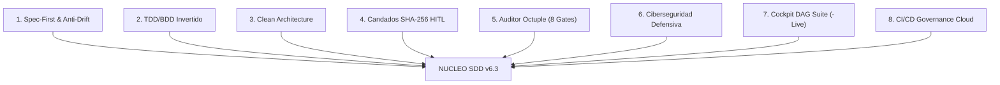
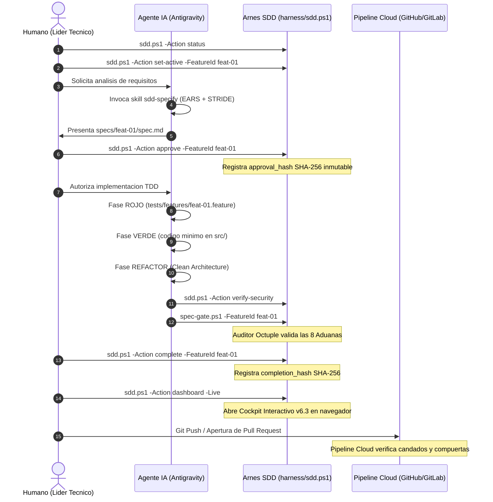

# LIBRO BLANCO Y DOCUMENTO MAESTRO: FRAMEWORK SDD v6.3

## Specification-Driven Development (Enterprise Security, CI/CD Governance & Cockpit DAG Suite Edition)

### Marco de Gobernanza, Arquitectura Limpia, Candados Criptograficos, Ciberseguridad Defensiva, Visor DAG Interactivo con Servidor en Vivo y CI/CD Gates para el Desarrollo con Agentes de Inteligencia Artificial

---

## 1. Resumen Ejecutivo y Vision General

### 1.1. El Dilema del Desarrollo con Inteligencia Artificial

La adopcion de Modelos de Lenguaje Grande (LLMs) y agentes autonomos de programacion en entornos de ingenieria de software empresarial ha incrementado exponencialmente la velocidad de emision de codigo. Sin embargo, esta velocidad conlleva un riesgo sistemico documentado: **la deriva de especificaciones (Specification Drift)**, la generacion de codigo espagueti fuera de perimetros arquitectonicos, la emision de pruebas sinteticas triviales (falsos positivos) y la introduccion de vulnerabilidades de ciberseguridad criticas (OWASP Top 10, CWE Sinks y fuga de credenciales).

El framework **Spec-Driven Development (SDD)**, en su version **v6.3 (Enterprise Security, CI/CD Governance & Cockpit DAG Suite Edition)**, ofrece una infraestructura de control formal e integral que transforma el desarrollo con agentes en un proceso matematicamente verificable, criptograficamente sellado y visualmente auditable.

### 1.2. El Paradigma SDD: "La Especificacion Manda"

En SDD, el codigo de produccion no es un fin en si mismo, sino un artefacto secundario derivado de una especificacion rigurosa, no ambigua y formalmente aprobada. Ninguna linea de codigo fuente puede ser modificada si no responde directamente a un criterio de aceptacion redactado bajo el estandar EARS (Easy Approach to Requirements Syntax) y traducido a un escenario BDD (Given-When-Then) ejecutable.

### 1.3. Novedades Primordiales de SDD v6.3

La version 6.3 introduce innovaciones clave de observabilidad, interaccion visual y gobernanza continua:

1. **Cockpit Ejecutivo & Visor DAG Interactivo**: Motor visual avanzado para renderizar grafos de dependencias con controles de pan suave, zoom con rueda de raton, ajuste a ventana, alternador instantaneo de orientacion (Horizontal `LR` <-> Vertical `TD`), exportacion a SVG/Mermaid y modo pantalla completa.
2. **Resaltado de Ruta Critica (Critical Path Highlighting)**: Navegacion interactiva en el diagrama donde la seleccion de un nodo ilumina su cadena completa de dependencias previas (upstream) y posteriores (downstream), atenuando el resto del grafo.
3. **Ficha Tecnica Desplegable (Drawer Modal)**: Panel lateral que expone en detalle la funcionalidad, criterios EARS, dependencias navegables, perimetro de archivos autorizados (`allowed_files`) y sellos criptograficos SHA-256.
4. **Servidor HTTP Nativo en Arnes (`-Live`)**: Servidor web embebido en PowerShell (`System.Net.HttpListener`) que monitorea en tiempo real cambios en el backlog y checkpoints, activando recarga automatica (hot-reload) sin refrescar manualmente el navegador.
5. **Auditor Criptografico en Tiempo Real**: Herramienta en el navegador (Web Crypto API) que calcula hashes SHA-256 al instante para contrastar especificaciones contra los candados aprobados por el humano (HITL).
6. **Matriz de Trazabilidad BDD Integrada**: Pestaña dedicada para verificar la paridad 1:1 entre requisitos de negocio y pruebas ejecutables.
7. **Consolidacion de CI/CD Governance**: Compuertas automaticas en Pull Requests para GitHub Actions (`.github/workflows/sdd-gate.yml`) y GitLab CI (`.gitlab-ci.yml`) con generacion de reportes estandarizados (`harness/pr-summary.ps1`).

---

## 2. Los 8 Pilares Fundamentales de SDD v6.3



### Detalle de Pilares Criticos

#### Pilar 1: Spec-First & Perimetro Cerrado (Anti-Drift)

Antes de cualquier implementacion, se define la especificacion en `specs/<id>/spec.md` con reglas EARS. El agente tiene prohibido inferir comportamiento no especificado. El archivo `feature_list.json` establece la lista blanca estricta de archivos modificables (`allowed_files`). Cualquier modificacion fuera de ese conjunto es bloqueada inmediatamente por el arnes.

#### Pilar 3: Clean Architecture Poliglota

El codigo se estructura en cuatro capas concentricas con la regla de dependencia hacia el interior:

1. **Domain**: Entidades puras y reglas de negocio sin dependencias externas.
2. **Application**: Casos de uso, puertos de entrada y puertos de salida (interfaces).
3. **Infrastructure**: Adaptadores secundarios (bases de datos, clientes HTTP, persistencia, APIs externas).
4. **Presentation**: Controladores, adaptadores primarios, UI, CLI y endpoints.

#### Pilar 4: Control Criptografico Humano en el Bucle (HITL)

La intervencion humana se sella mediante hashes SHA-256:

- **Sello de Aprobacion (`approval_hash`)**: Calculado sobre el contenido exacto de `spec.md` al ser aprobado por el humano (`.\harness\sdd.ps1 -Action approve`). Si el agente altera la especificacion, el hash se rompe y el arnes detiene la ejecucion.
- **Sello de Complecion (`completion_hash`)**: Emitido al finalizar la funcionalidad tras superar todas las aduanas (`.\harness\sdd.ps1 -Action complete`).

#### Pilar 6: Ciberseguridad Defensiva y Modelado STRIDE / OWASP

Cada especificacion incorpora una seccion de modelado de amenazas STRIDE. El script `harness/verify-security.ps1` analiza codigo estatico (SAST) buscando sinks vulnerables (inyecciones SQL, evaluacion dinamica `eval/exec`, deserializacion insegura) y secretos en texto plano.

#### Pilar 7: Observabilidad Ejecutiva & Cockpit DAG Suite v6.3

El comando `.\harness\sdd.ps1 -Action dashboard [-Live]` genera un panel visual integral en `progress/sdd_dashboard.html` con cuatro pestañas: Grafo DAG interactivo con pan/zoom y drawer de funcionalidades, matriz de trazabilidad BDD, auditor criptografico en navegador y compuertas CI/CD. En modo `-Live`, el arnes sirve la aplicacion localmente y la actualiza automaticamente ante cualquier cambio en el repositorio.

#### Pilar 8: Gobernanza Cloud y Aduanas CI/CD

El repositorio incorpora pipelines para GitHub Actions y GitLab CI que replican la auditoria local en la nube: validan candados SHA-256, ejecutan las 8 aduanas de `spec-gate.ps1`, ejecutan la suite de pruebas unitarias y BDD, y generan un reporte markdown para Pull Requests (`progress/pr_summary.md`).

---

## 3. Topologia Canonica del Proyecto SDD v6.3

```text
mi-proyecto/
|-- .agents/
|   |-- hooks.json                       # Hooks del IDE (SessionStart, PreTool, PostTool)
|   +-- skills/                          # 18 Skills Canonicas
|       |-- sdd-orchestrator/SKILL.md    # Orquestador maestro del bucle SDD
|       |-- sdd-dashboard/SKILL.md       # Cockpit interactivo y servidor live
|       |-- sdd-cicd/SKILL.md            # Pipelines cloud y PR summary
|       |-- sdd-secure-coding/SKILL.md   # SAST y modelado de amenazas STRIDE
|       +-- ... (14 skills adicionales)
|-- .github/workflows/
|   +-- sdd-gate.yml                     # Pipeline CI para GitHub Actions
|-- .gitlab-ci.yml                       # Pipeline CI para GitLab CI
|-- .specify/
|   |-- harness-config.json              # Configuracion de stack y directorios
|   |-- design-system/design-tokens.json # Tokens accesibles WCAG 2.1 AA
|   |-- memory/constitution.md           # 10 Principios constitucionales SDD
|   +-- templates/                       # Plantillas formales (spec, plan, tasks)
|-- docs/                                # Matrices de trazabilidad BDD
|-- harness/
|   |-- sdd.ps1                          # CLI unificada de gobernanza y control
|   |-- dashboard.ps1                    # Generador del Cockpit y servidor HTTP Live
|   |-- spec-gate.ps1                    # Auditor Octuple (8 Hard Gates)
|   |-- verify-security.ps1              # Escaner SAST y detector de sinks
|   |-- pr-summary.ps1                   # Generador de reportes de Pull Request
|   +-- init.ps1                         # Verificador de entorno y pruebas
|-- progress/
|   |-- sdd_dashboard.html               # Panel visual interactivo y visor DAG
|   +-- pr_summary.md                    # Reporte para bots de Pull Request
|-- src/                                 # Codigo fuente bajo Clean Architecture
|-- tests/                               # Pruebas unitarias y escenarios BDD (.feature)
|-- feature_list.json                    # Backlog criptografico con dependencias y hashes
|-- CHECKPOINTS.md                       # Bitacora formal de estados y criterios done
|-- AGENTS.md                            # Instrucciones maestras para agentes IA
+-- anti-gravity.md                      # Reglas operativas y convenciones
```

---

## 4. El Ciclo de Vida Operativo de 8 Fases



---

## 5. El Auditor Octuple: Las 8 Aduanas Infranqueables

El script `harness/spec-gate.ps1` ejecuta 8 aduanas que impiden de forma absoluta la progresion de funcionalidades que presenten vicios de diseno o fallos de seguridad:

| Aduana | Nombre | Descripcion de la Validacion | Accion ante Falla |
| :---: | :--- | :--- | :--- |
| **1** | **Spec Drift & Git Hygiene** | Verifica que ningun archivo fuera de `allowed_files` haya sido tocado en Git. | Detiene el flujo. Bloquea commit. |
| **2** | **Aislamiento Clean Architecture** | Valida que `Domain` y `Application` no importen adaptadores de `Infrastructure` o `Presentation`. | Error de pureza arquitectonica. |
| **3** | **SAST & Ciberseguridad (STRIDE/OWASP)** | Escaneo de sinks peligrosos, evaluacion dinamica insegura y deteccion de secretos en texto plano. | Falla de seguridad critica. |
| **4** | **Integridad de Candados SHA-256** | Recalcula el hash de `spec.md` y comprueba su identidad contra el `approval_hash`. | Falla por manipulacion HITL. |
| **5** | **Paridad BDD 1:1 y Anti-Fake Tests** | Comprueba que cada criterio EARS posea su escenario Given-When-Then y que no contenga asserts triviales (`assert True`). | Falla por prueba fraudulenta. |
| **6** | **Higiene de Formato Markdown** | Audita 0 violaciones en las reglas MD009, MD022, MD031, MD032, MD040, MD047 y MD058. | Falla de documentacion. |
| **7** | **Contratos & Guia de Usuario** | Exige la presencia y actualizacion de `user_guide.md` y esquemas de interfaces. | Falla de completitud. |
| **8** | **Sello de Complecion Humana** | Requiere la emision del `completion_hash` formal por parte del humano para autorizar el estado `done`. | Bloqueo de cierre. |

---

## 6. Arquitectura del Cockpit Ejecutivo & Visor DAG Suite v6.3

El Cockpit Web de SDD v6.3 (`progress/sdd_dashboard.html` generado por `harness/dashboard.ps1`) constituye una estacion de trabajo visual completa diseñada bajo criterios UI/UX Pro Max:

### 6.1. Controles Interactivos del Grafo DAG

- **Motor de Pan y Zoom Dinamico**: Algoritmo de transformacion matricial CSS (`translate(x,y) scale(s)`) que permite arrastrar el diagrama y aplicar zoom continuo con la rueda del raton o con botones dedicados (`+ Zoom`, `- Zoom`, `↺ Reset 100%`).
- **Alternador de Orientacion**: Boton interactivo `↔ Orientacion` que conmuta fluidamente entre disposicion horizontal (`flowchart LR`) y vertical (`flowchart TD`) renderizando de nuevo en el cliente con Mermaid.js.
- **Ruta Critica y Resaltado de Dependencias**: Al hacer clic en cualquier nodo:
  - El nodo seleccionado resalta con brillo cyan (`#06b6d4`).
  - Las dependencias directas e indirectas (upstream) se iluminan en morado/azul (`#8b5cf6`).
  - Las funcionalidades dependientes (downstream) se iluminan en amarillo/ambar (`#f59e0b`).
  - Todos los nodos y conexiones ajenos a la cadena se atenúan con opacidad al 30%.
- **Ficha Tecnica Desplegable (Feature Drawer)**: Panel modal lateral con animacion suave que detalla el ID, nombre, descripcion, lista de dependencias navegables (clic en una dependencia enfoca de inmediato dicho nodo en el grafo), archivos autorizados, comandos de accion rapida y candados criptograficos.
- **Exportacion Instantanea**: Boton "Copiar Mermaid" para copiar la definicion textual limpia al portapapeles y boton "Descargar SVG" para exportar el grafico vectorial escalable.

### 6.2. Servidor HTTP Nativo con Modo `-Live`

Al ejecutar `.\harness\sdd.ps1 -Action dashboard -Live [-Port 8080]`:

1. El arnes arranca una instancia ligera de `System.Net.HttpListener` en `http://localhost:8080/`.
2. Sirve el dashboard con codificacion UTF-8 y lanza el navegador predeterminado.
3. Inyecta un monitor de sondeo (polling/SSE) que consulta `/api/status` cada 1500 milisegundos.
4. El servidor inspecciona las marcas de tiempo (`LastWriteTime`) de `feature_list.json`, `CHECKPOINTS.md` y la carpeta `docs/`.
5. Si detecta modificaciones, regenera el HTML en memoria y responde `{ "reload": true }`, provocando la recarga automatica de la pagina.
6. Permite detener la sesion limpiamente con `Ctrl+C` liberando el puerto y los recursos de red.

### 6.3. Las 4 Pestanas Operativas del Cockpit

1. **Visor DAG & Backlog**: Hero bar de avance global, 6 tarjetas KPI ejecutivas, lienzo interactivo con toolbar completa, filtros rapidos por estado (`done`, `in_progress`, `spec_ready`, `pending`), tabla de backlog con buscador en tiempo real y consola de comandos rapidos.
2. **Matriz de Trazabilidad BDD**: Tabla de correspondencia entre cada funcionalidad, su criterio EARS, el archivo `.feature` asociado y el estado de aceptacion.
3. **Auditor Criptografico SHA-256**: Herramienta interactiva en el cliente basada en Web Crypto API (`window.crypto.subtle.digest`) que permite pegar el texto de cualquier `spec.md` y verificar inmediatamente si coincide con el candado registrado.
4. **Gobernanza CI/CD & 8 Aduanas**: Cuadricula visual con los 8 Hard Gates del Auditor Octuple y estado de integracion continua cloud.

---

## 7. Catálogo de las 18 Skills Canonicas

| # | Skill | Proposito Operativo |
| :---: | :--- | :--- |
| **1** | `sdd-orchestrator` | Orquestador maestro del bucle de desarrollo y control del arnes. |
| **2** | `sdd-onboard` | Entrevista interactiva inicial para configurar el stack y la arquitectura. |
| **3** | `sdd-constitution` | Guardian y ejecutor de los 10 principios constitucionales. |
| **4** | `sdd-specify` | Redaccion formal de requisitos EARS y modelado STRIDE. |
| **5** | `sdd-clarify` | Resolucion de ambiguedades mediante preguntas de seleccion multiple. |
| **6** | `sdd-ui-ux` | Diseno centrado en el usuario, heuristica y micro-interacciones. |
| **7** | `sdd-design-system` | Gestion de tokens de color, tipografia y contraste WCAG 2.1 AA. |
| **8** | `sdd-preview-design` | Generacion de wireframes y prototipos interactivos ejecutables. |
| **9** | `sdd-plan` | Descomposicion arquitectonica y asignacion a capas de Clean Architecture. |
| **10** | `sdd-tasks` | Generacion de tareas atomicas de implementacion con perimetro acotado. |
| **11** | `sdd-implement` | Desarrollo TDD/BDD Rojo-Verde-Refactor en codigo de produccion. |
| **12** | `sdd-user-guide` | Documentacion orientada al usuario y guias operativas. |
| **13** | `sdd-validate` | Verificacion formal y ejecucion del Auditor Octuple (`spec-gate.ps1`). |
| **14** | `sdd-change-spec` | Protocolo riguroso de modificacion de especificaciones preexistentes. |
| **15** | `sdd-reverse-spec` | Ingenieria inversa para extraer especificaciones desde codigo legado. |
| **16** | `sdd-secure-coding` | Escaneo estatico SAST, deteccion de sinks y remediacion OWASP. |
| **17** | `sdd-dashboard` | Panel visual interactivo, visor DAG, servidor HTTP Live y auditor SHA-256. |
| **18** | `sdd-cicd` | Pipelines de integracion continua en GitHub Actions y GitLab CI con PR summary. |

---

## 8. Casos de Estudio Poliglota y Mapeo Arquitectonico

### Caso Empresarial: Java 21 Spring Boot + Angular 21 + PostgreSQL 17

```text
spring-boot-angular-sdd/
|-- backend/
|   +-- src/main/java/com/empresa/proyecto/
|       |-- domain/model/           # Entidades puras y Value Objects
|       |-- domain/repository/      # Puertos de salida (interfaces Java)
|       |-- application/usecase/    # Servicios de aplicacion (casos de uso)
|       |-- application/dto/        # Records inmutables DTO de Java 21
|       |-- infrastructure/db/      # Repositorios Spring Data JPA y entidades ORM
|       +-- presentation/rest/      # Controladores REST con Bean Validation
|-- frontend/
|   +-- src/app/
|       |-- domain/models/          # Interfaces TypeScript inmutables
|       |-- application/facades/    # Signals y servicios de estado reactivo
|       |-- infrastructure/api/     # HttpClient y adaptadores REST
|       +-- presentation/views/     # Componentes Standalone accesibles
```

---

## 9. Diccionario Exhaustivo de Terminos SDD (Glosario)

- **Allowed Files**: Conjunto exhaustivo y acotado de rutas de archivos que el agente tiene autorizacion explicita para crear o editar durante una funcionalidad.
- **Approval Hash**: Resumen criptografico SHA-256 calculado sobre el texto exacto de `spec.md` al ser aprobado por el lider tecnico humano.
- **Completion Hash**: Sello criptografico emitido formalmente por el humano al concluir satisfactoriamente el ciclo de implementacion y superar las 8 aduanas.
- **DAG (Directed Acyclic Graph)**: Grafo aciclico dirigido que modela las relaciones de dependencia estricta entre funcionalidades del backlog.
- **Critical Path Highlighting**: Capacidad del visor DAG de iluminar la secuencia de dependencias ascendentes y descendentes de un nodo, aislandola del resto del grafo.
- **Live Server Mode**: Ejecucion del arnes bajo un servidor HTTP local embebido que actualiza la interfaz visual en tiempo real ante cambios en el sistema de archivos.
- **Hard Gate**: Compuerta de calidad automatizada e infranqueable que aborta el flujo de trabajo si no se satisface al 100% su criterio de aprobacion.
- **Inward Dependency Rule**: Regla inviolable de Clean Architecture que estipula que las dependencias de codigo solo pueden apuntar hacia adentro, hacia las capas de Dominio.
- **PR Summary**: Informe consolidado en formato Markdown emitido por el arnes para documentar la aprobacion de aduanas y sellos criptograficos en Pull Requests.
