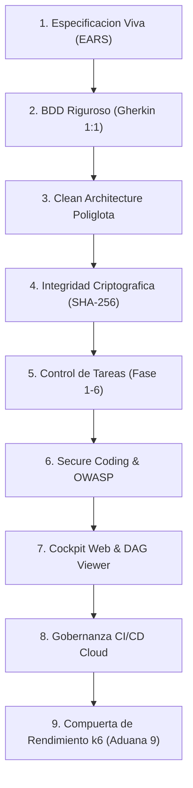
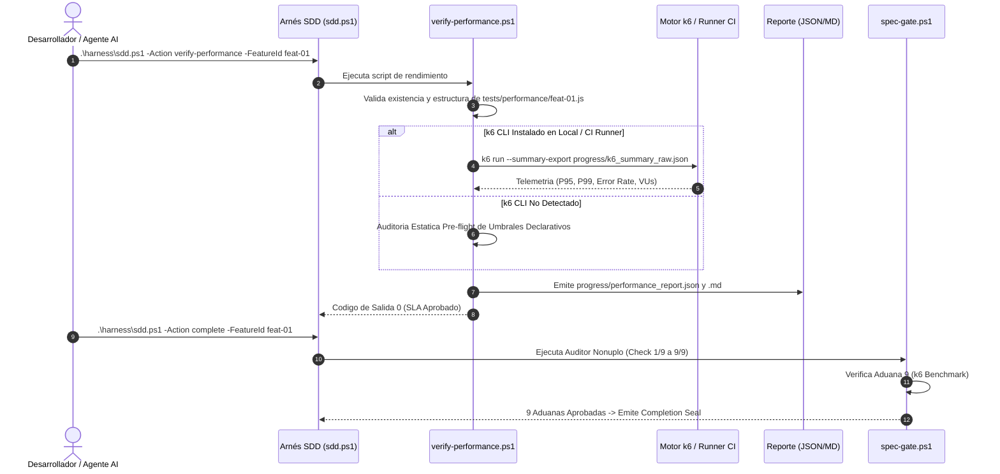
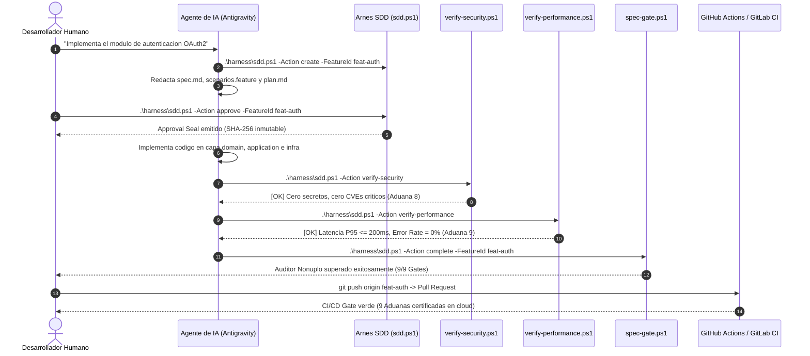

# Documento Maestro: Metodología SDD v6.4 (v6.e) - Performance & SLA Edition

> **Framework de Desarrollo Guiado por Especificaciones (Spec-Driven Development + BDD + Clean Architecture + Secure Coding + Cockpit Web + CI/CD Governance + k6 SLA Gate)**
> **Autor:** Salvador Velasco & Antigravity (Google DeepMind Team)
> **Versión:** 6.4 (v6.e)
> **Fecha:** 2026-10-30
> **Estado:** Aprobado para Producción Corporativa

---

## 1. Resumen Ejecutivo y Visión General v6.4 (v6.e)

La versión **6.4 (v6.e)** de la metodología SDD institucionaliza la **Compuerta de Rendimiento y Resiliencia SLA (k6 Benchmark)** como la **Novena Aduana Obligatoria (Aduana 9 / SLA Gate)** del marco de gobernanza.

En el desarrollo asistido por modelos de inteligencia artificial, es frecuente que los agentes de codificación generen soluciones que satisfacen al 100% las especificaciones funcionales y pruebas unitarias/BDD, pero introducen inadvertidamente cuellos de botella severos: consultas de base de datos $N+1$, serialización JSON ineficiente, saturación de hilos o algoritmos con complejidad $O(N^2)$.

SDD v6.4 resuelve de raíz este riesgo integrando una compuerta matemática inmutable: ninguna funcionalidad puede sellarse ni promoverse a producción si no demuestra que su latencia en el percentil 95 ($P_{95}$) es inferior o igual a 200 ms y su tasa de error bajo concurrencia es estrictamente 0.0%.

### Los 9 Pilares Fundamentales de SDD v6.4



1. **Pilar 1: Especificación Viva (EARS y Allowed Files)**: Reglas declarativas con sintaxis EARS (`[Ubiquitous]`, `[Event-driven]`, `[State-driven]`) y delimitación estricta de archivos permitidos contra el Spec Drift.
2. **Pilar 2: BDD Riguroso (Gherkin 1:1)**: Trazabilidad bidireccional exacta entre criterios de aceptación EARS y escenarios ejecutables en `specs/<feature>/scenarios.feature`.
3. **Pilar 3: Clean Architecture Políglota**: Aislamiento estricto de capas (Dominio, Aplicación, Presentación e Infraestructura) verificado mediante regex de importación para Python, TypeScript, C#, Go y Dart.
4. **Pilar 4: Integridad Criptográfica (SHA-256)**: Sello digital HMAC/SHA-256 generado al aprobar la especificación (`approval_hash`) y al sellar el cierre (`completion_hash`).
5. **Pilar 5: Control de Tareas y Fases**: Ejecución ordenada en 6 fases operativas sin saltos de disciplina.
6. **Pilar 6: Secure Coding & Threat Modeling**: Detección de secretos (TruffleHog), modelado de amenazas STRIDE y auditoría de vulnerabilidades conocidas (pip-audit / npm audit).
7. **Pilar 7: Cockpit Web Dashboard & DAG Suite**: Panel interactivo HTML5 en tiempo real con visor de dependencias TopoSort y métricas ejecutivas.
8. **Pilar 8: Gobernanza de Integración Continua (CI/CD)**: Pipelines listos para producción en GitHub Actions (`.github/workflows/sdd-gate.yml`) y GitLab CI (`.gitlab-ci.yml`).
9. **Pilar 9: Compuerta de Rendimiento y Resiliencia SLA (k6 Benchmark)**: Auditoría automatizada de latencia percentil ($P_{95} \le 200\text{ ms}$, $P_{99} \le 500\text{ ms}$) y tasa de error nula ($0.0\%$) bajo carga sostenida.

---

## 2. El Auditor Nónuplo: Las 9 Hard Gates

El script de aduana `harness/spec-gate.ps1` evoluciona del Auditor Óctuplo al **Auditor Nónuplo (9 Hard Gates)**. Cada compuerta actúa como un candado que detiene la integración ante la menor anomalía:

| Aduana | Nombre de Compuerta | Tipo de Verificación | Condición de Aprobación |
| :--- | :--- | :--- | :--- |
| **Gate 1** | **Allowed Files & Anti-Drift** | Integridad de Repositorio | Solo archivos declarados en `plan.md` fueron modificados o commiteados. |
| **Gate 2** | **Cobertura BDD 1:1** | Trazabilidad Funcional | Cada EARS `AC-x.x` tiene correspondencia exacta con escenarios Gherkin y tests. |
| **Gate 3** | **Clean Architecture Políglota** | Pureza Arquitectónica | Capa Dominio con 0 dependencias externas; Presentación sin acoplamiento a Infra. |
| **Gate 4** | **Firma Criptográfica Approval** | Validez de Especificación | Hash SHA-256 de `spec.md`, `scenarios.feature` y `plan.md` coincide con el sello. |
| **Gate 5** | **Completitud de Tareas** | Progreso Estructurado | Todas las tareas de `tasks.md` están marcadas `[x]` sin pendientes. |
| **Gate 6** | **Guía de Usuario Viva** | Documentación de Entrega | `docs/user_guide_<feature>.md` existe, tiene ejemplos y cumple markdownlint. |
| **Gate 7** | **Candado Inmutable Completion** | Sellado de Cierre | Hash SHA-256 inmutable emitido y registrado en `feature_list.json` y `CHECKPOINTS.md`. |
| **Gate 8** | **Seguridad OWASP & Secret Scan** | Ciberseguridad Defensiva | Cero credenciales hardcodeadas, cero inyecciones SQL y 0 CVEs High/Critical. |
| **Gate 9** | **Performance & SLA Gate (k6)** | Rendimiento y Resiliencia | Latencia $P_{95} \le 200\text{ ms}$, $P_{99} \le 500\text{ ms}$ y tasa de fallos $= 0.0\%$. |

---

## 3. Arquitectura y Ciclo de Vida de la Aduana 9 (k6)

La Aduana 9 evalúa las propiedades de tiempo de respuesta y concurrencia del software bajo un esquema declarativo:



### Especificación Declarativa del Benchmark en k6

Cada funcionalidad cuenta con un archivo de prueba en `tests/performance/<feature>.js` o utiliza el benchmark global `tests/performance/k6_benchmark.js`:

```javascript
// tests/performance/feat-01.js - Benchmark SLA Declarativo SDD v6.4
import http from 'k6/http';
import { check, sleep } from 'k6';

export const options = {
  vus: 10,
  duration: '10s',
  thresholds: {
    // SLA Gate: 95% de solicitudes por debajo de 200ms
    http_req_duration: ['p(95)<200', 'p(99)<500'],
    // SLA Gate: Tasa de error estricta al 0%
    http_req_failed: ['rate==0'],
  },
};

export default function () {
  const res = http.get('http://localhost:8080/health');
  check(res, {
    'status is 200': (r) => r.status === 200,
    'latency below 200ms': (r) => r.timings.duration < 200,
  });
  sleep(1);
}
```

### Formato del Reporte Estructurado (`progress/performance_report.json`)

```json
{
  "version": "6.4",
  "feature_id": "feat-01",
  "target_script": "tests/performance/feat-01.js",
  "status": "PASSED",
  "sla_thresholds": {
    "latency_p95_ms": 200,
    "latency_p99_ms": 500,
    "error_rate_pct": 0.0,
    "vus": 10,
    "duration": "10s"
  },
  "timestamp": "2026-10-30T17:09:30"
}
```

---

## 4. Catálogo Canónico de las 19 Skills de Inteligencia Artificial

Antigravity IDE y sus agentes interactúan con el proyecto mediante 19 habilidades especializadas ubicadas en `.agents/skills/`:

| # | Skill Canónica | Rol Operativo | Entregables y Responsabilidades |
| :--- | :--- | :--- | :--- |
| 1 | `sdd-orchestrator` | Director de Orquesta SDD | Guía el ciclo de vida, transiciones de estado y derivación de agentes. |
| 2 | `sdd-onboard` | Inicializador de Proyecto | Configura el entorno, detecta el stack y presenta el backlog inicial. |
| 3 | `sdd-constitution` | Guardián Constitucional | Aplica los principios rectores inmutables del proyecto. |
| 4 | `sdd-specify` | Analista de Requisitos | Redacta `spec.md` con sintaxis formal EARS y criterios de aceptación. |
| 5 | `sdd-clarify` | Validador de Requisitos | Resuelve ambigüedades mediante entrevistas interactivas. |
| 6 | `sdd-ui-ux` | Diseñador de Interfaces | Modela la experiencia de usuario y arquitectura de información. |
| 7 | `sdd-design-system` | Gestor del Sistema de Diseño | Define tokens de diseño, paletas y tipografías consistentes. |
| 8 | `sdd-preview-design` | Visualizador Visual | Genera wireframes interactivos en HTML para validación humana. |
| 9 | `sdd-plan` | Arquitecto de Software | Diseña `plan.md`, capas Clean Architecture y `Allowed Files`. |
| 10 | `sdd-tasks` | Planificador de Tareas | Desglosa la implementación en subtareas atómicas en `tasks.md`. |
| 11 | `sdd-implement` | Desarrollador Principal | Escribe el código fuente en estricta conformidad con `Allowed Files`. |
| 12 | `sdd-user-guide` | Documentador Técnico | Redacta la guía viva de usuario en `docs/user_guide_<feature>.md`. |
| 13 | `sdd-validate` | Auditor de Calidad | Ejecuta `spec-gate.ps1` y valida las 9 aduanas obligatorias. |
| 14 | `sdd-change-spec` | Ingeniero de Cambios | Controla la evolución de especificaciones mediante RFC estructurado. |
| 15 | `sdd-reverse-spec` | Ingeniero Inverso | Reconstruye especificaciones EARS a partir de bases de código legadas. |
| 16 | `sdd-secure-coding` | Oficial de Seguridad | Ejecuta SAST, escaneo de secretos y modelado de amenazas STRIDE. |
| 17 | `sdd-dashboard` | Gestor del Cockpit Web | Actualiza el panel interactivo y servidor DAG local en tiempo real. |
| 18 | `sdd-cicd` | Ingeniero de Integración | Configura y mantiene pipelines CI/CD en GitHub Actions y GitLab CI. |
| 19 | `sdd-performance` | Ingeniero de SLAs y Carga | Modela benchmarks k6, audita latencias P95/P99 y certifica la Aduana 9. |

---

## 5. Matriz de Comandos del Arnés (`harness/sdd.ps1`)

El arnés centraliza la operación del desarrollador humano y los agentes mediante comandos unificados:

```powershell
# ==============================================================================
# COMANDOS DE RENDIMIENTO Y RESILIENCIA (v6.4)
# ==============================================================================
# Ejecuta la compuerta de rendimiento con parametros por defecto (10 VUs, 10s, P95 <= 200ms)
.\harness\sdd.ps1 -Action verify-performance

# Ejecuta para una funcionalidad especifica con umbral estricto
.\harness\sdd.ps1 -Action verify-performance -FeatureId feat-01 -Vus 20 -Duration "15s" -ThresholdP95 150

# Invocacion directa al verificador del arnes
powershell -ExecutionPolicy Bypass -File .\harnesserify-performance.ps1 -ThresholdP95 200

# ==============================================================================
# COCKPIT WEB DASHBOARD & VISOR DAG (v6.3)
# ==============================================================================
# Genera el dashboard estatico
.\harness\sdd.ps1 -Action dashboard -NoBrowser

# Inicia el Cockpit interactivo con servidor en vivo y recarga automatica
.\harness\sdd.ps1 -Action dashboard -Live -Port 8080

# ==============================================================================
# GOBERNANZA CI/CD Y REPORTES DE PR (v6.2)
# ==============================================================================
# Inicializa o refresca pipelines CI/CD
.\harness\sdd.ps1 -Action init-cicd

# Genera el resumen enriquecido de Pull Request con el checklist de 9 Aduanas
.\harness\sdd.ps1 -Action pr-summary

# ==============================================================================
# CIBERSEGURIDAD DEFENSIVA (v6.1)
# ==============================================================================
# Ejecuta escaneo de secretos y dependencias vulnerables
.\harness\sdd.ps1 -Action verify-security

# ==============================================================================
# CICLO DE VIDA DE FUNCIONALIDADES (SDD CORE)
# ==============================================================================
# Consulta el estado del backlog
.\harness\sdd.ps1 -Action status

# Crea una nueva funcionalidad
.\harness\sdd.ps1 -Action create -FeatureId feat-02 -Title "Catalogo de Productos"

# Sella la aprobacion de especificaciones (Approval Seal)
.\harness\sdd.ps1 -Action approve -FeatureId feat-01

# Ejecuta la auditoria nonupla y sella el cierre definitivo (Completion Seal)
.\harness\sdd.ps1 -Action complete -FeatureId feat-01

# Higiene y correccion automatica de markdown
.\harness\sdd.ps1 -Action fix-markdown
```

---

## 6. Integración en Pipelines CI/CD y Cockpit Dashboard

### GitHub Actions (`.github/workflows/sdd-gate.yml`)

El pipeline de GitHub Actions incorpora el paso de k6 SLA Benchmark Gate:

```yaml
- name: Application Security Audit (SAST & Secret Scanning)
  shell: powershell
  run: |
    .\harness\sdd.ps1 -Action verify-security

- name: Performance & SLA Benchmark Gate (k6)
  shell: powershell
  run: |
    .\harness\sdd.ps1 -Action verify-performance

- name: Run Test Suite & Build Verification
  shell: powershell
  run: |
    .\harness\sdd.ps1 -Action verify -FeatureId ${{ env.ACTIVE_FEATURE }}

- name: SDD Spec-Gate Nonuple Audit
  shell: powershell
  run: |
    powershell -ExecutionPolicy Bypass -File .\harness\spec-gate.ps1 -FeatureId ${{ env.ACTIVE_FEATURE }}
```

### Telemetría de Rendimiento en el Cockpit Dashboard

El archivo `progress/sdd_dashboard.html` visualiza:

1. **Card de Métricas de 9 Aduanas**: Indicador 9/9 con estado en tiempo real.
2. **Tarjeta de la Aduana 9 (Performance & SLA Gate)**: Muestra el estado del benchmark k6, latencia $P_{95}$, tasa de errores y concurrencia evaluada.
3. **Píldora de Comando Rápido**: Permite copiar y ejecutar al instante `.\harness\sdd.ps1 -Action verify-performance`.

---

## 7. Diagrama de Interacción Humano-Agente-Arnés v6.4



---

## 8. Conclusiones y Certificación de Versión

La versión **6.4 (v6.e) - Performance & SLA Edition** eleva el estándar industrial del desarrollo de software asistido por inteligencia artificial. Mediante la sinergia entre especificaciones EARS, BDD, Clean Architecture, ciberseguridad defensiva y compuertas matemáticas de rendimiento con k6, los equipos de ingeniería logran entregar software corporativo robusto, resiliente y de alto desempeño.
