# LIBRO BLANCO Y DOCUMENTO MAESTRO: FRAMEWORK SDD v6.6

## Specification-Driven Development (Enterprise Regulatory Hardened & Compliance Audit Edition)

### Marco de Gobernanza Matemática, Arquitectura Limpia Políglota, Candado Criptográfico HMAC-SHA256, Ciberseguridad Defensiva, Resiliencia SLA k6 y Soporte de Evidencia Técnica Auditable para el Desarrollo con Agentes de Inteligencia Artificial

> **Autor:** Salvador Velasco & Antigravity (Google DeepMind Team)
> **Versión Oficial:** 6.6 (*Regulatory & Compliance Hardened Edition*)
> **Fecha de Publicación:** Noviembre de 2026
> **Clasificación:** Estándar Metodológico Corporativo y de Ingeniería de Software
> **Estado:** Aprobado para Producción Crítica, Alta Regulación y Auditorías Internacionales
> **Repositorio Base:** `D:\.antigravity\sdd-projects`

---

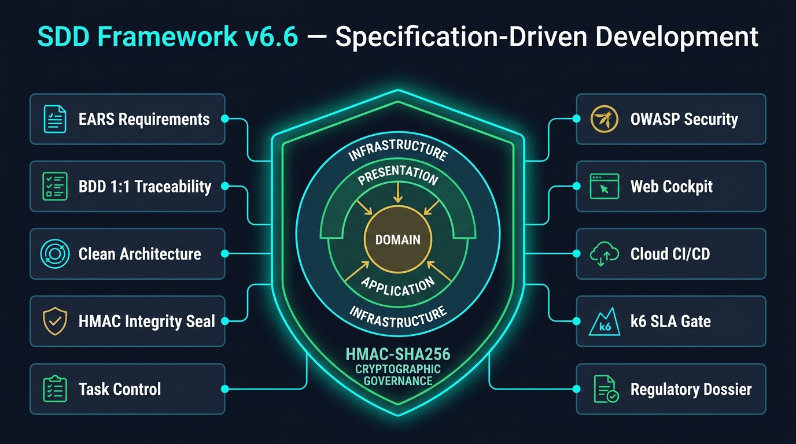

*Figura 1: Blueprint Arquitectónico de los 10 Pilares Sinérgicos, Anillos Concéntricos de Clean Architecture Políglota y Escudo de Gobernanza Criptográfica HMAC-SHA256 en SDD v6.6 ([Ver activo local](file:///D:/.antigravity/sdd-projects/docs/assets/sdd_v66_architecture_overview.jpg)).*

---

## Índice General de Contenidos

1. [Resumen Ejecutivo y Visión Estratégica](#1-resumen-ejecutivo-y-visión-estratégica)
2. [Ingeniería de Endurecimiento en v6.6 (Las 12 Mejoras Priorizadas)](#2-ingeniería-de-endurecimiento-en-v66-las-12-mejoras-priorizadas)
3. [Los 10 Pilares Sinérgicos de SDD v6.6](#3-los-10-pilares-sinérgicos-de-sdd-v66)
4. [Arquitectura del Candado Criptográfico HMAC-SHA256 y Gobernanza HITL](#4-arquitectura-del-candado-criptográfico-hmac-sha256-y-gobernanza-hitl)
5. [Topología Canónica del Repositorio y Modelo Entidad-Relación](#5-topología-canónica-del-repositorio-y-modelo-entidad-relación)
6. [El Ciclo de Vida Operativo y Flujo Humano-Agente-Arnés](#6-el-ciclo-de-vida-operativo-y-flujo-humano-agente-arnés)
7. [El Auditor Nónuplo Reforzado (`spec-gate.ps1`) — Las 9+1 Hard Gates](#7-el-auditor-nónuplo-reforzado-spec-gateps1--las-91-hard-gates)
8. [Ecosistema Agéntico: Las 20 Skills Canónicas y los 3 Hooks Nativos Fail-Closed](#8-ecosistema-agéntico-las-20-skills-canónicas-y-los-3-hooks-nativos-fail-closed)
9. [Compatibilidad Políglota y Casos de Estudio Empresariales](#9-compatibilidad-políglota-y-casos-de-estudio-empresariales)
10. [Observabilidad Ejecutiva (Cockpit Web), Gobernanza CI/CD y Evidencia Regulatoria](#10-observabilidad-ejecutiva-cockpit-web-gobernanza-cicd-y-evidencia-regulatoria)
11. [Verificación Formal del Framework: Suite Automatizada en Pester 6](#11-verificación-formal-del-framework-suite-automatizada-en-pester-6)
12. [Manual de Operaciones y Referencia Exhaustiva de Comandos CLI](#12-manual-de-operaciones-y-referencia-exhaustiva-de-comandos-cli)
13. [Diccionario y Glosario Exhaustivo de Términos SDD v6.6](#13-diccionario-y-glosario-exhaustivo-de-términos-sdd-v66)
14. [Conclusiones y Beneficios Estratégicos](#14-conclusiones-y-beneficios-estratégicos)

---

## 1. Resumen Ejecutivo y Visión Estratégica

### 1.1. La Crisis Silenciosa del Desarrollo Asistido por Inteligencia Artificial

La adopción masiva de modelos de lenguaje grande (LLMs) y agentes autónomos de codificación en entornos empresariales y gubernamentales ha multiplicado la velocidad de escritura de código, pero ha introducido seis vectores críticos de riesgo operativo, deuda técnica y vulnerabilidad regulatoria cuando opera sin contención determinista:

1. **Alucinaciones Funcionales y Desviación de Alcance (*Spec Drift*):** Los agentes tienden a resolver problemas agregando funcionalidades no solicitadas, reescribiendo contratos de API existentes, instalando dependencias no autorizadas o modificando archivos ajenos a su tarea en el repositorio.
2. **Pruebas Falsas (*Fake Tests*) y Cobertura Fraudulenta:** Ante fallos complejos de lógica, los agentes sin supervisión suelen generar suites de pruebas complacientes (`assert True == True`, bloques `pass`, mocks triviales o decoradores `@skip`) para simular un 100% de aprobación sin ejercitar las reglas de negocio reales.
3. **Erosión Arquitectónica y Código Espagueti:** Al optimizar para la respuesta inmediata del turno actual, los modelos rompen el aislamiento de capas, inyectando consultas SQL o llamadas HTTP directamente en controladores de presentación o contaminando el modelo de dominio con frameworks de infraestructura.
4. **Vulnerabilidades OWASP, Fuga de Secretos y Cadena de Suministro:** Generación inadvertida de inyecciones por concatenación de cadenas, exposición de llaves privadas o tokens JWT en texto plano, y adopción de paquetes con vulnerabilidades públicas críticas (CVEs).
5. **Degradación Silenciosa de Rendimiento y Latencia:** Algoritmos cuadráticos $O(N^2)$, problemas de consulta $N+1$ y bloqueos de entrada/salida que superan pruebas unitarias aisladas pero colapsan bajo concurrencia en producción.
6. **Falsificación de Sellos y Fragilidad en Auditorías Regulatorias:** En sectores regulados (Banca/Fintech, Dispositivos Médicos, Farmacéutica, Gobierno y Defensa), permitir que un agente de IA auto-apruebe sus propias especificaciones o recalcule un hash SHA-256 sin llave secreta invalida toda cadena de custodia ante auditorías externas (ISO/IEC 27001, SOC 2 Type II, FDA 21 CFR Part 11, HIPAA, Órganos Internos de Control).

### 1.2. El Paradigma SDD v6.6: "La Especificación Manda, el Código Obedece y la Criptografía Gobierna"

El framework **Specification-Driven Development (SDD v6.6)** erradica de raíz estas vulnerabilidades mediante un axioma de ingeniería innegociable: **el código fuente no es la fuente de verdad; la especificación formal aprobada por un humano y sellada criptográficamente es el único soberano del sistema**.

> [!IMPORTANT]
> **Axioma Rector de SDD v6.6:**
> Ninguna línea de código ejecutable puede existir en `src/` sin contar previamente con:
>
> 1. Una especificación funcional redactada en sintaxis formal **EARS** (`spec.md`) con paridad 1:1 en escenarios ejecutables **BDD Gherkin** (`scenarios.feature`).
> 2. Un plan arquitectónico (`plan.md`) con declaración explícita de archivos permitidos (**Allowed Files**), diseño de 4 capas de **Clean Architecture** y modelado de amenazas **STRIDE**.
> 3. Un **Sello Criptográfico HMAC-SHA256** calculado con clave simétrica secreta (`.specify/.sdd_key` o `$env:SDD_HMAC_KEY`) sobre la tríada documental completa (`spec.md` + `scenarios.feature` + `plan.md`), firmado exclusivamente por un operador humano identificado (**HITL**).
> 4. Superación determinista de las **9+1 Compuertas Duras (El Auditor Nónuplo)** en `spec-gate.ps1`.

### 1.3. Línea de Evolución Histórica del Framework (v1.0 a v6.6)

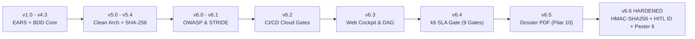

| Versión | Hito Arquitectónico Principal | Capacidades Incorporadas | Compuertas |
| :---: | :--- | :--- | :---: |
| **v1.0 – v4.3** | **Núcleo EARS & BDD** | Sintaxis formal EARS, escenarios Gherkin, plantillas base y control de fases iniciales. | 4 Gates |
| **v5.0 – v5.4** | **Clean Architecture & Hash Simple** | Aislamiento de 4 capas concéntricas, sellos SHA-256 iniciales, grafo DAG y pre-commit hooks. | 7 Gates |
| **v6.0 – v6.1** | **Ciberseguridad Defensiva** | Modelado STRIDE obligatorio, detección de Tríada Letal, TruffleHog y auditoría de CVEs. | 8 Gates |
| **v6.2** | **Gobernanza CI/CD Cloud** | Workflows para GitHub Actions y GitLab CI, más generador de resúmenes de Pull Request. | 8 Gates |
| **v6.3** | **Observabilidad Ejecutiva** | Cockpit Web Dashboard interactivo en HTML5 con servidor HTTP local y visor DAG (*TopoSort*). | 8 Gates |
| **v6.4** | **Compuerta de Rendimiento SLA** | Integración de benchmarks de carga k6 ($P_{95} \le 200\text{ ms}$), naciendo el **Auditor Nónuplo**. | 9 Gates |
| **v6.5** | **Expediente Regulatorio PDF** | Compilador PDF vectorial vía Chromium Headless y catálogo ampliado a 20 skills canónicas. | 9 Gates |
| **v6.6** | **Regulatory & Compliance Hardened** | **HMAC-SHA256 con clave secreta**, inclusión de `plan.md` en el sello, identidad HITL no repudiable, paridad `@AC-1.4`, filtro anti-falso positivo en Gate 1, sinceramiento `SKIPPED_LOCAL` en Gate 9, soporte Java Maven/Gradle, rigor regulatorio y suite de pruebas en **Pester 6**. | **9+1 Gates** |

### 1.4. Impacto Cuantitativo en Reducción de Riesgos Agénticos

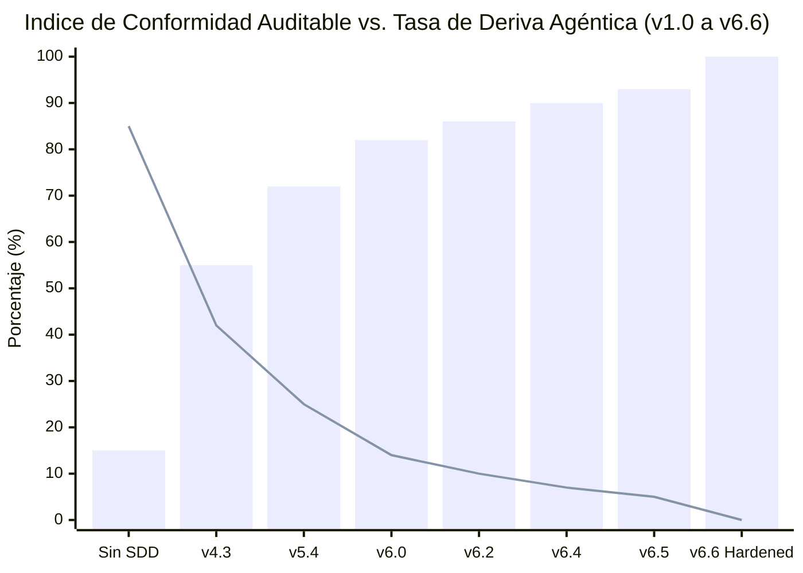

*Nota del gráfico: Las barras representan el **Índice de Madurez y Conformidad Auditable (%)** y la línea descendente representa la **Superficie de Deriva o Evasión Agéntica (%)**, la cual cae a `0%` en v6.6 al cerrar los vectores de auto-aprobación, alteración de `plan.md` y falsificación de hashes sin llave.*

### 1.5. Matriz Comparativa de Evolución: v6.5 vs. v6.6 (Hardened Edition)

| Dimensión de Control | Estado en SDD v6.5 | Estado Endurecido en SDD v6.6 | Impacto en Seguridad y Auditoría |
| :--- | :--- | :--- | :--- |
| **Algoritmo de Sellado** | SHA-256 plano sin clave secreta (a pesar de mencionarse HMAC en textos). | **HMAC-SHA256 real** (`System.Security.Cryptography.HMACSHA256`) con llave de 256 bits en `.specify/.sdd_key` o `$env:SDD_HMAC_KEY`. | Impide que un agente recalcule el hash tras alterar una especificación. |
| **Cobertura del Sello** | Cubría únicamente `spec.md` y `scenarios.feature`. | **Cobertura Tridocumental:** `spec.md` + `scenarios.feature` + `plan.md`. | Bloquea el ataque de agregar archivos no autorizados en `plan.md` post-aprobación. |
| **Identidad de Aprobación (HITL)** | Solo guardaba el hash; permitía invocación automática por parte del agente. | Captura obligatoria de `approved_by` (usuario/email Git u OS), `approved_at` (ISO 8601 UTC) y prohibición explícita de auto-aprobación. | Satisface trazabilidad de firma electrónica (FDA 21 CFR Part 11 Sec. 11.50). |
| **Interceptor `PreToolUse`** | Validaba existencia de `plan.md`, pero no verificaba el sello criptográfico. | **Fail-Closed criptográfico:** recalcula y verifica el HMAC-SHA256 antes de permitir cualquier escritura en `src/`. | Prevención física en tiempo real dentro del IDE ante especificaciones adulteradas. |
| **Paridad Inicial de Plantillas** | `spec.template.md` tenía 4 criterios (`AC-1.1`..`1.4`), pero `scenarios.template.feature` solo incluía 3. | Inclusión nativa del escenario `@AC-1.4` (resiliencia y fallos transitorios) en todas las plantillas y generadores. | Paridad matemática 1:1 desde el minuto cero sin errores artificiales. |
| **Detección de Spec Drift (Gate 1)** | Reportaba `tests/performance/k6_benchmark.js` como archivo no autorizado. | Exclusión explícita del artefacto de scaffolding `tests/performance/k6_benchmark.js` en `spec-gate.ps1`. | Cero falsos positivos al auditar proyectos recién inicializados. |
| **Orden de `tasks.template.md`** | Listaba controladores antes de entidades o servicios en algunas secciones. | Secuencia estricta de Clean Architecture: *Domain $\rightarrow$ Ports $\rightarrow$ Application $\rightarrow$ Infrastructure $\rightarrow$ Presentation*. | Guía al agente respetando la regla de dependencia concéntrica. |
| **Transparencia de Gate 9 (k6)** | Emitía `"status": "CERTIFIED"` incluso si el binario `k6` no estaba instalado. | Emite advertencia `[WARN]` y estado `"SKIPPED_LOCAL"` con `"sla_certified": false` cuando `k6` no está en el `PATH`. | Evidencia honesta y auditable; distingue validación sintáctica de prueba de carga real. |
| **Soporte de Stack Java** | Regex de Java en compuertas, pero ausente en `set-stack` de `sdd.ps1`. | Perfil completo `java` / `java-maven` (`pom.xml`, `mvn test`, `src/main/java`, `src/test/java`). | Soporte empresarial completo para ecosistemas Spring Boot / Jakarta EE. |
| **Terminología Regulatoria** | Afirmaba "certificar" y "acreditar legalmente" normas ISO/FDA/SOC2. | Refinado a **"Evidencia Técnica Auditable"** y **"Soporte de Cumplimiento"**, alineado a ISO/IEC 25010 y SOC 2. | Rigor jurídico e institucional irreprochable frente a auditores acreditados. |
| **Pruebas del Propio Framework** | Verificación manual ad-hoc. | Suite automatizada formal en **Pester 6** (`tests/v66-governance.Tests.ps1`) + **PSScriptAnalyzer** con 0 errores. | Garantía continua de que las compuertas del arnés no sufran regresiones. |

---

## 2. Ingeniería de Endurecimiento en v6.6 (Las 12 Mejoras Priorizadas)

La versión 6.6 nace como respuesta directa a la auditoría forense documentada en el informe [Analisis Sdd V65](file:///C:/Users/salvador.velasco/.gemini/antigravity/brain/9c4f8c4f-407b-4783-a0c9-070e8b2c1242/analisis_sdd_v65.md). Cada hallazgo fue clasificado por criticidad (**P0 Crítico**, **P1 Alto**, **P2 Medio**) y resuelto tanto en el generador PowerShell ([setup-sdd-project-v66.ps1](file:///D:/.antigravity/sdd-projects/setup-sdd-project-v66.ps1)) como en su contraparte multiplataforma Python ([setup-sdd-project-v66.py](file:///D:/.antigravity/sdd-projects/setup-sdd-project-v66.py)).

| ID | Prioridad | Recomendación Aplicada | Vulnerabilidad / Brecha Cerrada | Implementación Técnica en SDD v6.6 |
| :---: | :---: | :--- | :--- | :--- |
| **P0.1** | **P0** | **Candado Criptográfico HMAC-SHA256 Real** | En v6.5 se usaba `SHA256::Create()` sin secreto; un agente podía modificar `spec.md` y actualizar `feature_list.json` por su cuenta. | Función `Compute-SddApprovalHash` con `HMACSHA256` y llave simétrica de 32 bytes almacenada en `.specify/.sdd_key` (o leída de `$env:SDD_HMAC_KEY`). |
| **P0.2** | **P0** | **Inclusión de `plan.md` en el Sello** | `plan.md` (que contiene `## Allowed Files`) quedaba fuera del hash, permitiendo inyectar rutas arbitrarias sin romper el sello. | Concatenación normalizada: `spec.md + "---" + scenarios.feature + "---" + plan.md` antes de aplicar HMAC-SHA256. |
| **P0.3** | **P0** | **Paridad BDD 1:1 en Plantillas (`@AC-1.4`)** | `spec.template.md` definía `AC-1.1` a `AC-1.4`, pero `scenarios.template.feature` omitía `@AC-1.4`, haciendo fallar Gate 4 por defecto. | Incorporación del escenario `@AC-1.4` (*Manejo de fallos transitorios y resiliencia*) en `scenarios.template.feature` y `sdd.ps1`. |
| **P0.4** | **P0** | **Cero Falsos Positivos en Gate 1** | `tests/performance/k6_benchmark.js` creado por el propio instalador era detectado como archivo no autorizado en `tests/`. | Filtro explícito en `spec-gate.ps1` (Aduana 1) que excluye `tests[/\\]performance[/\\]k6_benchmark\.js$` del escaneo de drift. |
| **P0.5** | **P0** | **Alineación Clean Arch en `tasks.template.md`** | El orden de subtareas sugería crear controladores antes de consolidar puertos y casos de uso. | Reestructuración de `tasks.template.md` en 5 bloques secuenciales: *1. Domain $\rightarrow$ 2. Ports $\rightarrow$ 3. Application $\rightarrow$ 4. Infrastructure $\rightarrow$ 5. Presentation*. |
| **P1.1** | **P1** | **Trazabilidad HITL y Prohibición de Auto-Aprobación** | Las skills indicaban al agente ejecutar `sdd.ps1 approve` autónomamente y no quedaba registro de quién aprobó. | Regla HITL estricta en `AGENTS.md` y skills; captura automática de `approved_by`, `approved_at` y `algorithm` en `feature_list.json` y `CHECKPOINTS.md`. |
| **P1.2** | **P1** | **Soporte Completo para Stack Java (Maven/Gradle)** | No existía preset `java` en la función `Invoke-ConfigureStack` de `sdd.ps1`. | Nuevo bloque `java` / `java-maven` que configura `pom.xml`, `mvn test`, `src/main/java`, `src/test/java` y reglas `.gitignore` para JVM. |
| **P1.3** | **P1** | **Sinceramiento de Gate 9 (`SKIPPED_LOCAL`)** | `verify-performance.ps1` reportaba `"status": "CERTIFIED"` con métricas simuladas cuando `k6` no estaba instalado. | Si `k6` no está en el `PATH`, valida sintaxis pero emite `[WARN]`, `"status": "SKIPPED_LOCAL"` y `"sla_certified": false`. |
| **P1.4** | **P1** | **Refinamiento de Lenguaje Regulatorio** | Textos en `export-compliance.ps1` reclamaban "certificación legal directa" de normas internacionales. | Sustitución por **"Evidencia Técnica Auditable"** y **"Soporte para Auditorías de Cumplimiento"** (ISO/IEC 25010, ISO 27001, SOC 2, FDA 21 CFR Part 11). |
| **P2.1** | **P2** | **Higiene de Repositorio y Archivo Legacy** | Coexistencia de 70 scripts obsoletos (v4 a v6.4) y parches sueltos en la raíz del repositorio. | Movimiento estructurado de las versiones históricas al directorio [`archive/`](file:///D:/.antigravity/sdd-projects/archive/) bajo control de versiones Git. |
| **P2.2** | **P2** | **Parámetros de Ejecución Desatendida** | El instalador bloqueaba pipelines automatizados al pedir carpeta por consola o lanzar `agy.exe -i`. | Adición de los parámetros `-DestinationPath <path>` y `-NoAutoLaunch` en `setup-sdd-project-v66.ps1` y `--destination-path` / `--no-auto-launch` en `.py`. |
| **P2.3** | **P2** | **Suite de Pruebas de Gobernanza en Pester 6** | Ausencia de pruebas unitarias/integración automatizadas sobre el propio arnés PowerShell. | Creación de [`tests/v66-governance.Tests.ps1`](file:///D:/.antigravity/sdd-projects/tests/v66-governance.Tests.ps1) con 6 pruebas end-to-end y validación estática PSScriptAnalyzer. |

---

## 3. Los 10 Pilares Sinérgicos de SDD v6.6

El framework se estructura sobre diez pilares interdependientes que operan en conjunto desde la concepción del requisito hasta la emisión del expediente de auditoría:

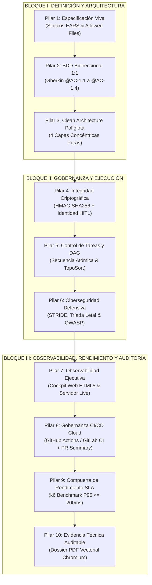

### 3.1. Mapa Estructural de los 10 Pilares

```text
┌──────────────────────────────────────────────────────────────────────────────────────────────────────────────┐
│                                 LOS 10 PILARES FUNDAMENTALES DE SDD v6.6                                     │
├───────────────────────────┬───────────────────────────┬───────────────────────────┬──────────────────────────┤
│ PILAR 1: EARS & Anti-Drift│ PILAR 2: BDD 1:1 Riguroso │ PILAR 3: Clean Arch       │ PILAR 4: HMAC-SHA256     │
│ • Sintaxis formal EARS    │ • AC-1.1..1.4 <-> @AC-1.x │ • Domain 100% puro        │ • Llave .specify/.sdd_key│
│ • Lista Allowed Files     │ • Cero Fake Tests         │ • 4 Anillos concéntricos  │ • Sella spec+feature+plan│
│ • Hook PreToolUse físico  │ • Trazabilidad biunívoca  │ • 7 Stacks políglotas     │ • Identidad HITL firmada │
├───────────────────────────┼───────────────────────────┼───────────────────────────┼──────────────────────────┤
│ PILAR 5: Tareas & DAG     │ PILAR 6: Secure Coding    │ PILAR 7: Cockpit Web      │ PILAR 8: CI/CD Cloud     │
│ • tasks.md secuencial     │ • Modelo STRIDE en plan   │ • Dashboard HTML5 + SVG   │ • GitHub Actions/GitLab  │
│ • Grafo DAG (depends_on)  │ • Alerta Tríada Letal     │ • Algoritmo TopoSort      │ • Resumen PR automático  │
│ • Orden Clean Arch        │ • SAST + Secretos + CVEs  │ • Servidor HTTP -Live     │ • Bloqueo de Merge       │
├───────────────────────────┴───────────────────────────┼───────────────────────────┴──────────────────────────┤
│ PILAR 9: Rendimiento y Resiliencia SLA (k6 Gate 9)    │ PILAR 10: Expediente de Evidencia Técnica (PDF/HTML) │
│ • Latencia P(95) <= 200ms, P(99) <= 500ms, Err == 0%  │ • Renderizado PDF vectorial vía Chromium Headless    │
│ • Modo Dual Honesto: Ejecución Real vs SKIPPED_LOCAL  │ • Mapeo técnico ISO 27001, FDA Part 11, SOC2, HIPAA  │
└───────────────────────────────────────────────────────┴──────────────────────────────────────────────────────┘
```

### 3.2. Desglose Técnico de Cada Pilar

#### 3.2.1. Pilar 1: Especificación Viva (Gramática EARS y Perímetro Allowed Files)

Todo requerimiento funcional debe formalizarse en `specs/<feature_id>/spec.md` empleando una de las cinco cláusulas canónicas de **EARS (*Easy Approach to Requirements Syntax*)**, eliminando la prosa ambigua en lenguaje natural:

| Tipo de Requisito EARS | Estructura Sintáctica Obligatoria | Ejemplo Canónico en `spec.md` |
| :--- | :--- | :--- |
| **Ubiquitous (Ubicuo)** | **THE** `<sistema>` **SHALL** `<respuesta>` | **THE** Servicio de Pagos **SHALL** cifrar todo número de tarjeta en tránsito usando TLS 1.3. |
| **Event-Driven (Por Evento)** | **WHEN** `<evento>`, **THE** `<sistema>` **SHALL** `<respuesta>` | **WHEN** el usuario envía credenciales válidas, **THE** Autenticador **SHALL** emitir un JWT firmado con expiración de 15 minutos. |
| **State-Driven (Por Estado)** | **WHILE** `<estado>`, **THE** `<sistema>` **SHALL** `<respuesta>` | **WHILE** la cuenta se encuentre en estado `LOCKED`, **THE** API Gateway **SHALL** rechazar intentos de login con HTTP 423. |
| **Optional (Opcional)** | **WHERE** `<característica>`, **THE** `<sistema>` **SHALL** `<respuesta>` | **WHERE** el cliente tenga habilitado MFA biométrico, **THE** Flujo de Login **SHALL** solicitar el reto WebAuthn. |
| **Unwanted (No Deseado / Error)** | **IF** `<condición de fallo>`, **THEN THE** `<sistema>` **SHALL** `<mitigación>` | **IF** el proveedor bancario responde con timeout $> 3\text{ s}$, **THEN THE** Orquestador **SHALL** activar el circuit-breaker y encolar el reintento. |

Conjuntamente, el archivo `specs/<feature_id>/plan.md` declara bajo el encabezado `## Allowed Files` la lista blanca exhaustiva de archivos que pueden ser creados o modificados. Cualquier archivo tocado fuera de dicha lista dispara el bloqueo inmediato en el IDE (`PreToolUse`) y en la Aduana 1 (`spec-gate.ps1`).

#### 3.2.2. Pilar 2: BDD Riguroso y Paridad Bidireccional 1:1

Cada criterio de aceptación identificado en `spec.md` (`AC-1.1`, `AC-1.2`, `AC-1.3`, `AC-1.4`, etc.) exige una relación biunívoca (biyección matemática) con un escenario Gherkin etiquetado con `@AC-1.x` en `specs/<feature_id>/scenarios.feature` y su correspondiente prueba automatizada en `tests/`. En SDD v6.6, las plantillas incluyen de fábrica los 4 arquetipos fundamentales:

- `@AC-1.1`: Flujo feliz nominal (*Happy Path*).
- `@AC-1.2`: Rechazo controlado ante entradas inválidas o malformadas (*Input Validation*).
- `@AC-1.3`: Restricción de seguridad o autorización (*Security Boundary*).
- `@AC-1.4`: Resiliencia y recuperación ante fallos transitorios (*Fault Tolerance & Resilience*).

#### 3.2.3. Pilar 3: Clean Architecture Políglota y Accesibilidad Matemática UI/UX

El código fuente en `src/` se organiza en cuatro capas concéntricas gobernadas por la **Regla de Dependencia** (las dependencias de código fuente solo pueden apuntar hacia el interior):

1. **Domain (`src/domain/`):** Entidades corporativas, Value Objects, eventos de dominio y excepciones puras. **Cero dependencias externas** (prohibido importar ORM, HTTP, UI o SDKs cloud).
2. **Application (`src/application/`):** Casos de uso, comandos/consultas (CQRS) y definición de interfaces/puertos (`IRepository`, `IPaymentGateway`). Solo depende de `domain`.
3. **Presentation (`src/presentation/`):** Controladores REST/GraphQL, vistas UI o comandos CLI. Depende de `application`, nunca directamente de `infrastructure`.
4. **Infrastructure (`src/infrastructure/`):** Implementaciones concretas de los puertos (PostgreSQL, Redis, APIs externas, sistemas de archivos).

En componentes visuales o de interfaz, el pilar aplica **UI/UX Pro Max**: consumo obligatorio de `design-tokens.json`, prohibición de colores hexadecimales hardcodeados (*magic hex codes*), modelado de los **5 estados de interfaz** (*Default, Hover/Focus, Loading, Empty, Error*) y cumplimiento matemático de contraste **WCAG 2.1 Nivel AA** verificando la luminancia relativa $L$:

$$\text{Contrast Ratio} = \frac{L_{\max} + 0.05}{L_{\min} + 0.05} \ge 4.5 : 1$$

donde la luminancia relativa $L$ para un color sRGB $(R, G, B)$ normalizado se define como:

$$L = 0.2126 \cdot R_{\text{lin}} + 0.7152 \cdot G_{\text{lin}} + 0.0722 \cdot B_{\text{lin}}$$

#### 3.2.4. Pilar 4: Integridad Criptográfica Hardened (HMAC-SHA256 + HITL)

Sustituye los resúmenes simples por un código de autenticación de mensajes basado en hash con clave secreta (**HMAC-SHA256**) que protege conjuntamente `spec.md`, `scenarios.feature` y `plan.md`, vinculando la firma a la identidad verificada del aprobador humano (detallado en la [Sección 4](#4-arquitectura-del-candado-criptográfico-hmac-sha256-y-gobernanza-hitl)).

#### 3.2.5. Pilar 5: Control de Tareas Atómicas y Grafo Acíclico Dirigido (DAG)

El backlog del proyecto en `feature_list.json` modela las funcionalidades como nodos de un **Grafo Acíclico Dirigido (DAG)** mediante el atributo `depends_on`. Ninguna funcionalidad puede iniciar su implementación si alguno de sus prerrequisitos no posee un `completion_hash` válido. Dentro de cada funcionalidad, `tasks.md` impone el orden constructivo de adentro hacia afuera (*Domain $\rightarrow$ Ports $\rightarrow$ Application $\rightarrow$ Infrastructure $\rightarrow$ Presentation*).

#### 3.2.6. Pilar 6: Ciberseguridad Defensiva, STRIDE y Tríada Letal

Todo `plan.md` exige completar la matriz de modelado de amenazas **STRIDE** (*Spoofing, Tampering, Repudiation, Information Disclosure, Denial of Service, Elevation of Privilege*) y demarcar las **Fronteras de Confianza (`‖`)**. El escáner `harness/verify-security.ps1` audita:

- Detección de la **Tríada Letal** (componentes que combinan acceso a datos sensibles + entrada externa no confiable + salida a red pública).
- Escaneo de secretos y llaves privadas (patrones de alta entropía, AWS, GCP, JWT, RSA, conexíon a BD).
- Análisis estático SAST contra inyecciones SQL/NoSQL, ejecución remota (`eval`, `exec`, `Invoke-Expression`), XSS y Path Traversal.
- Auditoría de vulnerabilidades en dependencias (`pip-audit`, `npm audit`, `dotnet list package --vulnerable`, `cargo audit`, `mvn dependency-check`).

#### 3.2.7. Pilar 7: Observabilidad Ejecutiva y Cockpit Web en Vivo

El generador `harness/dashboard.ps1` compila un panel ejecutivo interactivo en `progress/sdd_dashboard.html` y puede levantar un servidor HTTP reactivo en segundo plano (`-Live -Port 8080`) que visualiza en tiempo real el grafo DAG ordenado topológicamente (*TopoSort*), el estado de los candados HMAC y las métricas de las 9 compuertas.

#### 3.2.8. Pilar 8: Gobernanza CI/CD Cloud y Protección de Ramas

Sincroniza la gobernanza local con la nube a través de `.github/workflows/sdd-gate.yml` y `.gitlab-ci.yml`. Cada Pull Request ejecuta automáticamente las 9 compuertas, compila el dossier de evidencia y publica un resumen ejecutivo en Markdown (`harness/pr-summary.ps1` $\rightarrow$ `$GITHUB_STEP_SUMMARY`).

#### 3.2.9. Pilar 9: Compuerta de Rendimiento y Resiliencia SLA (k6 Benchmark)

Valida mediante scripts declarativos k6 (`tests/performance/k6_benchmark.js`) que el servicio cumpla umbrales contractuales bajo concurrencia: $P_{95} \le 200\text{ ms}$, $P_{99} \le 500\text{ ms}$ y $\text{Error Rate} = 0.0\%$, operando con transparencia dual (`CERTIFIED` cuando `k6` ejecuta la carga vs. `SKIPPED_LOCAL` con advertencia explícita cuando `k6` no reside en la máquina de desarrollo).

#### 3.2.10. Pilar 10: Expediente de Evidencia Técnica Auditable (PDF/HTML)

El motor `harness/export-compliance.ps1` recopila especificaciones, sellos HMAC-SHA256, identidad de aprobadores HITL, resultados SAST, métricas de rendimiento y bitácora de checkpoints en un expediente autocontenido en HTML5 (`@media print`) y lo compila a **PDF vectorial nativo** utilizando Chromium Headless (Microsoft Edge / Google Chrome).

---

## 4. Arquitectura del Candado Criptográfico HMAC-SHA256 y Gobernanza HITL

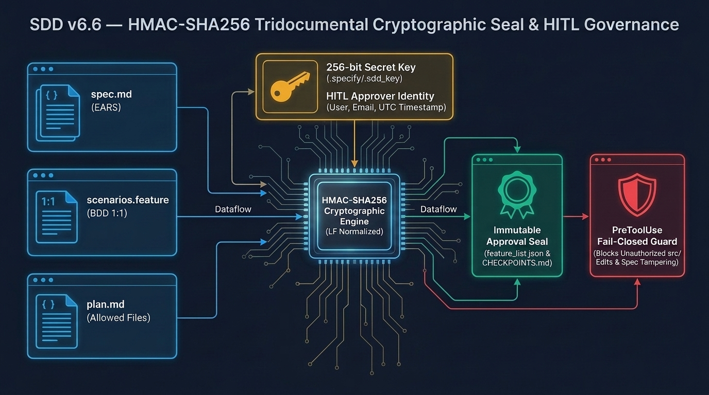

*Figura 2: Arquitectura del Sello Criptográfico Tridocumental HMAC-SHA256, Gestión de Clave de 256 bits, Atribución de Identidad HITL y Guardia Físico Fail-Closed `PreToolUse` en SDD v6.6 ([Ver activo local](file:///D:/.antigravity/sdd-projects/docs/assets/sdd_v66_hmac_cryptographic_seal.jpg)).*

### 4.1. Formulación Matemática del Sello Tridocumental

En versiones previas a la v6.6, el cálculo de integridad empleaba una función hash pública $\text{SHA-256}(M)$ y omitía el archivo `plan.md`. Dado que $\text{SHA-256}$ no requiere llave secreta, un agente con permisos de escritura sobre el repositorio podía modificar `spec.md` o ampliar `Allowed Files` en `plan.md` y recalcular el resumen por sí mismo.

En **SDD v6.6**, el sello de aprobación se define formalmente mediante un Código de Autenticación de Mensajes basado en Hash (**HMAC-SHA256**, conforme a RFC 2104 y FIPS 198-1):

$$\text{Seal}_{\text{HMAC}}(K, M) = \text{SHA-256}\Big((K' \oplus \text{opad}) \;\parallel\; \text{SHA-256}\big((K' \oplus \text{ipad}) \;\parallel\; M\big)\Big)$$

donde:

- $K$ es la clave secreta criptográfica de 256 bits (32 bytes), derivada de `$env:SDD_HMAC_KEY` o del archivo protegido `.specify/.sdd_key`.
- $\text{ipad} = \text{0x36}$ repetido 64 veces y $\text{opad} = \text{0x5c}$ repetido 64 veces.
- $M$ es el mensaje canónico tridocumental construido mediante la función de normalización determinista $\mathcal{N}$ (que convierte todos los saltos de línea `\r\n` y `\r` a `\n` y elimina espacios residuales en los extremos):

$$M = \mathcal{N}(\text{spec.md}) \;\parallel\; \text{"\textbackslash n---\textbackslash n"} \;\parallel\; \mathcal{N}(\text{scenarios.feature}) \;\parallel\; \text{"\textbackslash n---\textbackslash n"} \;\parallel\; \mathcal{N}(\text{plan.md})$$

#### Propiedades de Seguridad Garantizadas:

1. **Resistencia a Falsificación Agéntica:** Sin acceso a la clave $K$ (o con el archivo `.sdd_key` protegido por el interceptor `PreToolUse`), ningún agente puede generar un $\text{Seal}_{\text{HMAC}}$ válido para un documento modificado.
2. **Inmutabilidad de Alcance (`plan.md`):** Cualquier adición de un archivo a la sección `## Allowed Files` de `plan.md` altera el tercer término de $M$, produciendo por efecto avalancha un código HMAC completamente distinto y disparando `[BLOQUEO CRÍTICO: SPEC TAMPERING DETECTADO]` en Gate 0 y Gate 4.
3. **Invarianza Multiplataforma (Windows / Linux / macOS):** La función de normalización $\mathcal{N}(x)$ asegura que el sello calculado en una estación Windows (`CRLF`) sea idéntico bit a bit al verificado en un runner Linux de GitHub Actions o GitLab CI (`LF`).

### 4.2. Jerarquía y Gestión de Llaves Criptográficas

| Prioridad | Origen de la Clave | Uso Recomendado | Mecanismo de Provisión |
| :---: | :--- | :--- | :--- |
| **1 (Máxima)** | Variable de Entorno `$env:SDD_HMAC_KEY` | Pipelines CI/CD (GitHub Secrets, GitLab Masked Vars, HashiCorp Vault, Azure Key Vault, AWS KMS). | Inyectada en memoria al proceso de validación sin tocar el disco. |
| **2 (Local)** | Archivo `.specify/.sdd_key` | Desarrollo local e interactivo con Antigravity IDE. | Generada automáticamente con CSPRNG (`System.Security.Cryptography.RandomNumberGenerator`) de 32 bytes (64 caracteres hex) en la primera aprobación y excluida en `.gitignore`. |

### 4.3. Máquina de Estados del Candado Criptográfico y Detección de Tampering

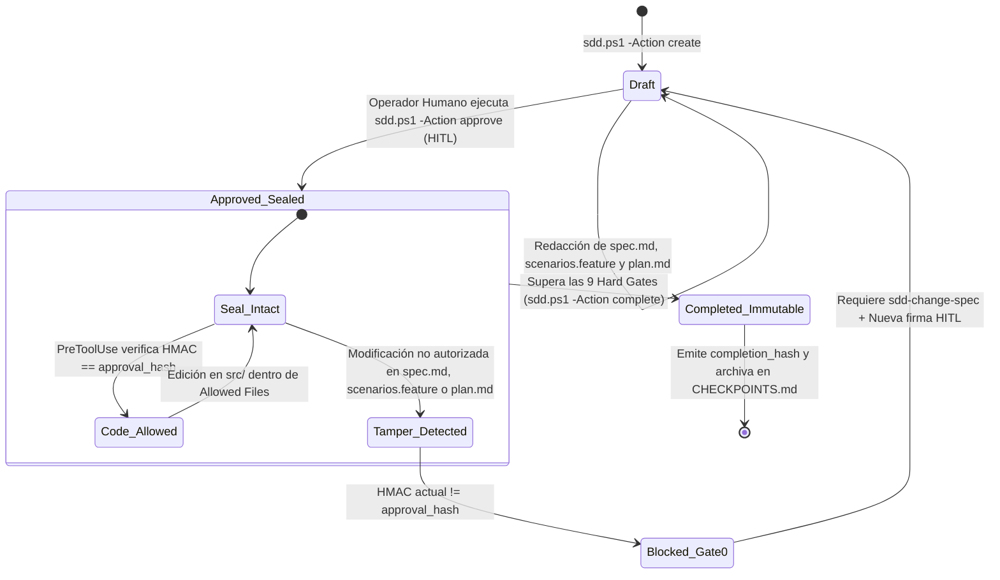

### 4.4. Implementación de Referencia en el Arnés (`harness/sdd.ps1`)

```powershell
function Get-SddHmacKey {
    if (-not [string]::IsNullOrWhiteSpace($env:SDD_HMAC_KEY)) {
        return $env:SDD_HMAC_KEY.Trim()
    }
    $keyFile = ".specify\.sdd_key"
    if (Test-Path $keyFile) {
        return (Get-Content $keyFile -Raw -Encoding UTF8).Trim()
    }
    if (-not (Test-Path ".specify")) {
        New-Item -ItemType Directory -Force -Path ".specify" | Out-Null
    }
    $bytes = New-Object byte[] 32
    [System.Security.Cryptography.RandomNumberGenerator]::Create().GetBytes($bytes)
    $newKey = [BitConverter]::ToString($bytes).Replace("-", "")
    Set-Content -Path $keyFile -Value $newKey -Encoding UTF8 -NoNewline
    return $newKey
}

function Compute-SddApprovalHash {
    param([string]$FeatureDir)
    $specFile = Join-Path $FeatureDir "spec.md"
    $scenFile = Join-Path $FeatureDir "scenarios.feature"
    $planFile = Join-Path $FeatureDir "plan.md"

    $c1 = if (Test-Path $specFile) { ((Get-Content $specFile -Raw -Encoding UTF8) -replace "`r`n", "`n" -replace "`r", "`n").Trim() } else { "" }
    $c2 = if (Test-Path $scenFile) { ((Get-Content $scenFile -Raw -Encoding UTF8) -replace "`r`n", "`n" -replace "`r", "`n").Trim() } else { "" }
    $c3 = if (Test-Path $planFile) { ((Get-Content $planFile -Raw -Encoding UTF8) -replace "`r`n", "`n" -replace "`r", "`n").Trim() } else { "" }

    $payload = "$c1`n---`n$c2`n---`n$c3"
    $keyStr  = Get-SddHmacKey
    $hmac    = New-Object System.Security.Cryptography.HMACSHA256
    $hmac.Key = [System.Text.Encoding]::UTF8.GetBytes($keyStr)
    $hashBytes = $hmac.ComputeHash([System.Text.Encoding]::UTF8.GetBytes($payload))
    return [BitConverter]::ToString($hashBytes).Replace("-", "")
}

function Get-SddApproverIdentity {
    param([string]$ExplicitApprover)
    if (-not [string]::IsNullOrWhiteSpace($ExplicitApprover)) { return $ExplicitApprover }
    try {
        $gName  = (git config user.name 2>$null)
        $gEmail = (git config user.email 2>$null)
        if ($gName -and $gEmail) { return "$gName <$gEmail>" }
        if ($gName) { return "$gName" }
    } catch {}
    if ($env:USERNAME) { return $env:USERNAME }
    if ($env:USER)     { return $env:USER }
    return "HITL-Operator"
}
```

### 4.5. Esquema de Registro Auditable en `feature_list.json`

Al ejecutarse la aprobación humana, el nodo de la funcionalidad en `feature_list.json` queda enriquecido con metadatos criptográficos y de identidad no repudiables:

```json
{
  "id": "FEAT-100",
  "name": "Autenticación Multifactor Biométrica",
  "status": "in_progress",
  "depends_on": [],
  "approval_hash": "1C9A2E35653FAFBF8D4019C2A74E8810B23C9D00F12E34A56B78C90D12E34F56",
  "approved_by": "Salvador Velasco <salvador.velasco@gmail.com>",
  "approved_at": "2026-11-02T16:30:50Z",
  "algorithm": "HMAC-SHA256",
  "approval_reason": "Especificación EARS, paridad BDD 1:1 y Allowed Files revisados y autorizados."
}
```

---

## 5. Topología Canónica del Repositorio y Modelo Entidad-Relación

### 5.1. Árbol Completo de Directorios y Archivos en SDD v6.6

```text
<RAÍZ_DEL_PROYECTO>/
├── .agents/                                  # Inteligencia Artificial y Gobernanza Nativa de IDE
│   ├── hooks.json                            # Definición de Hooks (SessionStart, PreToolUse, PostToolUse)
│   └── skills/                               # Catálogo Canónico de 20 Skills Operativas (SKILL.md + .md)
│       ├── sdd-orchestrator/                 # #01: Orquestador central del ciclo SDD y fases
│       ├── sdd-onboard/                      # #02: Entrevista socrática de onboarding (5 preguntas)
│       ├── sdd-constitution/                 # #03: Guardián de las 10 leyes constitucionales
│       ├── sdd-specify/                      # #04: Redactor de requisitos formales EARS
│       ├── sdd-clarify/                      # #05: Detector adversarial de ambigüedades
│       ├── sdd-ui-ux/                        # #06: Accesibilidad matemática WCAG 2.1 AA y 5 estados
│       ├── sdd-design-system/                # #07: Gestor de tokens semánticos de diseño
│       ├── sdd-preview-design/               # #08: Generador de prototipos HTML interactivos
│       ├── sdd-plan/                         # #09: Arquitecto Clean Arch, Allowed Files y STRIDE
│       ├── sdd-tasks/                        # #10: Desglosador de tareas atómicas ordenadas
│       ├── sdd-implement/                    # #11: Desarrollador Double-Loop TDD bajo PreToolUse
│       ├── sdd-user-guide/                   # #12: Redactor de manuales vivos de usuario (4 secciones)
│       ├── sdd-validate/                     # #13: Auditor de las 9+1 compuertas duras
│       ├── sdd-change-spec/                  # #14: Gestor formal de RFCs y re-sellado HMAC
│       ├── sdd-reverse-spec/                 # #15: Ingeniería inversa para sistemas legados (Brownfield)
│       ├── sdd-secure-coding/                # #16: Oficial de ciberseguridad OWASP, STRIDE y SAST
│       │   └── references/                   # Guías detalladas OWASP Top 10 y Trust Boundaries
│       ├── sdd-dashboard/                    # #17: Gestor del Cockpit Web HTML5 y servidor DAG
│       ├── sdd-cicd/                         # #18: Ingeniero de pipelines GitHub Actions / GitLab CI
│       ├── sdd-performance/                  # #19: Especialista en benchmarks k6 y SLAs P95/P99
│       └── sdd-compliance/                   # #20: Compilador de expediente de evidencia PDF/HTML
├── .github/
│   └── workflows/
│       └── sdd-gate.yml                      # Pipeline GitHub Actions (9 Aduanas + Dossier PDF)
├── .gitlab-ci.yml                            # Pipeline GitLab CI/CD con etapas de gobernanza
├── .specify/                                 # Núcleo de Configuración, Memoria y Plantillas
│   ├── .sdd_key                              # Clave simétrica secreta de 256 bits para HMAC-SHA256
│   ├── harness-config.json                   # Configuración políglota del stack, rutas y comandos
│   ├── design-system/
│   │   └── design-tokens.json                # Paleta cromática validada WCAG AA, tipografía y espaciado
│   ├── memory/
│   │   ├── constitution.md                   # Constitución inmutable del proyecto (10 Artículos)
│   │   └── onboard-state.json                # Estado persistente de la entrevista de descubrimiento
│   └── templates/
│       ├── spec.template.md                  # Plantilla EARS (con criterios AC-1.1 a AC-1.4)
│       ├── scenarios.template.feature        # Plantilla Gherkin 1:1 (con etiquetas @AC-1.1 a @AC-1.4)
│       ├── plan.template.md                  # Plantilla de arquitectura, STRIDE y Allowed Files
│       ├── tasks.template.md                 # Plantilla secuencial Clean Architecture (Domain -> API)
│       ├── user_guide.template.md            # Plantilla de manual de usuario en 4 secciones
│       └── impl_report.template.md           # Plantilla de bitácora técnica de implementación
├── docs/                                     # Documentación Viva y Activos Arquitectónicos
│   ├── assets/                               # Diagramas e infografías de alta resolución
│   ├── user_guide_<feature>.md               # Guía operativa de usuario por funcionalidad
│   └── traceability_<feature>.md             # Matriz bidireccional EARS <-> BDD <-> Tests <-> Código
├── harness/                                  # Arnés Determinista de Gobernanza y Auditoría
│   ├── hooks/
│   │   ├── session-start.ps1                 # Hook de inicio: inyecta contexto y estado del backlog
│   │   ├── pre-tool-enforce.ps1              # Hook Fail-Closed: verifica HMAC y Allowed Files
│   │   └── post-tool-check.ps1               # Hook post-edición: audita importaciones entre capas
│   ├── dashboard.ps1                         # Generador de Cockpit Web HTML5 y servidor HTTP Live
│   ├── export-compliance.ps1                 # Compilador de Expediente de Evidencia PDF (Chromium)
│   ├── init.ps1                              # Diagnóstico de entorno, sello HMAC y runner de tests
│   ├── pr-summary.ps1                        # Generador de informe de gobernanza para Pull Requests
│   ├── preview-design.ps1                    # Renderizador visual de design-tokens.json
│   ├── sdd.ps1                               # CLI unificado del framework (HITL, HMAC, stacks)
│   ├── spec-gate.ps1                         # El Auditor Nónuplo (Gate 0 + 9 Hard Gates)
│   ├── verify-performance.ps1                # Verificador de SLAs k6 (Modo Dual: Real / SKIPPED_LOCAL)
│   └── verify-security.ps1                   # Escáner de secretos, SAST OWASP y CVEs (Aduana 8)
├── progress/                                 # Telemetría, Reportes y Entregables de Auditoría
│   ├── compliance_dossier.html               # Expediente técnico auditable en HTML5 (@media print)
│   ├── compliance_dossier.pdf                # Expediente técnico auditable en PDF vectorial
│   ├── performance_report.json               # Telemetría estructurada k6 (P95, P99, estado real)
│   ├── performance_report.md                 # Resumen legible de métricas SLA
│   ├── pr_summary.md                         # Checklist consolidado para Pull Requests
│   └── sdd_dashboard.html                    # Cockpit Web interactivo con grafo DAG
├── specs/                                    # Especificaciones Formales por Funcionalidad
│   └── <FEATURE_ID>/
│       ├── spec.md                           # Requisitos formales EARS
│       ├── scenarios.feature                 # Escenarios ejecutables Gherkin 1:1
│       ├── plan.md                           # Diseño Clean Arch, STRIDE y lista Allowed Files
│       └── tasks.md                          # Subtareas atómicas con estado [ ] / [x]
├── src/                                      # Código Fuente de Producción (Clean Architecture)
│   ├── domain/                               # Anillo 1: Entidades y lógica de negocio 100% pura
│   ├── application/                          # Anillo 2: Casos de uso y puertos (interfaces)
│   ├── presentation/                         # Anillo 3: Controladores, vistas UI y endpoints
│   └── infrastructure/                       # Anillo 4: Adaptadores de persistencia, red y cloud
├── tests/                                    # Suites de Verificación Automatizada
│   ├── unit/                                 # Pruebas unitarias rápidas de dominio y aplicación
│   ├── acceptance/                           # Step definitions y pruebas BDD de extremo a extremo
│   ├── performance/
│   │   └── k6_benchmark.js                   # Script declarativo de carga y umbrales SLA k6
│   └── v66-governance.Tests.ps1              # Suite Pester 6 de validación de controles SDD v6.6
├── AGENTS.md                                 # Instrucciones maestras y reglas HITL para agentes IA
├── anti-gravity.md                           # Configuración contextual para Google Antigravity IDE
├── CHECKPOINTS.md                            # Bitácora inmutable de sellos HMAC, cierres e identidad
├── feature_list.json                         # Backlog DAG con estados, hashes HMAC y metadatos HITL
├── .gitattributes                            # Normalización de finales de línea y atributos Git
└── .gitignore                                # Exclusión de .specify/.sdd_key, cachés y binarios
```

### 5.2. Modelo Entidad-Relación de Artefactos de Gobernanza

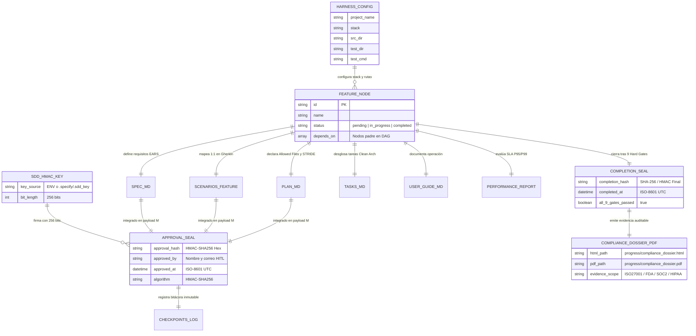

---

## 6. El Ciclo de Vida Operativo y Flujo Humano-Agente-Arnés

### 6.1. Diagrama de Flujo de las 8 Estaciones Operativas

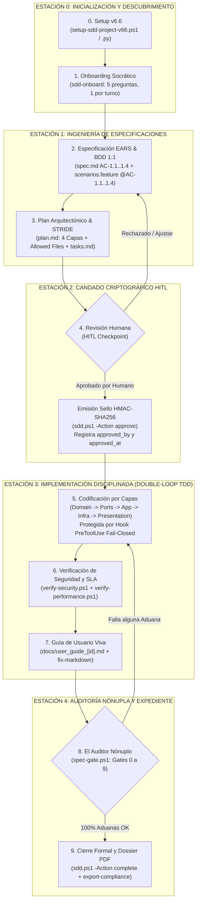

### 6.2. Diagrama de Secuencia de Interacción Determinista (End-to-End)

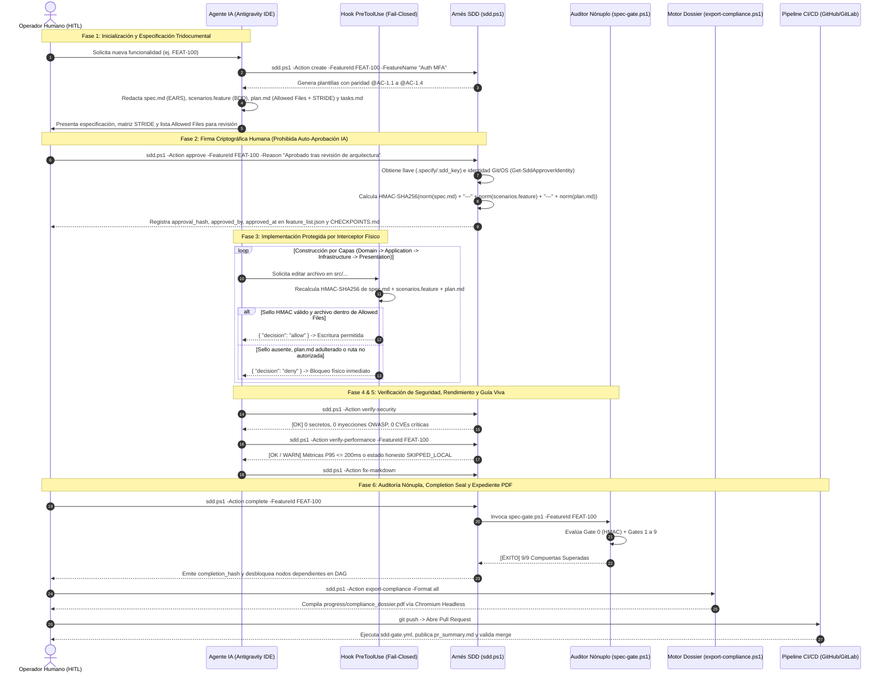

---

## 7. El Auditor Nónuplo Reforzado (`spec-gate.ps1`) — Las 9+1 Hard Gates

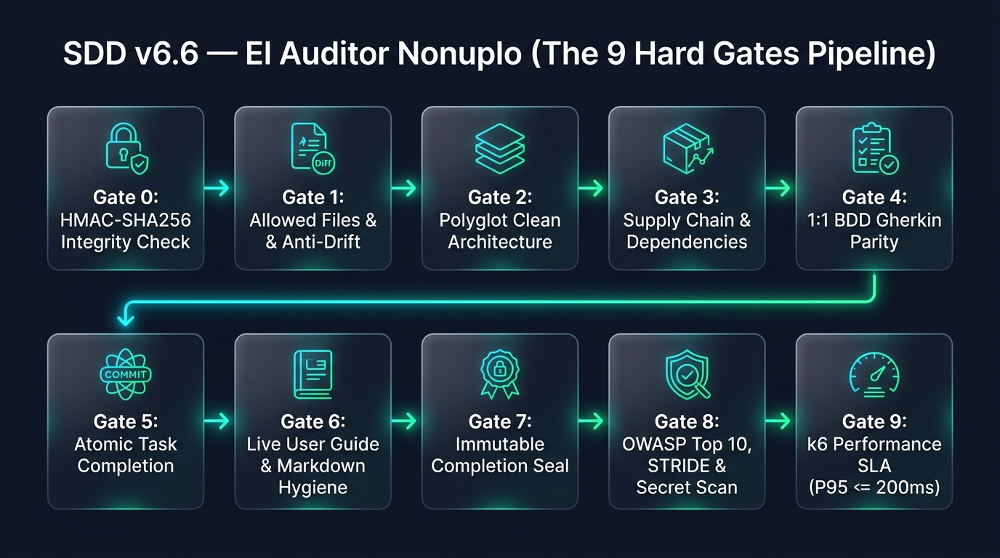

*Figura 3: Tubería de Verificación Secuencial de "El Auditor Nónuplo" (`harness/spec-gate.ps1`), mostrando la Compuerta 0 de Integridad Criptográfica HMAC-SHA256 seguida de las 9 Compuertas Duras de Calidad, Arquitectura, Seguridad y Rendimiento ([Ver activo local](file:///D:/.antigravity/sdd-projects/docs/assets/sdd_v66_nonuplo_hard_gates.jpg)).*

### 7.1. Diagrama de Flujo de Ejecución del Auditor Nónuplo

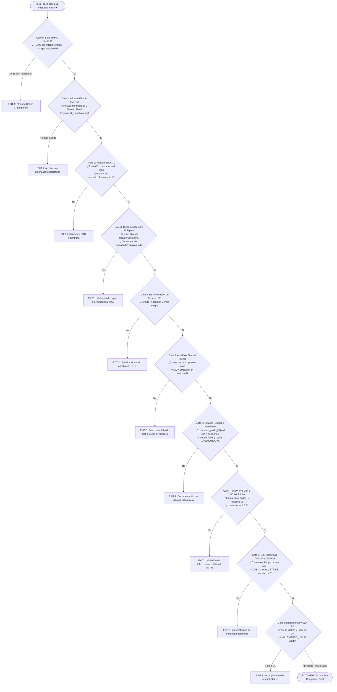

### 7.2. Especificación Técnica Exhaustiva de las Compuertas

| Compuerta | Nombre Oficial | Artefactos Auditados | Algoritmo / Regla de Validación Determinista | Endurecimiento Específico en v6.6 |
| :---: | :--- | :--- | :--- | :--- |
| **Gate 0** | **Verificación Previa HMAC-SHA256** | `spec.md`, `scenarios.feature`, `plan.md`, `.specify/.sdd_key`, `feature_list.json` | Recalcula el HMAC-SHA256 tridocumental normalizado a LF y lo compara contra `approval_hash`. | Nuevo chequeo de barrera inicial; incluye `plan.md` dentro del payload criptográfico (P0.1, P0.2). |
| **Gate 1** | **Allowed Files & Anti-Drift** | `git status --porcelain`, `git diff`, sección `## Allowed Files` en `plan.md` / `spec.md` | Verifica que todo archivo nuevo o modificado en `src/` y `tests/` pertenezca al conjunto declarado en `Allowed Files`. | Excluye formalmente `tests/performance/k6_benchmark.js` para erradicar falsos positivos del scaffold (P0.4). |
| **Gate 2** | **Cobertura y Paridad BDD 1:1** | `specs/<id>/spec.md`, `specs/<id>/scenarios.feature`, `tests/` | Extrae con regex todos los `AC-\d+\.\d+` de `spec.md` y exige presencia exacta de `@AC-\d+\.\d+` en `.feature` y referencia en `tests/`. | Paridad 1:1 garantizada de fábrica incluyendo `@AC-1.4` en plantillas y generador (P0.3). |
| **Gate 3** | **Clean Architecture & Supply Chain** | `src/domain/`, `src/application/`, `src/presentation/`, manifiesto de paquetes | Escanea importaciones con expresiones regulares políglotas; prohíbe que `domain` importe `infrastructure` o `presentation` y audita librerías contra `plan.md`. | Incorpora soporte completo para paquetes Java (`import ...presentation|infrastructure`) y Maven `pom.xml` (P1.2). |
| **Gate 4** | **Inmutabilidad del Candado y HITL** | `feature_list.json`, `CHECKPOINTS.md`, tríada en `specs/<id>/` | Confirma que la funcionalidad no esté en `pending`, que `approval_hash` coincida con el HMAC actual y que exista atribución `approved_by`. | Valida los nuevos campos `approved_by`, `approved_at` y `algorithm: "HMAC-SHA256"` (P1.1). |
| **Gate 5** | **Anti-Fake Tests & Completitud de Tareas** | Archivos en `tests/`, `specs/<id>/tasks.md`, ejecución real de `init.ps1 -Mode test` | Rechaza tests con cuerpo vacío (`pass`, `assert true == true`, `skip`), verifica que no queden casillas `[ ]` en `tasks.md` y ejecuta el runner de pruebas del stack. | Valida el nuevo orden constructivo de `tasks.md` alineado a Clean Architecture (P0.5). |
| **Gate 6** | **Guía de Usuario Viva & Higiene Markdown** | `docs/user_guide_<id>.md`, todos los `.md` del proyecto | Verifica las 4 secciones obligatorias, ausencia de `TODO`/`TBD`/`{PLACEHOLDER}`, y auto-repara reglas markdownlint MD022 y MD047. | Conserva auto-reparación al vuelo de saltos de línea y encabezados. |
| **Gate 7** | **UI/UX Pro Max & Accesibilidad WCAG** | `src/presentation/`, `.specify/design-system/design-tokens.json` | Detecta códigos hexadecimales sueltos en UI, verifica los 5 estados visuales y calcula algorítmicamente el ratio de contraste $\ge 4.5:1$. | Mantiene validación matemática de luminancia relativa W3C. |
| **Gate 8** | **Ciberseguridad OWASP, STRIDE & Secretos** | `src/`, `plan.md`, `harness/verify-security.ps1` | Audita presencia de tabla STRIDE en `plan.md`, busca credenciales filtradas, patrones de inyección SQL/Command y ejecuta auditoría de CVEs. | Integración de reglas de escaneo para los 7 stacks políglotas. |
| **Gate 9** | **Performance & Resiliencia SLA (k6)** | `tests/performance/k6_benchmark.js`, `progress/performance_report.json` | Verifica umbrales $P_{95} \le 200\text{ ms}$, $P_{99} \le 500\text{ ms}$ y errores $= 0\%$. | **Sinceramiento transparente:** distingue ejecución activa (`CERTIFIED`) de ausencia local de k6 (`SKIPPED_LOCAL` con `WARN`) y corrige escape JSON de rutas Windows (P1.3). |

### 7.3. Arquitectura Dual Transparente de la Compuerta 9 (`verify-performance.ps1`)

Uno de los perfeccionamientos clave de SDD v6.6 es la eliminación de "certificaciones simuladas" cuando el desarrollador local no tiene instalado el binario `k6` en su máquina de trabajo:

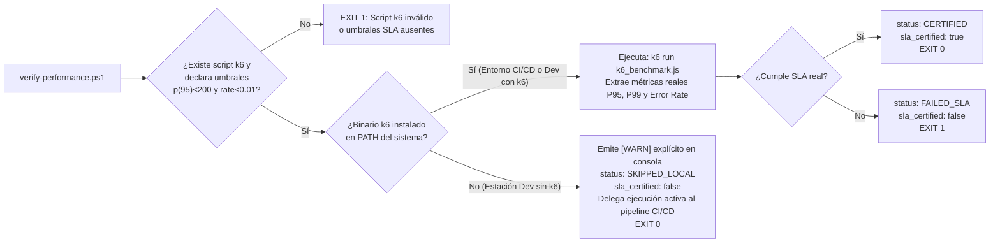

Ejemplo del reporte `progress/performance_report.json` generado en una estación local sin `k6` en SDD v6.6 (nótese la normalización de barras inclinadas `/` y la transparencia de los campos `status` y `sla_certified`):

```json
{
  "feature_id": "FEAT-100",
  "timestamp": "2026-11-02T16:30:51Z",
  "tool": "k6",
  "mode": "static_contract_validation_only",
  "status": "SKIPPED_LOCAL",
  "sla_certified": false,
  "target_script": "tests/performance/k6_benchmark.js",
  "vus": 10,
  "duration": "10s",
  "metrics": {
    "p95_ms": null,
    "p99_ms": null,
    "error_rate_pct": null,
    "sla_p95_threshold_ms": 200,
    "sla_error_threshold_pct": 0.0,
    "note": "k6 CLI no instalado localmente. Umbrales declarativos verificados; medicion real delegada a CI/CD."
  }
}
```

---

## 8. Ecosistema Agéntico: Las 20 Skills Canónicas y los 3 Hooks Nativos Fail-Closed

### 8.1. Los 3 Hooks Nativos del IDE (`.agents/hooks.json`)

El archivo `.agents/hooks.json` enlaza el ciclo de ejecución del agente en Google Antigravity IDE con tres scripts deterministas ubicados en `harness/hooks/`:

| Hook | Evento Disparador | Script Ejecutado | Comportamiento y Política de Seguridad |
| :--- | :--- | :--- | :--- |
| **`SessionStart`** | Apertura de proyecto o inicio de conversación en el IDE. | `harness/hooks/session-start.ps1` | Lee `feature_list.json` y `.specify/memory/onboard-state.json`. Si el proyecto es nuevo, activa automáticamente la entrevista socrática (`sdd-onboard`); si existe una feature activa, inyecta el contexto y estado del candado HMAC. |
| **`PreToolUse`** | Antes de ejecutar herramientas de escritura (`write_file`, `edit_file`, etc.). | `harness/hooks/pre-tool-enforce.ps1` | **Política Fail-Closed:** Si la ruta objetivo apunta a `src/` o a `.specify/.sdd_key`, verifica que exista una feature en estado `in_progress`, que `plan.md` exista y que el **HMAC-SHA256 recalculado en vivo coincida exactamente con `approval_hash`**. De lo contrario, devuelve `{"decision": "deny"}`. |
| **`PostToolUse`** | Inmediatamente después de crear o modificar un archivo. | `harness/hooks/post-tool-check.ps1` | Analiza las sentencias `import` / `using` / `require` del archivo guardado. Si detecta una violación de Clean Architecture (ej. infraestructura dentro de `src/domain/`), registra la alerta en `progress/arch_alerts.log` y notifica al agente. |

### 8.2. Diagrama de Decisión del Interceptor Físico `PreToolUse` Fail-Closed

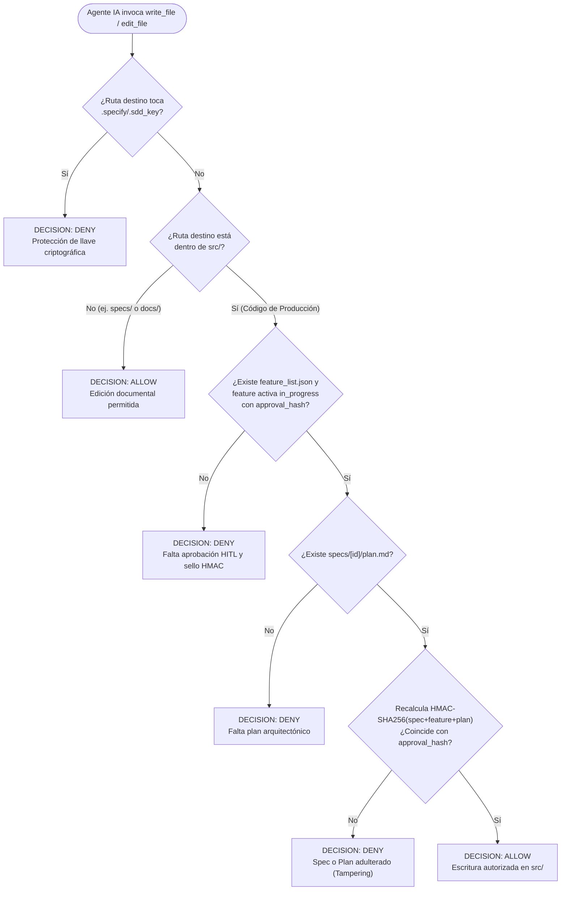

### 8.3. Mapa de Orquestación de las 20 Skills Canónicas

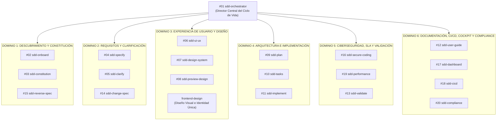

### 8.4. Catálogo Maestro de las 20 Skills Canónicas (`.agents/skills/`)

| # | Identificador de Skill | Rol Especializado | Fase SDD | Artefactos de Entrada | Artefactos de Salida / Acción Principal |
| :---: | :--- | :--- | :---: | :--- | :--- |
| **01** | `sdd-orchestrator` | Director de Orquesta SDD | Todas | `feature_list.json`, `CHECKPOINTS.md` | Coordina transiciones de fase, invoca skills y exige paradas HITL. |
| **02** | `sdd-onboard` | Entrevistador Socrático | Fase 0/1 | Respuestas del usuario (1 por turno) | `.specify/memory/onboard-state.json`, `constitution.md`, backlog inicial. |
| **03** | `sdd-constitution` | Guardián Constitucional | Todas | `.specify/memory/constitution.md` | Vela por el cumplimiento de los 10 artículos rectores del proyecto. |
| **04** | `sdd-specify` | Ingeniero de Requisitos EARS | Fase 1 | Requerimiento de negocio | `specs/<id>/spec.md` (`AC-1.1`..`1.4`) y `scenarios.feature` (`@AC-1.1`..`1.4`). |
| **05** | `sdd-clarify` | Analista Adversarial | Fase 1/2 | Borrador de `spec.md` | Detecta casos borde, huecos lógicos y formula preguntas de desambiguación. |
| **06** | `sdd-ui-ux` | Arquitecto de Interfaz y WCAG | Fase 2/3 | `spec.md`, `design-tokens.json` | Diseña componentes con 5 estados obligatorios y contraste WCAG AA $\ge 4.5:1$. |
| **07** | `sdd-design-system` | Curador de Design Tokens | Fase 2 | Identidad visual del proyecto | `.specify/design-system/design-tokens.json` (colores, tipografía, espaciado). |
| **08** | `sdd-preview-design` | Prototipador Interactivo | Fase 2 | `design-tokens.json` | Ejecuta `harness/preview-design.ps1` y genera catálogo visual HTML. |
| **09** | `sdd-plan` | Arquitecto Clean Architecture | Fase 2 | `spec.md`, `constitution.md` | `specs/<id>/plan.md` con 4 anillos, tabla STRIDE y lista `## Allowed Files`. |
| **10** | `sdd-tasks` | Planificador Técnico TDD | Fase 2 | `plan.md`, `scenarios.feature` | `specs/<id>/tasks.md` ordenado estrictamente de `Domain` a `Presentation`. |
| **11** | `sdd-implement` | Desarrollador Double-Loop TDD | Fase 3 | Tríada sellada HMAC + `tasks.md` | Código en `src/` y pruebas en `tests/` respetando `Allowed Files`. |
| **12** | `sdd-user-guide` | Redactor Técnico de Entrega | Fase 6 | `spec.md`, implementación final | `docs/user_guide_<id>.md` en 4 secciones canónicas sin placeholders. |
| **13** | `sdd-validate` | Auditor de Calidad Nónuplo | Fase 6 | Repositorio completo | Ejecuta `harness/spec-gate.ps1` y diagnostica las 9+1 compuertas duras. |
| **14** | `sdd-change-spec` | Gestor de Cambios (RFC) | Transversal | Solicitud de cambio de alcance | Actualiza `spec.md`/`plan.md`, invalida sello previo y solicita nueva firma HITL. |
| **15** | `sdd-reverse-spec` | Ingeniero Inverso Brownfield | Fase 0/1 | Código legado existente | Extrae especificaciones EARS y escenarios BDD a partir de sistemas previos. |
| **16** | `sdd-secure-coding` | Oficial de Ciberseguridad | Fase 4 | `src/`, `plan.md`, referencias OWASP | Ejecuta `verify-security.ps1`, valida STRIDE, Tríada Letal y SAST/CVEs. |
| **17** | `sdd-dashboard` | Operador de Observabilidad | Transversal | `feature_list.json`, `progress/` | Ejecuta `dashboard.ps1` para actualizar `sdd_dashboard.html` y servidor `-Live`. |
| **18** | `sdd-cicd` | Ingeniero DevSecOps Cloud | Fase 6 | `.github/workflows/`, `.gitlab-ci.yml` | Mantiene pipelines cloud y genera `progress/pr_summary.md`. |
| **19** | `sdd-performance` | Ingeniero de Rendimiento y SLA | Fase 5 | `tests/performance/k6_benchmark.js` | Ejecuta `verify-performance.ps1` y audita percentiles $P_{95} \le 200\text{ ms}$. |
| **20** | `sdd-compliance` | Auditor de Evidencia Técnica | Fase 6 | Todos los reportes y sellos HMAC | Ejecuta `export-compliance.ps1` generando `compliance_dossier.pdf` y `.html`. |

### 8.5. Skill Especializada de Diseño de Interfaz: `frontend-design` (Anthropic)

Para proyectos con interfaz gráfica (Web, SaaS, Mobile), SDD v6.6 integra la skill de referencia **`frontend-design`** (de Anthropic / `skills.sh`) en `.agents/skills/frontend-design/SKILL.md`. Esta habilidad actúa como complemento de alto nivel para `sdd-ui-ux` y `sdd-design-system`:

1. **Erradicación de Clichés de IA (*Anti-AI Slop*):**
   - Prohíbe el uso de patrones genéricos como fondos crema con serifas repetitivas, sombras grises idénticas (`rgba(0,0,0,0.1)`), tarjetas SaaS homogéneas y gradientes púrpura por defecto.
2. **Plan de Diseño Previo Obligatorio (Two-Pass Process):**
   - **Paleta Cromática Semántica:** Definición explícita de 4 a 6 valores hexadecimales con propósito funcional.
   - **Jerarquía Tipográfica:** Selección deliberada de máximo 2 familias tipográficas con roles específicos para títulos y cuerpo de texto, respetando longitudes de línea $< 80$ caracteres.
   - **Concepto de Maquetación y Wireframes ASCII:** Bosquejos estructurales previos a la codificación HTML/CSS.
   - **Principios del Dominio:** El diseño visual se fundamenta en la industria, usuarios y propósito del negocio.
3. **Piso de Calidad y Restricción Estética:**
   - Cumplimiento estricto de WCAG 2.1 AA ($\text{contraste} \ge 4.5:1$).
   - Foco visible accesible por teclado y respeto por preferencias de movimiento reducido (`prefers-reduced-motion`).
   - Microcopy intencional en voz activa, orientado a la resolución de errores y estados vacíos sin textos de relleno cosméticos.

---

## 9. Compatibilidad Políglota y Casos de Estudio Empresariales

### 9.1. Matriz de Perfiles Políglotas Soportados Nativamente (`Invoke-ConfigureStack`)

El comando `.\harness\sdd.ps1 -Action set-stack -Stack <preset>` reconfigura automáticamente `.specify/harness-config.json` y `.gitignore` para adaptarse a los 7 ecosistemas corporativos principales:

| Preset Stack | Lenguaje / Ecosistema | Manifiesto de Dependencias | Directorio Fuentes (`src_dir`) | Directorio Pruebas (`test_dir`) | Comando de Pruebas (`test_cmd`) | Verificación de Tipos / Compilación (`typecheck_cmd`) | Auditoría de Vulnerabilidades CVE |
| :--- | :--- | :--- | :--- | :--- | :--- | :--- | :--- |
| **`python`** | Python 3.11+ | `requirements.txt` / `pyproject.toml` | `src` | `tests` | `pytest` | `mypy src` | `pip-audit` |
| **`typescript`** / **`node`** | TypeScript / Node.js | `package.json` | `src` | `tests` | `npm test` / `npx vitest run` | `npx tsc --noEmit` | `npm audit --audit-level=high` |
| **`csharp`** / **`dotnet`** | C# / .NET 8+ | `*.csproj` / `*.sln` | `src` | `tests` | `dotnet test` | `dotnet build --no-incremental` | `dotnet list package --vulnerable` |
| **`golang`** / **`go`** | Go 1.22+ | `go.mod` | `src` | `tests` | `go test ./...` | `go vet ./...` | `govulncheck ./...` |
| **`rust`** | Rust (Cargo) | `Cargo.toml` | `src` | `tests` | `cargo test` | `cargo check` | `cargo audit` |
| **`flutter`** / **`dart`** | Dart / Flutter | `pubspec.yaml` | `lib` | `test` | `flutter test` | `flutter analyze` | `dart pub outdated` |
| **`java`** / **`java-maven`** | Java 21+ (Maven / Spring) | `pom.xml` | `src/main/java` | `src/test/java` | `mvn test` | `mvn compile -q` | `mvn org.owasp:dependency-check-maven:check` |

### 9.2. Expresiones Regulares de Aislamiento de Capas en `spec-gate.ps1` y `post-tool-check.ps1`

Para garantizar que la capa `domain` permanezca 100% pura y que `presentation` no salte directamente a `infrastructure`, el arnés aplica inspección sintáctica mediante las siguientes expresiones regulares:

| Lenguaje | Expresión Regular de Violación en `domain/` (Prohíbe importar `infrastructure` o `presentation`) | Expresión Regular de Violación en `presentation/` (Prohíbe acoplamiento directo a `infrastructure`) |
| :--- | :--- | :--- |
| **Python** | `(?m)^\s*(?:from\s+(?:src\.)?(?:infrastructure\|presentation)\b\|import\s+(?:src\.)?(?:infrastructure\|presentation)\b)` | `(?m)^\s*(?:from\s+(?:src\.)?infrastructure\b\|import\s+(?:src\.)?infrastructure\b)` |
| **TypeScript / JS** | `(?:from\s+['"][^'"]*(?:infrastructure\|presentation)['"]\|require\(\s*['"][^'"]*(?:infrastructure\|presentation)['"]\s*\))` | `(?:from\s+['"][^'"]*infrastructure['"]\|require\(\s*['"][^'"]*infrastructure['"]\s*\))` |
| **C# (.NET)** | `(?m)^\s*using\s+(?:global::)?[\w\.]*\.(?:Infrastructure\|Presentation)\b` | `(?m)^\s*using\s+(?:global::)?[\w\.]*\.Infrastructure\b` |
| **Go** | `(?m)^\s*(?:import\s+)?["'][^"']*/(?:infrastructure\|presentation)["']` | `(?m)^\s*(?:import\s+)?["'][^"']*/infrastructure["']` |
| **Rust** | `(?m)^\s*use\s+(?:crate::)?(?:infrastructure\|presentation)\b` | `(?m)^\s*use\s+(?:crate::)?infrastructure\b` |
| **Flutter / Dart** | `(?m)^\s*import\s+['"][^'"]*(?:infrastructure\|presentation)[^'"]*['"]` | `(?m)^\s*import\s+['"][^'"]*infrastructure[^'"]*['"]` |
| **Java (Maven/Gradle)** | `(?m)^\s*import\s+[\w\.]*\.(?:infrastructure\|presentation)\.[\w\*]+;` | `(?m)^\s*import\s+[\w\.]*\.infrastructure\.[\w\*]+;` |

### 9.3. Caso de Estudio Empresarial 1: Core Bancario SPEI en Java 21 (Spring Boot 3.4 + Maven + PostgreSQL 17)

Con la incorporación del preset `java-maven` en SDD v6.6 (Recomendación P1.2), la inicialización y configuración de un microservicio transaccional de alta regulación en Java se ejecuta con:

```powershell
# 1. Inicializar proyecto con soporte desatendido
.\setup-sdd-project-v66.ps1 -ProjectName "CoreBancarioSPEI" -DestinationPath "D:\Proyectos" -NoAutoLaunch

# 2. Configurar el stack Java Maven
cd "D:\Proyectos\CoreBancarioSPEI"
.\harness\sdd.ps1 -Action set-stack -Stack java-maven
```

El archivo `.specify/harness-config.json` resultante queda configurado automáticamente como:

```json
{
  "project_name": "CoreBancarioSPEI",
  "version": "6.6",
  "stack": "java",
  "src_dir": "src/main/java",
  "test_dir": "src/test/java",
  "test_cmd": "mvn test",
  "typecheck_cmd": "mvn compile -q",
  "manifest_file": "pom.xml",
  "layers": {
    "domain": "src/main/java/domain",
    "application": "src/main/java/application",
    "infrastructure": "src/main/java/infrastructure",
    "presentation": "src/main/java/presentation"
  }
}
```

#### Artefacto 1: `specs/FEAT-SPEI-001/spec.md` (Requisitos Formales EARS)

```markdown
# Especificación Funcional: [FEAT-SPEI-001] Liquidación Interbancaria Atómica

## 1. Contexto de Negocio
Liquidación en tiempo real de órdenes de transferencia interbancaria con prevención de doble gasto e idempotencia criptográfica.

## 2. Criterios de Aceptación (Sintaxis EARS)
- **AC-1.1 [Event-driven]:** WHEN una orden de transferencia con clave de rastreo única y saldo suficiente es recibida, THE Motor de Liquidación SHALL debitar la cuenta origen, acreditar la cuenta destino y emitir un acuse firmado en menos de 150 ms.
- **AC-1.2 [Unwanted]:** IF el monto de la orden es menor o igual a cero o la cuenta CLABE no cumple el dígito verificador de 18 dígitos, THEN THE Motor de Liquidación SHALL rechazar la petición con código `ERR_INVALID_CLABE` sin abrir transacción en base de datos.
- **AC-1.3 [State-driven]:** WHILE una clave de rastreo se encuentre registrada previamente en el almacén de idempotencia, THE Motor de Liquidación SHALL retornar el resultado original sin ejecutar un segundo cargo financiero.
- **AC-1.4 [Unwanted]:** IF el nodo primario de persistencia presenta un fallo transitorio de conexión, THEN THE Motor de Liquidación SHALL abortar atómicamente la unidad de trabajo, activar el circuit-breaker y registrar el evento de auditoría sin pérdida de consistencia.
```

#### Artefacto 2: `specs/FEAT-SPEI-001/scenarios.feature` (Paridad BDD 1:1 en Gherkin)

```gherkin
Feature: Liquidación Interbancaria Atómica (FEAT-SPEI-001)

  @AC-1.1
  Scenario: Liquidación exitosa con saldo suficiente
    Given una cuenta origen "012180001234567899" con saldo disponible de 50000.00 MXN
    When se procesa una orden SPEI por 1500.00 MXN con clave de rastreo "RASTREO-2026-0001"
    Then el saldo final de la cuenta origen es 48500.00 MXN
    And se emite un recibo de liquidación con estado "LIQUIDADA"

  @AC-1.2
  Scenario: Rechazo por cuenta CLABE con dígito verificador inválido
    Given una orden de transferencia hacia la CLABE inválida "012180001234567890"
    When el servicio valida la estructura de la orden
    Then la operación es rechazada con el código de error "ERR_INVALID_CLABE"

  @AC-1.3
  Scenario: Protección de idempotencia ante clave de rastreo duplicada
    Given una orden previamente liquidada con clave de rastreo "RASTREO-2026-0001"
    When se recibe un reintento con la misma clave de rastreo "RASTREO-2026-0001"
    Then no se realiza ningún cargo adicional y se devuelve el acuse original

  @AC-1.4
  Scenario: Resiliencia y rollback ante fallo transitorio de persistencia
    Given una interrupción temporal en el adaptador de persistencia bancaria
    When se intenta procesar una orden con clave de rastreo "RASTREO-2026-0002"
    Then la transacción ejecuta rollback completo y el circuit-breaker pasa a estado "OPEN"
```

#### Artefacto 3: `specs/FEAT-SPEI-001/plan.md` (Clean Architecture, STRIDE y Allowed Files)

```markdown
# Plan Arquitectónico: [FEAT-SPEI-001]

## 1. Diseño en 4 Capas (Clean Architecture Java 21)
- **Domain (`src/main/java/domain/`):** Record inmutable `OrdenSpei`, entidad `CuentaBancaria` y validador puro de dígito verificador CLABE (0 dependencias Spring/JPA).
- **Application (`src/main/java/application/`):** Caso de uso `LiquidarOrdenSpeiUseCase` y puertos `CuentaRepositoryPort`, `IdempotenciaPort`.
- **Infrastructure (`src/main/java/infrastructure/`):** Adaptador `JpaCuentaRepositoryAdapter` (PostgreSQL 17 con bloqueo pesimista) y `RedisIdempotenciaAdapter`.
- **Presentation (`src/main/java/presentation/`):** Controlador `SpeiRestController` con validación Bean Validation.

## 2. Modelado de Amenazas STRIDE y Fronteras de Confianza (‖)
| Amenaza STRIDE | Vector Identificado en Frontera `‖` | Mitigación Determinista |
| :--- | :--- | :--- |
| **Spoofing** | Suplantación de institución participante en API Gateway `‖` | Autenticación mutua mTLS + validación de certificado X.509. |
| **Tampering** | Alteración de monto o CLABE en el payload JSON | Verificación de firma digital RSA-PSS del mensaje antes del caso de uso. |
| **Repudiation** | Negación de envío de orden de pago | Registro inmutable de payload firmado y timestamp UTC en bitácora de auditoría. |
| **Information Disclosure** | Exposición de PII o saldos en logs de error | Enmascaramiento de cuentas CLABE en trazas (`****7899`). |
| **Denial of Service** | Inundación de peticiones repetidas | Rate-limiting por IP/Institución + caché de idempotencia en memoria. |
| **Elevation of Privilege** | Manipulación de parámetros internos de cuenta | Separación estricta de DTO de entrada y entidad de dominio pura. |

## Allowed Files
- src/main/java/domain/OrdenSpei.java
- src/main/java/domain/CuentaBancaria.java
- src/main/java/application/LiquidarOrdenSpeiUseCase.java
- src/main/java/application/ports/CuentaRepositoryPort.java
- src/main/java/infrastructure/JpaCuentaRepositoryAdapter.java
- src/main/java/presentation/SpeiRestController.java
- src/test/java/domain/OrdenSpeiTest.java
- src/test/java/acceptance/SpeiAcceptanceTest.java
```

---

### 9.4. Caso de Estudio Empresarial 2: Microservicio Clínico HL7/FHIR en Python 3.12 (FastAPI + Pytest + Mypy)

En el sector salud (sujeto a **HIPAA 45 CFR § 164.312** y **FDA 21 CFR Part 11**), SDD v6.6 asegura que la lógica de dosificación médica en `src/domain/` permanezca completamente aislada de FastAPI y SQLAlchemy:

| Capa Arquitectónica | Ruta Permitida (`Allowed Files`) | Restricción Auditada por Gate 3 y `post-tool-check.ps1` |
| :--- | :--- | :--- |
| **1. Domain** | `src/domain/dosage_calculator.py` | **Solo librería estándar de Python** (`dataclasses`, `decimal`, `enum`). Prohibido importar `fastapi`, `sqlalchemy`, `pydantic` o `requests`. |
| **2. Application** | `src/application/prescribe_medication.py` | Define `Protocol` para repositorios (`PatientRepositoryProtocol`). Solo importa `src.domain`. |
| **3. Infrastructure** | `src/infrastructure/postgres_patient_repo.py` | Implementa persistencia cifrada AES-256-GCM y consultas parametrizadas SQLAlchemy. |
| **4. Presentation** | `src/presentation/fhir_router.py` | Endpoints FastAPI que delegan al caso de uso en `src.application` sin tocar `src.infrastructure`. |

---

## 10. Observabilidad Ejecutiva (Cockpit Web), Gobernanza CI/CD y Evidencia Regulatoria

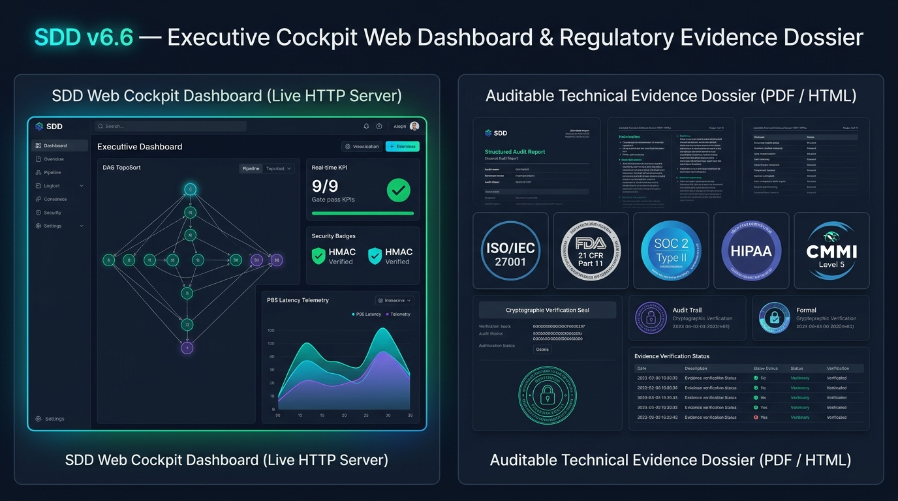

*Figura 4: Panel Izquierdo: Cockpit Web Dashboard Interactivo (`progress/sdd_dashboard.html`) con Servidor HTTP en Vivo, Grafo DAG TopoSort y Telemetría de Compuertas. Panel Derecho: Expediente de Evidencia Técnica Auditable en PDF Vectorial (`progress/compliance_dossier.pdf`) alineado con controles de ISO/IEC 27001, FDA 21 CFR Part 11, SOC 2 Type II, HIPAA y CMMI Nivel 5 ([Ver activo local](file:///D:/.antigravity/sdd-projects/docs/assets/sdd_v66_cockpit_and_compliance.jpg)).*

### 10.1. Cockpit Web Dashboard & Servidor DAG en Tiempo Real (`harness/dashboard.ps1`)

El script `harness/dashboard.ps1` materializa la observabilidad ejecutiva del proyecto sin requerir frameworks frontend externos ni servidores Node.js:

1. **Ordenamiento Topológico (*TopoSort*) del Grafo DAG:** Procesa los nodos de `feature_list.json` y sus aristas `depends_on`, detectando dependencias circulares y renderizando visualmente la ruta crítica del proyecto con codificación semántica de colores validada bajo WCAG 2.1 AA.
2. **Tarjetas de Telemetría y Estado Criptográfico:** Muestra en tiempo real el porcentaje de avance del backlog, el estado de las 9 compuertas duras, los hashes HMAC-SHA256 truncados, el nombre del aprobador humano (`approved_by`) y las métricas de latencia $P_{95}$ / $P_{99}$ extraídas de `progress/performance_report.json`.
3. **Servidor HTTP Embebido (`-Live`):** Mediante `System.Net.HttpListener`, el comando `.\harness\sdd.ps1 -Action dashboard -Live -Port 8080` levanta un servicio local que monitorea cambios en `feature_list.json` y `CHECKPOINTS.md`, refrescando la vista ejecutiva automáticamente.

### 10.2. Gobernanza CI/CD Cloud (`.github/workflows/sdd-gate.yml` y `.gitlab-ci.yml`)

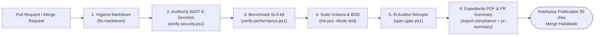

### 10.3. Compilador de Expediente en PDF Vectorial vía Chromium Headless (`harness/export-compliance.ps1`)

Para generar un entregable de auditoría inalterable sin depender de bibliotecas pesadas de terceros (como `wkhtmltopdf`, LaTeX o paquetes Python), `export-compliance.ps1` construye primero un documento HTML5 de alta precisión tipográfica con reglas `@media print` (formato A4, márgenes de 18 mm, control de saltos de página `page-break-inside: avoid`) y posteriormente invoca el motor **Chromium Headless** nativo del sistema operativo (**Microsoft Edge** o **Google Chrome**):

```powershell
$pArgs = @(
    "--headless=new",
    "--disable-gpu",
    "--no-first-run",
    "--no-default-browser-check",
    "--run-all-compositor-stages-before-draw",
    "--print-to-pdf=$FullPdfPath",
    $FullHtmlPath
)
Start-Process -FilePath $browserPath -ArgumentList $pArgs -Wait -NoNewWindow
```

### 10.4. Marco Conceptual Regulatorio en v6.6: Evidencia Técnica Determinista vs. Certificación Institucional

> [!NOTE]
> **Rigor y Alcance Jurídico-Técnico (Mejora P1.4):**
> Ninguna herramienta de software automatizada otorga por sí misma una "certificación legal" ni sustituye el dictamen de un organismo auditor acreditado (como AICPA para SOC 2, organismos certificadores acreditados ante IAF/EMA para ISO/IEC 27001, o inspectores de la FDA).
> La función exacta de **SDD v6.6** es generar, preservar y exportar **Evidencia Técnica Auditable, Determinista y Criptográficamente Íntegra** que demuestra la ejecución efectiva de los controles de ingeniería exigidos por dichos marcos normativos.

### 10.5. Matriz Exhaustiva de Mapeo de Controles Regulatorios

| Marco / Norma Internacional | Cláusula / Control Específico | Requerimiento Normativo | Mecanismo Técnico y Evidencia Generada por SDD v6.6 | Artefacto de Prueba en el Dossier |
| :--- | :--- | :--- | :--- | :--- |
| **ISO/IEC 27001:2022** | **Anexo A.8.25** (Ciclo de vida de desarrollo seguro) | Establecer y aplicar reglas para el desarrollo seguro de software y sistemas. | Separación de capas Clean Architecture (Gate 3), modelado STRIDE en `plan.md` y escaneo SAST/CVE (Gate 8). | Sección 4 y 5 de `compliance_dossier.pdf` + reporte de `verify-security.ps1`. |
| **ISO/IEC 27001:2022** | **Anexo A.8.32** (Gestión de cambios) | Sujetar todo cambio a procedimientos formales de autorización, prueba y control documental. | Sello tridocumental HMAC-SHA256 sobre `spec.md`, `scenarios.feature` y `plan.md` + bloqueo de `Allowed Files` (Gate 0 y Gate 1). | Tabla de Hashes HMAC y registro cronológico en `CHECKPOINTS.md`. |
| **ISO/IEC 27001:2022** | **Anexo A.8.28** (Codificación segura) | Aplicar principios de codificación segura y prohibir secretos en código fuente. | Detección de patrones de inyección OWASP, Tríada Letal y escaneo de secretos de alta entropía. | Resultado de Aduana 8 (`[PASS] 0 Secretos / 0 SAST`). |
| **ISO/IEC 25010:2023** | **Calidad de Producto** (Mantenibilidad, Eficiencia y Seguridad) | Evaluar modularidad, reusabilidad, comportamiento temporal ($P_{95}$) e integridad. | Anillos concéntricos desacoplados, paridad BDD 1:1 y benchmark declarativo k6 ($P_{95} \le 200\text{ ms}$). | `progress/performance_report.json` y Matriz de Trazabilidad. |
| **FDA 21 CFR Part 11** | **Sec. 11.10(a), (e)** (Validación y Audit Trails en Sistemas Cerrados) | Asegurar exactitud, confiabilidad y bitácoras de auditoría generadas por computadora con estampa de tiempo. | Cadena de custodia inmutable en `CHECKPOINTS.md` y `feature_list.json` con marcas temporales UTC ISO-8601. | Bitácora de firmas y sellos de apertura (`approval_hash`) y cierre (`completion_hash`). |
| **FDA 21 CFR Part 11** | **Sec. 11.50 & 11.70** (Manifestación y Vinculación de Firma) | Los registros firmados deben mostrar nombre impreso del firmante, fecha/hora y significado (aprobación/revisión), enlazados criptográficamente al registro. | Captura obligatoria de `approved_by` (Nombre y correo), `approved_at` (UTC), `approval_reason` y vínculo `HMAC-SHA256` con clave de 256 bits. | Tabla de Atribución HITL en `feature_list.json` y portada del Dossier PDF. |
| **SOC 2 Type II (AICPA)** | **CC6.8 & CC7.1** (Prevención de software no autorizado y monitoreo) | Prevenir la introducción de código o configuraciones no autorizadas y detectar alteraciones. | Hook `PreToolUse` Fail-Closed en el IDE + Gate 0/1 en CI/CD que aborta cualquier modificación fuera de `Allowed Files`. | Logs de ejecución de `spec-gate.ps1` y resumen `progress/pr_summary.md`. |
| **SOC 2 Type II (AICPA)** | **CC8.1** (Autorización y pruebas de cambios) | Autorizar, diseñar, desarrollar, probar y aprobar cambios antes de su implementación en producción. | Flujo obligatorio de 6 fases con parada HITL previa a la codificación y exigencia de paridad BDD 1:1 (`@AC-1.1`..`@AC-1.4`). | Matriz bidireccional `docs/traceability_<id>.md`. |
| **HIPAA Security Rule** | **45 CFR § 164.312(b), (c)(1)** (Controles de Auditoría e Integridad) | Implementar mecanismos electrónicos para corroborar que la información no ha sido alterada o destruida de manera no autorizada. | Verificación matemática continua mediante `Compute-SddApprovalHash` (HMAC-SHA256) en `init.ps1`, `pre-tool-enforce.ps1` y `spec-gate.ps1`. | Verificación de integridad criptográfica en el Dossier de Auditoría. |
| **CMMI Nivel 5** | **QPM / CAR** (Gestión Cuantitativa de Proyectos y Análisis Causal) | Gestionar el desempeño del proceso mediante métricas estadísticas y prevenir recurrencia de defectos. | Telemetría estadística de percentiles $P_{95}$, $P_{99}$, tasa de fallos $0\%$ y suite de regresión de gobernanza en Pester 6. | Reportes cuantitativos en `progress/sdd_dashboard.html` y `performance_report.json`. |

---

## 11. Verificación Formal del Framework: Suite Automatizada en Pester 6

Para garantizar que el propio arnés de gobernanza SDD v6.6 funcione con precisión matemática y no sufra regresiones, el repositorio incorpora una suite formal de pruebas de integración en **Pester 6.2.0** ([`tests/v66-governance.Tests.ps1`](file:///D:/.antigravity/sdd-projects/tests/v66-governance.Tests.ps1)) y análisis estático con **PSScriptAnalyzer 1.25.0** (almacenados localmente en `tools/` para ejecución 100% *air-gapped* sin depender de internet).

### 11.1. Matriz de Pruebas Automatizadas en `tests/v66-governance.Tests.ps1`

| # | Caso de Prueba (`It`) | Recomendación Validada | Escenario y Aserciones Ejecutadas | Estado |
| :-: | :--- | :---: | :--- | :---: |
| **1** | `Crea una funcionalidad e incluye @AC-1.4 para paridad BDD 1:1` | **P0.3** | Ejecuta `sdd.ps1 -Action create -FeatureId FEAT-100` en un sandbox limpio y verifica que `spec.md` contenga `AC-1.4` y `scenarios.feature` contenga `@AC-1.4`. | **PASS** |
| **2** | `Sella la funcionalidad con HMAC-SHA256 y registra la identidad del aprobador` | **P0.1, P1.1** | Ejecuta `sdd.ps1 -Action approve -FeatureId FEAT-100 -Force`, comprueba la creación de `.specify/.sdd_key`, verifica que `algorithm == "HMAC-SHA256"`, que `approval_hash` tenga 64 caracteres hex y que `approved_by` y `approved_at` no estén vacíos. | **PASS** |
| **3** | `Detecta alteración en plan.md (Spec Tampering) y bloquea Gate 0` | **P0.2** | Inyecta una ruta maliciosa (`- src/hacked.py`) en `specs/FEAT-100/plan.md` después de haber sellado la funcionalidad, invoca `spec-gate.ps1` y comprueba que falle con código de salida `!= 0` y mensaje `SPEC TAMPERING DETECTADO`. | **PASS** |
| **4** | `No reporta k6_benchmark.js como archivo no autorizado en Gate 1` | **P0.4** | Restaura `plan.md`, re-sella la funcionalidad, ejecuta `spec-gate.ps1` y verifica que `tests/performance/k6_benchmark.js` no aparezca en la lista de violaciones de Spec Drift de la Aduana 1. | **PASS** |
| **5** | `Reporta estado SKIPPED_LOCAL y advertencia clara cuando k6 no está en PATH local` | **P1.3** | Ejecuta `verify-performance.ps1 -FeatureId FEAT-100` con `PATH` restringido (sin `k6`), parsea `progress/performance_report.json` con `ConvertFrom-Json` y valida que `status == "SKIPPED_LOCAL"` y `sla_certified == $false`. | **PASS** |
| **6** | `Configura exitosamente el stack java-maven` | **P1.2** | Ejecuta `sdd.ps1 -Action set-stack -Stack java-maven` y comprueba en `.specify/harness-config.json` que `stack == "java"`, `manifest_file == "pom.xml"`, `test_cmd == "mvn test"` y `src_dir == "src/main/java"`. | **PASS** |

### 11.2. Comandos para Ejecutar la Suite de Verificación del Framework

```powershell
# 1. Ejecutar las 6 pruebas de integración de gobernanza con Pester 6
powershell.exe -ExecutionPolicy Bypass -NoProfile -Command "Import-Module '.\tools\Pester\6.2.0\Pester.psd1'; Invoke-Pester -Path '.\tests\v66-governance.Tests.ps1' -Output Detailed"

# 2. Auditar calidad estática AST de PowerShell con PSScriptAnalyzer (0 Errores)
powershell.exe -ExecutionPolicy Bypass -NoProfile -Command "Import-Module '.\tools\PSScriptAnalyzer\1.25.0\PSScriptAnalyzer.psd1'; Invoke-ScriptAnalyzer -Path '.\setup-sdd-project-v66.ps1' -Severity Error"

# 3. Validar compilación sintáctica del generador multiplataforma Python
python -m py_compile .\setup-sdd-project-v66.py
```

---

## 12. Manual de Operaciones y Referencia Exhaustiva de Comandos CLI

### 12.1. Inicialización del Proyecto (`setup-sdd-project-v66.ps1` / `.py`)

| Plataforma | Comando de Ejecución | Parámetros Soportados |
| :--- | :--- | :--- |
| **Windows (PowerShell) — Interactivo** | `powershell -ExecutionPolicy Bypass -File .\setup-sdd-project-v66.ps1` | Solicita nombre de proyecto y ruta por consola; abre Antigravity IDE al finalizar. |
| **Windows (PowerShell) — Desatendido / CI** | `.\setup-sdd-project-v66.ps1 -ProjectName "MiApp" -DestinationPath "D:\Proyectos" -NoAutoLaunch` | `-ProjectName <str>`: Nombre de carpeta.<br>`-DestinationPath <path>`: Directorio padre.<br>`-NoAutoLaunch`: Omite lanzar `agy.exe -i`. |
| **Linux / macOS / Windows (Python 3)** | `python setup-sdd-project-v66.py --project-name "MiApp" --destination-path "/opt/proyectos" --no-auto-launch` | `--project-name <str>`<br>`--destination-path <path>`<br>`--no-auto-launch` |

### 12.2. Referencia Completa del CLI Unificado (`harness/sdd.ps1`)

| Acción (`-Action`) | Parámetros Asociados | Función Operativa Detallada |
| :--- | :--- | :--- |
| **`status`** / **`list`** | Ninguno | Muestra versión del arnés (`v6.6`), stack activo, tabla de funcionalidades en el backlog DAG, estado de sellos HMAC-SHA256, identidad de firmantes (`approved_by`) y siguiente paso sugerido. |
| **`create`** | `-FeatureId <id> -FeatureName <nombre> [-DependsOn <id1,id2>]` | Crea la carpeta `specs/<id>/`, instancia `spec.md`, `scenarios.feature` (con `@AC-1.1` a `@AC-1.4`), `plan.md` y `tasks.md`, y registra el nodo en `feature_list.json` en estado `pending`. |
| **`approve`** | `-FeatureId <id> [-Approver <str>] [-Reason <str>] [-Force]` | **Checkpoint HITL:** Verifica que la tríada documental exista, genera o lee la clave `.specify/.sdd_key`, calcula el sello `HMAC-SHA256` sobre `spec.md + scenarios.feature + plan.md`, captura la identidad del operador humano y cambia el estado a `in_progress`. |
| **`set-stack`** | `-Stack <python\|typescript\|csharp\|golang\|rust\|flutter\|java-maven>` | Configura `.specify/harness-config.json` con los directorios, manifiesto y comandos de prueba/tipado del lenguaje elegido, y actualiza `.gitignore`. |
| **`verify-security`** | Ninguno | Invoca `harness/verify-security.ps1`: escanea secretos en el árbol de código, busca antipatrones SAST (SQLi, XSS, `eval`, Path Traversal), verifica la tabla STRIDE en `plan.md` y ejecuta el auditor de CVEs del stack. |
| **`verify-performance`** | `[-FeatureId <id>] [-Vus <int>] [-Duration <str>]` | Invoca `harness/verify-performance.ps1`: valida el contrato de SLAs en `tests/performance/k6_benchmark.js` y ejecuta la prueba k6 en vivo (o emite estado `SKIPPED_LOCAL` con `WARN` si `k6` no está instalado localmente). |
| **`complete`** | `-FeatureId <id>` | Ejecuta el **Auditor Nónuplo** (`harness/spec-gate.ps1`). Si las 9+1 compuertas aprueban, calcula el `completion_hash`, genera `docs/traceability_<id>.md`, marca el estado `completed` y registra el cierre en `CHECKPOINTS.md`. |
| **`export-compliance`** | `[-FeatureId <id>] [-Format pdf\|html\|md\|all] [-Open]` | Invoca `harness/export-compliance.ps1`: consolida toda la evidencia técnica y criptográfica en `progress/compliance_dossier.html` y renderiza `progress/compliance_dossier.pdf` mediante Chromium Headless. |
| **`dashboard`** | `[-NoBrowser] [-Live] [-Port <int>]` | Invoca `harness/dashboard.ps1`: calcula el orden topológico del DAG, genera `progress/sdd_dashboard.html` y opcionalmente levanta el servidor HTTP reactivo en `http://localhost:<Port>/`. |
| **`preview-design`** | `[-NoBrowser]` | Invoca `harness/preview-design.ps1`: renderiza una galería visual interactiva de los tokens de color, contraste WCAG AA y tipografías de `.specify/design-system/design-tokens.json`. |
| **`init-cicd`** | Ninguno | Regenera o actualiza los pipelines `.github/workflows/sdd-gate.yml` y `.gitlab-ci.yml` adaptados al stack configurado. |
| **`pr-summary`** | `[-OutputFile <path>]` | Invoca `harness/pr-summary.ps1`: genera el resumen ejecutivo en Markdown (`progress/pr_summary.md`) listo para comentarios de Pull Request o `$GITHUB_STEP_SUMMARY`. |
| **`fix-markdown`** | Ninguno | Escanea todos los archivos `.md` del repositorio y repara automáticamente violaciones de formato markdownlint (espaciado de encabezados MD022, listas MD032, bloques de código MD031 y salto de línea final único MD047). |

### 12.3. Flujo Operativo Paso a Paso (Recetario Rápido para Equipos)

```powershell
# Paso 1: Consultar estado general del proyecto
.\harness\sdd.ps1 -Action status

# Paso 2: Crear una nueva funcionalidad en el backlog
.\harness\sdd.ps1 -Action create -FeatureId "FEAT-001" -FeatureName "Motor de Conciliación"

# Paso 3: (Tras redactar spec.md, scenarios.feature y plan.md) Firmar candado humano HITL
.\harness\sdd.ps1 -Action approve -FeatureId "FEAT-001" -Reason "Especificación EARS y Allowed Files validados por Arquitectura"

# Paso 4: Ejecutar diagnóstico y pruebas durante la implementación TDD
.\harness\init.ps1 -Mode test

# Paso 5: Auditar ciberseguridad defensiva (Aduana 8) y rendimiento SLA (Aduana 9)
.\harness\sdd.ps1 -Action verify-security
.\harness\sdd.ps1 -Action verify-performance -FeatureId "FEAT-001"

# Paso 6: Sanear formato Markdown y cerrar formalmente la funcionalidad (9+1 Hard Gates)
.\harness\sdd.ps1 -Action fix-markdown
.\harness\sdd.ps1 -Action complete -FeatureId "FEAT-001"

# Paso 7: Compilar el Expediente de Evidencia Técnica en PDF y abrir el Cockpit Web
.\harness\sdd.ps1 -Action export-compliance -Format all -Open
.\harness\sdd.ps1 -Action dashboard -Live -Port 8080
```

---

## 13. Diccionario y Glosario Exhaustivo de Términos SDD v6.6

### Categoría 1: Metodologías y Paradigmas Fundamentales

1. **SDD (*Specification-Driven Development*):** Paradigma de ingeniería de software donde la especificación formal precede, delimita y gobierna matemáticamente la existencia y validez del código ejecutable.
2. **BDD (*Behavior-Driven Development*):** Metodología que expresa los criterios de aceptación como escenarios de comportamiento observables y automatizables en lenguaje Gherkin (`Given-When-Then`).
3. **Double-Loop TDD:** Ciclo de desarrollo guiado por pruebas de doble bucle: el bucle externo verifica escenarios de aceptación BDD y el bucle interno verifica pruebas unitarias de dominio y aplicación.
4. **HITL (*Human-in-the-Loop*):** Principio rector de gobernanza que exige la intervención, revisión y firma explícita de un operador humano identificado en los puntos de control críticos, prohibiendo la auto-aprobación por parte de agentes de IA.
5. **Greenfield vs. Brownfield:** *Greenfield* refiere a proyectos creados desde cero bajo SDD; *Brownfield* refiere a sistemas legados preexistentes cuyas especificaciones se reconstruyen mediante ingeniería inversa (`sdd-reverse-spec`).

### Categoría 2: Ingeniería de Requisitos y Control de Alcance

1. **EARS (*Easy Approach to Requirements Syntax*):** Notación estructurada desarrollada originalmente para sistemas críticos (Rolls-Royce) que restringe la redacción de requisitos a 5 plantillas libres de ambigüedad (*Ubiquitous, Event-driven, State-driven, Optional, Unwanted*).
2. **Criterio de Aceptación (`AC-x.x`):** Identificador único de una condición verificable en `spec.md` que debe poseer paridad 1:1 con un escenario `@AC-x.x` en `scenarios.feature`.
3. **Allowed Files (Lista Blanca de Archivos):** Sección obligatoria en `plan.md` y `spec.md` que enumera las únicas rutas del repositorio que pueden ser creadas o modificadas durante la implementación de una funcionalidad.
4. **Spec Drift (Deriva de Especificación):** Desviación no autorizada en la que el código implementado modifica archivos fuera de alcance o introduce comportamientos no respaldados por la especificación sellada.
5. **Spec Tampering (Adulteración de Especificación):** Modificación furtiva de `spec.md`, `scenarios.feature` o `plan.md` posterior a la firma humana con el propósito de burlar las compuertas de validación; detectada de forma inmediata por el candado HMAC-SHA256.

### Categoría 3: Criptografía y Cadena de Custodia (Novedades v6.6)

1. **HMAC-SHA256 (*Hash-based Message Authentication Code*):** Función criptográfica (RFC 2104) que combina el algoritmo SHA-256 con una llave secreta simétrica de 256 bits para garantizar simultáneamente integridad de datos y autenticidad del origen.
2. **Llave Simétrica SDD (`.specify/.sdd_key` / `$env:SDD_HMAC_KEY`):** Secreto criptográfico de 32 bytes utilizado por `Compute-SddApprovalHash` para firmar y verificar la tríada documental, inaccesible para modificación por el agente gracias al hook `PreToolUse`.
3. **Tríada Documental Sellada:** Conjunto indivisible conformado por `spec.md`, `scenarios.feature` y `plan.md`, normalizado con saltos de línea `LF` y concatenado mediante delimitadores `---` antes de aplicar HMAC-SHA256.
4. **Approval Seal (`approval_hash`):** Sello HMAC-SHA256 emitido al aprobar una funcionalidad que autoriza el inicio de la fase de codificación en `src/`.
5. **Completion Seal (`completion_hash`):** Sello criptográfico definitivo emitido por `sdd.ps1 -Action complete` únicamente tras superar el 100% de las compuertas del Auditor Nónuplo.
6. **Atribución de Identidad HITL (`approved_by`, `approved_at`):** Metadatos obligatorios introducidos en v6.6 que registran el nombre, correo electrónico y estampa de tiempo UTC del humano que emitió el sello de aprobación.
7. **Bitácora de Checkpoints (`CHECKPOINTS.md`):** Libro mayor cronológico e inmutable que preserva el historial de sellos de aprobación y cierre del proyecto.

### Categoría 4: Arquitectura de Software y Poliglotismo

1. **Clean Architecture (Arquitectura Limpia):** Patrón arquitectónico de 4 anillos concéntricos (*Domain, Application, Presentation, Infrastructure*) donde las dependencias apuntan estrictamente hacia el interior.
2. **Capa de Dominio Puro (`src/domain/`):** Núcleo central que encapsula las entidades y reglas de negocio corporativas sin depender de ninguna librería de base de datos, red o interfaz gráfica.
3. **Puertos y Adaptadores (Arquitectura Hexagonal):** Mecanismo mediante el cual la capa `application` define interfaces abstractas (Puertos) y la capa `infrastructure` provee las implementaciones concretas (Adaptadores).
4. **Inversión de Dependencias (Principio DIP de SOLID):** Regla según la cual los módulos de alto nivel no dependen de módulos de bajo nivel, sino que ambos dependen de abstracciones.
5. **Arnés Políglota (`.specify/harness-config.json`):** Archivo de metaconfiguración que abstrae los directorios, manifiestos y comandos de compilación/prueba para Python, TypeScript, C#, Go, Rust, Flutter y Java.

### Categoría 5: El Auditor Nónuplo y Calidad Determinista

1. **El Auditor Nónuplo (`harness/spec-gate.ps1`):** Motor central de verificación que ejecuta la Compuerta 0 más las 9 Compuertas Duras antes de permitir el cierre de cualquier funcionalidad.
2. **Hard Gate (Compuerta Dura):** Control automatizado determinista cuyo fallo interrumpe inmediatamente el flujo con código de salida distinto de cero (`EXIT 1`).
3. **Fake Test (Prueba Falsa):** Antipatrón de prueba generado para inflar artificialmente la cobertura (ej. `assert True == True`, cuerpo `pass`, o `@skip`), detectado y bloqueado por la Aduana 5.
4. **Matriz de Trazabilidad Bidireccional (`docs/traceability_<id>.md`):** Tabla autogenerada que enlaza hacia adelante y hacia atrás cada requisito EARS con su escenario Gherkin, su prueba automatizada y su archivo de código fuente.
5. **Pester 6 Governance Suite (`tests/v66-governance.Tests.ps1`):** Suite de pruebas automatizadas de integración que verifica el correcto funcionamiento de los controles criptográficos, anti-drift y políglotas del propio framework SDD v6.6.
6. **PSScriptAnalyzer (Auditoría AST):** Analizador estático del Árbol de Sintaxis Abstracta de PowerShell utilizado para certificar cero errores sintácticos o de seguridad en los scripts del arnés.

### Categoría 6: Ciberseguridad Defensiva y Modelado de Amenazas

1. **Modelo STRIDE:** Metodología de análisis de amenazas que evalúa seis categorías de riesgo en `plan.md`: *Spoofing, Tampering, Repudiation, Information Disclosure, Denial of Service* y *Elevation of Privilege*.
2. **Tríada Letal (*Lethal Triad*):** Condición de riesgo crítico que ocurre cuando un mismo componente combina acceso a datos confidenciales, procesamiento de entrada externa no confiable y capacidad de comunicación hacia redes externas.
3. **Frontera de Confianza (`Trust Boundary ‖`):** Punto arquitectónico donde los datos cruzan entre zonas con distinto nivel de privilegio y donde es obligatorio aplicar validación de esquemas, sanitización y autenticación.
4. **SAST (*Static Application Security Testing*):** Inspección estática del código fuente ejecutada por `verify-security.ps1` para descubrir vulnerabilidades OWASP Top 10 sin necesidad de ejecutar el binario.
5. **Secret Scanning:** Detección automatizada de credenciales hardcodeadas, tokens de API, cadenas de conexión o llaves privadas RSA/SSH en el repositorio.
6. **CSPRNG (*Cryptographically Secure Pseudo-Random Number Generator*):** Generador de números pseudoaleatorios criptográficamente seguro (`RandomNumberGenerator`) utilizado en SDD v6.6 para crear la llave de 256 bits en `.specify/.sdd_key`.

### Categoría 7: Accesibilidad Matemática y Diseño UI/UX

1. **Design Tokens (`design-tokens.json`):** Variables semánticas centralizadas (paleta de colores, radios, sombras, tipografías) que prohíben el uso de valores literales dispersos en el código de interfaz.
2. **Magic Hex Code:** Mala práctica consistente en incrustar códigos de color hexadecimales crudos (como `#FF5733`) en vistas o hojas de estilo en lugar de referenciar tokens semánticos; bloqueada por la Aduana 7.
3. **Luminancia Relativa ($L$) y Ratio WCAG 2.1 AA:** Medida fotométrica estandarizada por el W3C utilizada por el arnés para verificar matemáticamente que el contraste entre texto y fondo sea al menos de $4.5:1$.
4. **Regla de los 5 Estados Visuales:** Obligación de diseñar y soportar explícitamente los estados *Default, Hover/Focus, Loading (Skeleton/Spinner), Empty State* y *Error State* en toda vista interactiva.

### Categoría 8: Rendimiento, Resiliencia y SLAs (Pilar 9)

1. **Percentil 95 ($P_{95}$) y Percentil 99 ($P_{99}$):** Indicadores estadísticos de latencia que exigen que el 95% y el 99% de las peticiones bajo carga concurrente respondan en menos de $200\text{ ms}$ y $500\text{ ms}$ respectivamente.
2. **Benchmark Declarativo k6 (`tests/performance/k6_benchmark.js`):** Script de prueba de carga que codifica en código los umbrales de nivel de servicio (*Thresholds*) auditados por la Aduana 9.
3. **Estado `SKIPPED_LOCAL` (Sinceramiento v6.6):** Estado formal emitido en `progress/performance_report.json` cuando el binario `k6` no se encuentra instalado en la estación de desarrollo local, validando estáticamente el contrato pero dejando constancia explícita (`sla_certified: false`) de que la prueba de estrés activa debe ejecutarse en el runner de CI/CD.

### Categoría 9: Observabilidad, Grafos DAG y Gobernanza Agéntica

1. **DAG (*Directed Acyclic Graph* / Grafo Acíclico Dirigido):** Estructura matemática sin ciclos que modela las dependencias entre funcionalidades (`depends_on`) en `feature_list.json`.
2. **Ordenamiento Topológico (*TopoSort*):** Algoritmo linealizador aplicado por `dashboard.ps1` sobre el DAG del backlog para determinar la secuencia válida de ejecución de funcionalidades.
3. **Interceptor Fail-Closed (`pre-tool-enforce.ps1`):** Guardia de seguridad que ante cualquier duda, ausencia de configuración o discrepancia en el sello HMAC deniega por defecto (`decision: "deny"`) la operación de escritura del agente.
4. **Skill Canónica (`SKILL.md`):** Unidad modular de conocimiento e instrucciones operativas alojada en `.agents/skills/` que especializa el comportamiento del agente de IA para una tarea acotada del ciclo de vida.
5. **Modo Desatendido (`-DestinationPath` / `-NoAutoLaunch`):** Configuración de inicialización no interactiva incorporada en v6.6 para permitir la ejecución automatizada en pipelines CI/CD y suites de prueba sin bloquear la consola.

### Categoría 10: Cumplimiento y Evidencia Regulatoria (Pilar 10)

1. **Evidencia Técnica Auditable:** Conjunto de registros deterministas, trazas de pruebas, análisis SAST y firmas HMAC-SHA256 generados por el arnés que sirven como sustento probatorio objetivo ante auditores internos o externos.
2. **Dossier de Cumplimiento (`progress/compliance_dossier.pdf`):** Expediente ejecutivo en formato PDF vectorial compilado automáticamente por `export-compliance.ps1`.
3. **Motor Chromium Headless:** Mecanismo de renderizado sin interfaz gráfica que utiliza Microsoft Edge o Google Chrome para transformar el expediente HTML5 (`@media print`) en un archivo PDF paginado de alta fidelidad.
4. **RFC de Especificación (`sdd-change-spec`):** Solicitud formal de cambio sobre una especificación previamente sellada que invalida el candado vigente y exige una nueva revisión y firma HITL antes de modificar el código.

---

### 13.1. Tabla de Referencia Rápida de Siglas, Acrónimos y Artefactos (A–Z)

| Término / Sigla | Nombre Completo / Ruta | Categoría | Función Esencial en SDD v6.6 |
| :--- | :--- | :--- | :--- |
| **`AC-x.x`** | Acceptance Criterion | Requisitos | Identificador de criterio de aceptación en `spec.md` con paridad 1:1 en Gherkin (`@AC-x.x`). |
| **`Allowed Files`** | Lista Blanca de Archivos Permitidos | Gobernanza | Perímetro cerrado de archivos autorizados en `plan.md`; auditado en Gate 1 y `PreToolUse`. |
| **`approval_hash`** | Sello Criptográfico de Aprobación | Criptografía | Código `HMAC-SHA256` calculado sobre `spec.md + scenarios.feature + plan.md`. |
| **`AST`** | Abstract Syntax Tree | Calidad | Árbol sintáctico inspeccionado para validar pureza de capas y scripts PowerShell. |
| **`BDD`** | Behavior-Driven Development | Metodología | Especificación ejecutable mediante escenarios `Given-When-Then` en `scenarios.feature`. |
| **`CHECKPOINTS.md`** | Bitácora Inmutable de Firmas | Auditoría | Registro histórico cronológico de sellos HMAC, cierres e identidad de firmantes. |
| **`completion_hash`** | Sello Criptográfico de Cierre | Criptografía | Hash definitivo emitido tras superar las 9+1 compuertas de `spec-gate.ps1`. |
| **`CSPRNG`** | Cryptographically Secure PRNG | Criptografía | Generador aleatorio seguro con el que se crea la clave de 256 bits en `.specify/.sdd_key`. |
| **`CVE`** | Common Vulnerabilities and Exposures | Seguridad | Vulnerabilidades públicas en librerías de terceros auditadas en la Compuerta 8. |
| **`DAG`** | Directed Acyclic Graph | Planificación | Grafo acíclico de dependencias (`depends_on`) entre funcionalidades en `feature_list.json`. |
| **`DIP`** | Dependency Inversion Principle | Arquitectura | Principio SOLID que asegura que el dominio y la aplicación no dependan de infraestructura. |
| **`EARS`** | Easy Approach to Requirements Syntax | Requisitos | Gramática formal de 5 cláusulas (`Ubiquitous`, `Event-driven`, `State-driven`, `Optional`, `Unwanted`). |
| **`FDA 21 CFR Part 11`** | Electronic Records; Electronic Signatures | Regulación | Normativa de firmas electrónicas y bitácoras de auditoría soportada por los metadatos HITL. |
| **`Fail-Closed`** | Fallo Cerrado / Denegación por Defecto | Seguridad | Política del hook `PreToolUse` que bloquea escrituras en `src/` ante cualquier anomalía. |
| **`HITL`** | Human-in-the-Loop | Gobernanza | Obligación de revisión y firma humana explícita (`approved_by`), prohibiendo auto-aprobación IA. |
| **`HMAC-SHA256`** | Hash-based Message Authentication Code | Criptografía | Algoritmo de firma con clave secreta de 256 bits implementado en SDD v6.6 (RFC 2104). |
| **`ISO/IEC 25010`** | Systems and Software Quality Models | Calidad | Estándar internacional de calidad de software (mantenibilidad, seguridad y eficiencia). |
| **`ISO/IEC 27001`** | Information Security Management | Regulación | Estándar de seguridad de la información cuyos controles A.8.25, A.8.28 y A.8.32 soporta SDD. |
| **`k6`** | Grafana k6 Load Testing Engine | Rendimiento | Motor de pruebas de carga que valida umbrales SLA ($P_{95} \le 200\text{ ms}$) en la Compuerta 9. |
| **`SAST`** | Static Application Security Testing | Seguridad | Análisis estático de código fuente contra inyecciones OWASP ejecutado por `verify-security.ps1`. |
| **`SKIPPED_LOCAL`** | Estado de Omisión Local Transparente | Rendimiento | Estado reportado en v6.6 cuando `k6` no está instalado localmente, delegando la carga a CI/CD. |
| **`SOC 2 Type II`** | System and Organization Controls 2 | Regulación | Marco AICPA de controles de integridad del procesamiento y gestión de cambios auditables. |
| **`STRIDE`** | Spoofing, Tampering, Repudiation, Info Disclosure, DoS, EoP | Seguridad | Metodología de modelado de amenazas obligatoria dentro de cada `plan.md`. |
| **`TopoSort`** | Topological Sorting | Observabilidad | Algoritmo que ordena linealmente el grafo DAG en el Cockpit Web Dashboard. |
| **`WCAG 2.1 AA`** | Web Content Accessibility Guidelines | UI/UX | Estándar de accesibilidad cuyo ratio mínimo de contraste ($4.5:1$) audita la Compuerta 7. |

---

## 14. Conclusiones y Beneficios Estratégicos

El **Framework SDD v6.6 (Regulatory & Compliance Hardened Edition)** culmina la evolución desde el uso experimental de asistentes de código hacia una **disciplina de ingeniería de software formal, criptográficamente blindada y lista para el escrutinio regulatorio más riguroso**:

1. **Cierre Total de Brechas de Gobernanza Agéntica:** Al sustituir hashes simples por **HMAC-SHA256 con clave secreta de 256 bits**, incorporar `plan.md` al payload sellado y exigir verificación criptográfica en el interceptor `PreToolUse` (*Fail-Closed*), queda matemáticamente neutralizada cualquier tentativa de *Spec Drift*, *Spec Tampering* o auto-aprobación por parte de la IA.
2. **Responsabilidad Humana No Repudiable (HITL):** Cada funcionalidad aprobada porta la identidad verificada del autorizador humano (`approved_by`), la estampa de tiempo UTC (`approved_at`) y el motivo de aprobación, satisfaciendo las exigencias de atribución de firma electrónica de normas como **FDA 21 CFR Part 11** e **ISO/IEC 27001**.
3. **Veracidad y Cero Falsos Positivos:** La paridad inicial 1:1 con `@AC-1.4`, la exclusión limpia de artefactos de scaffolding en la Aduana 1 y el reporte honesto `SKIPPED_LOCAL` en la Aduana 9 garantizan que cada señal emitida por el arnés sea 100% fidedigna.
4. **Calidad Autoverificada con Pester 6:** El propio framework cuenta ahora con su suite automatizada de pruebas de gobernanza (`tests/v66-governance.Tests.ps1`), asegurando que las compuertas que vigilan el código estén ellas mismas sometidas a verificación continua.
5. **Poliglotismo Empresarial y Evidencia en Un Clic:** Desde microservicios en **Python**, **TypeScript**, **Go** o **Rust** hasta arquitecturas corporativas en **Java 21 (Maven/Spring Boot)**, **.NET 8** y **Flutter**, SDD v6.6 estandariza la excelencia arquitectónica y entrega en segundos un expediente técnico auditable en PDF vectorial.
