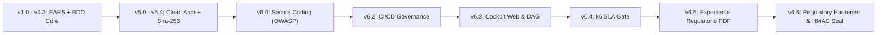
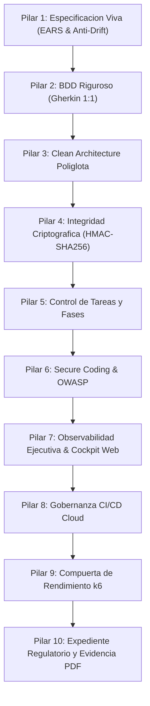
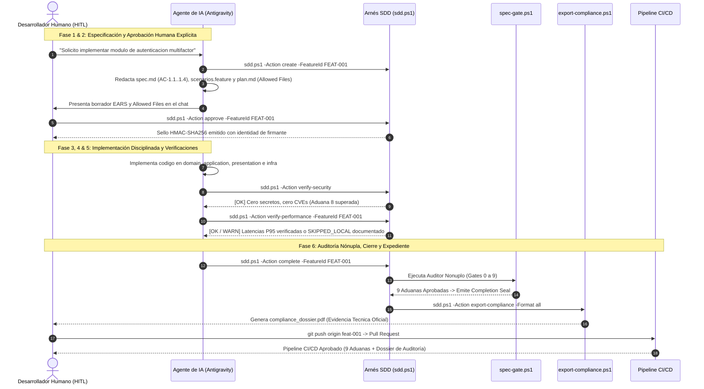

# LIBRO BLANCO Y DOCUMENTO MAESTRO: FRAMEWORK SDD v6.6

## Specification-Driven Development (Enterprise Regulatory Hardened & Compliance Audit Edition)

### Marco de Gobernanza Matemática, Arquitectura Limpia Políglota, Candado Criptográfico HMAC-SHA256, Ciberseguridad Defensiva, Resiliencia k6 y Soporte de Evidencia Regulatoria para el Desarrollo con Agentes de Inteligencia Artificial

> **Autor:** Salvador Velasco & Antigravity (Google DeepMind Team)<br>
> **Versión Oficial:** 6.6 (Regulatory & Compliance Hardened Edition)<br>
> **Fecha de Publicación:** Noviembre de 2026<br>
> **Clasificación:** Estándar Metodológico Corporativo y de Ingeniería de Software<br>
> **Estado:** Aprobado para Entornos Críticos, Alta Regulación y Auditorías Internacionales

---

## 1. Resumen Ejecutivo y Visión Estratégica

### 1.1. El Dilema del Desarrollo Asistido por Inteligencia Artificial

La adopción de modelos de lenguaje grande (LLMs) y agentes autónomos de codificación en entornos empresariales ha incrementado de manera sustancial la velocidad de generación de código. Sin embargo, en ausencia de barreras de contención formal, introduce riesgos críticos de gobernanza, deuda técnica y seguridad:

1. **Alucinaciones Funcionales y Desviación de Alcance (*Spec Drift*)**: Los agentes tienden a resolver problemas agregando dependencias innecesarias, alterando contratos de API existentes o modificando archivos no autorizados en el repositorio.
2. **Pruebas Falsas (*Fake Tests*)**: Es habitual que los agentes generen suites de pruebas complacientes (`assert true == true`, mocks triviales o aserciones vacías) para simular una cobertura del 100% sin validar la lógica de negocio.
3. **Erosión Arquitectónica y Código Espagueti**: Al carecer de visión global de largo plazo, los agentes rompen las capas de abstracción, inyectando llamadas directas a base de datos en controladores web o importando librerías de infraestructura en el dominio puro.
4. **Vulnerabilidades y Secretos Filtrados**: Generación inadvertida de credenciales hardcodeadas, inyecciones SQL/NoSQL y uso de paquetes de software con CVEs conocidos.
5. **Degradación de Desempeño y Latencia**: Algoritmos $O(N^2)$, consultas $N+1$ en bases de datos relacionales y serializaciones JSON ineficientes que aprueban pruebas unitarias pero colapsan bajo concurrencia.
6. **Fragilidad Regulatoria e Inconsistencias de Auditoría**: En sectores altamente regulados (Fintech, Salud, Farmacéutica, Gobierno y Defensa), el software sin trazabilidad matemática formal, sin firmas inmutables de aprobación humana (HITL) y sin expediente técnico auditable resulta inaceptable ante comités de certificación y auditorías externas.

### 1.2. El Paradigma SDD: "La Especificación Manda, el Código Obedece y la Criptografía Gobierna"

El **Specification-Driven Development (SDD v6.6)** resuelve de raíz estas vulnerabilidades mediante un principio arquitectónico inmutable: **el código no es el soberano; la especificación formal es la única fuente de verdad**.

Bajo el marco SDD v6.6, ningún agente de IA ni desarrollador humano puede escribir una sola línea de código ejecutable en `src/` sin antes haber redactado, clarificado y sellado criptográficamente una especificación funcional formal basada en sintaxis **EARS** (*Easy Approach to Requirements Syntax*), escenarios **BDD** (*Behavior-Driven Development*) y un plan técnico con lista explícita de archivos permitidos (*Allowed Files*).

Una vez aprobada por un ser humano responsable (HITL), la especificación se sella con un candado **HMAC-SHA256** utilizando una clave persistente del proyecto. Un arnés de software determinista (*The Harness*) audita de forma implacable que:
- El código implementado respete estrictamente los archivos declarados (*Allowed Files*), sin falsos positivos en herramientas del scaffold.
- Se preserve la pureza de las capas de Clean Architecture.
- Se superen análisis de ciberseguridad defensiva (OWASP / STRIDE).
- Se auditen umbrales de latencia $P_{95} \le 200\text{ ms}$ y resiliencia k6, transparentando el estado de ejecución real (`SKIPPED_LOCAL` en entornos de desarrollo sin k6).
- Se compile un expediente técnico auditable en PDF y HTML alineado formalmente con los requerimientos técnicos de ISO 27001, FDA 21 CFR Part 11, SOC 2 y HIPAA.

### 1.3. Evolución del Framework: De v1.0 a v6.6



- **SDD v1.0 - v4.3**: Introducción de EARS formal, escenarios Gherkin, plantillas estructuradas y control de fases básicas.
- **SDD v5.0 - v5.4**: Incorporación de Clean Architecture, aislamiento de capas, candados criptográficos (Approval y Completion Seals) y pre-commit hooks.
- **SDD v6.0 - v6.1**: Ciberseguridad Defensiva, modelado de amenazas STRIDE, escaneo de secretos (TruffleHog) y auditoría de CVEs (pip-audit / npm audit).
- **SDD v6.2**: Gobernanza de Integración Continua con pipelines en GitHub Actions y GitLab CI, y resúmenes automatizados de Pull Request.
- **SDD v6.3**: Observabilidad Ejecutiva con el Cockpit Web Dashboard interactivo y visor visual del grafo DAG de dependencias (TopoSort).
- **SDD v6.4**: Compuerta de Rendimiento y Resiliencia SLA (k6 Benchmark), elevando la verificación al Auditor Nónuplo (9 Hard Gates).
- **SDD v6.5**: Expediente Regulatorio y Compliance PDF (Pilar 10), compilador Chromium Headless y catálogo de 20 skills canónicas.
- **SDD v6.6 (Edición Actual - Hardened)**:
  - **Sello HMAC-SHA256 con Clave Criptográfica**: Implementación formal con clave persistente en `.specify/.sdd_key` o `$env:SDD_HMAC_KEY`.
  - **Inclusión Inmutable de `plan.md` en el Sello**: Sella conjuntamente `spec.md`, `scenarios.feature` y `plan.md`. Cualquier alteración de `Allowed Files` invalida el sello.
  - **Human-in-the-Loop Estricto**: Eliminación de auto-aprobación del agente. Registro auditable de identidad del firmante (`approved_by`, `approved_at`, `algorithm`).
  - **Paridad BDD 1:1 en Plantillas**: Inclusión de `@AC-1.4` para satisfacer todos los criterios de aceptación desde el scaffold inicial.
  - **Eliminación de Falsos Positivos en Gate 1**: Exclusión de artefactos generados por el framework (`tests/performance/k6_benchmark.js`).
  - **Hook PreToolUse Fail-Closed**: Denegación por defecto ante escrituras no autorizadas en `src/`.
  - **Sinceramiento de Gate 9 y Reportes de Rendimiento**: Estado real `SKIPPED_LOCAL` con advertencia cuando k6 no está en el PATH local.
  - **Soporte Nativo de Java (Maven/Gradle)**: Integración políglota completa en `Invoke-ConfigureStack`.
  - **Lenguaje Regulatorio Riguroso**: Sustitución de declaraciones absolutas por "Evidencia Técnica Auditable".
  - **Suite de Pruebas de Gobernanza con Pester 6**: Pruebas automatizadas de los controles de gobernanza (`tests/v66-governance.Tests.ps1`).

---

## 2. Los 10 Pilares Fundamentales de SDD v6.6



### 2.1. Pilar 1: Especificación Viva (EARS y Allowed Files)

Todo requisito debe ser formalizado en `specs/<feature>/spec.md` utilizando sintaxis EARS estricta:

- `[Ubiquitous]`: El sistema siempre deberá cumplir con la propiedad.
- `[Event-driven]`: **WHEN** [evento] **THE SYSTEM SHALL** [acción].
- `[State-driven]`: **WHILE** [estado] **THE SYSTEM SHALL** [acción].
- `[Optional]`: **WHERE** [condición opcional] **THE SYSTEM SHALL** [acción].
- `[Unwanted]`: **IF** [error o excepción] **THEN THE SYSTEM SHALL** [recuperación segura].

Adicionalmente, el documento `specs/<feature>/plan.md` define de forma obligatoria la sección `## Allowed Files`. Cualquier archivo creado o modificado fuera de esta lista provoca la detención inmediata del proceso de compilación y commit (Aduana 1).

### 2.2. Pilar 2: BDD Riguroso & Trazabilidad 1:1

Cada criterio de aceptación EARS `AC-x.x` debe mapearse exactamente contra un escenario ejecutable en `specs/<feature>/scenarios.feature` redactado en Gherkin (`Given-When-Then`), y a su vez contra una prueba unitaria o de aceptación. En SDD v6.6, la plantilla base garantiza paridad 1:1 inmediata (`@AC-1.1`, `@AC-1.2`, `@AC-1.3`, `@AC-1.4`), eliminando no-conformidades artificiales al inicio del proyecto.

### 2.3. Pilar 3: Clean Architecture Políglota

El código se organiza en cuatro capas concéntricas con regla de dependencia unidireccional estricta hacia el centro:

1. **Domain (`src/domain/`)**: Entidades puras de negocio y reglas corporativas. Cero librerías de infraestructura, frameworks web o bases de datos.
2. **Application (`src/application/`)**: Casos de uso, orquestación y contratos de interfaces (puertos).
3. **Presentation (`src/presentation/`)**: Controladores REST, UI, CLI o vistas. Desacoplada de detalles de infraestructura.
4. **Infrastructure (`src/infrastructure/`)**: Adaptadores para bases de datos, redes, sistemas de archivos y servicios cloud.

Soporta perfiles nativos para Python, TypeScript, C# (.NET), Go, Rust, Flutter (Dart) y Java (Maven/Gradle).

### 2.4. Pilar 4: Integridad Criptográfica Hardened (HMAC-SHA256)

El desarrollo asistido por IA exige inmutabilidad matemática verificable:

- **Algoritmo HMAC-SHA256**: Sustituye el hashing básico de versiones anteriores por un código de autenticación de mensajes basado en hash (**HMAC-SHA256**), empleando la clase `System.Security.Cryptography.HMACSHA256`.
- **Gestión de Llaves Criptográficas**:
  - Clave de 256 bits generada con `RandomNumberGenerator` y almacenada en `.specify\.sdd_key`.
  - Sobrescritura opcional mediante la variable de entorno `$env:SDD_HMAC_KEY` para integración con sistemas de gestión de secretos (KMS, HashiCorp Vault, Azure Key Vault).
- **Cobertura Tridocumental**: El sello de aprobación protege simultáneamente:
  $$\text{HMAC-SHA256}_{K}(\text{norm}(\text{spec.md}) \parallel \text{"---"} \parallel \text{norm}(\text{scenarios.feature}) \parallel \text{"---"} \parallel \text{norm}(\text{plan.md}))$$
  Si un agente o usuario altera `plan.md` para ampliar unilateralmente los `Allowed Files`, el sello se invalida de forma inmediata.
- **Atribución de Identidad HITL**: El registro de aprobación captura obligatoriamente:
  - Identidad del firmante: `git config user.name <user.email>` o cuenta del sistema operativo.
  - Marca de tiempo UTC (`yyyy-MM-ddTHH:mm:ssZ`).
  - Algoritmo: `HMAC-SHA256`.
  - Motivo de la aprobación.
  Registrado tanto en `feature_list.json` como en `CHECKPOINTS.md`.

### 2.5. Pilar 5: Control de Tareas y Fases Operativas

El progreso se desglosa en subtareas atómicas dentro de `specs/<feature>/tasks.md`. El arnés guía la ejecución a través de 6 fases secuenciales sin permitir saltos arbitrarios.

### 2.6. Pilar 6: Ciberseguridad Defensiva y Threat Modeling

Integración de modelado de amenazas **STRIDE** (*Spoofing, Tampering, Repudiation, Information Disclosure, Denial of Service, Elevation of Privilege*), escaneo automatizado de credenciales con **TruffleHog**, detección de patrones de inyección (SQL, Command, Path Traversal) y auditoría de vulnerabilidades en dependencias mediante `pip-audit`, `npm audit` o `mvn dependency-check` (Aduana 8).

### 2.7. Pilar 7: Observabilidad Ejecutiva & Cockpit Web

Panel interactivo HTML5 en tiempo real (`progress/sdd_dashboard.html`) servido mediante un servidor HTTP local en PowerShell (`sdd.ps1 -Action dashboard -Live`). Permite inspeccionar el backlog, la salud de las 9 compuertas y el grafo DAG de dependencias ordenado mediante clasificación topológica (*TopoSort*).

### 2.8. Pilar 8: Gobernanza de Integración Continua Cloud (CI/CD)

Workflows estandarizados para **GitHub Actions** (`.github/workflows/sdd-gate.yml`) y **GitLab CI** (`.gitlab-ci.yml`) que ejecutan de forma automática la auditoría de seguridad, higiene Markdown, pruebas BDD, compuerta k6 y compilación del expediente de evidencia regulatoria, emitiendo un reporte enriquecido de Pull Request (`harness/pr-summary.ps1`).

### 2.9. Pilar 9: Compuerta de Rendimiento y Resiliencia SLA (k6 Benchmark)

Asegura que el software cumpla umbrales de servicio críticos antes de su despliegue:
- Latencia en el percentil 95: $P_{95} \le 200\text{ ms}$.
- Latencia en el percentil 99: $P_{99} \le 500\text{ ms}$.
- Tasa de errores HTTP/red: $\text{Error Rate} = 0.0\%$.
- **Arquitectura Transparente (SDD v6.6)**: Si `k6` está instalado localmente, ejecuta la medición activa en vivo. Si no lo está, valida la sintaxis y los umbrales declarativos del script, pero reporta con total veracidad el estado `SKIPPED_LOCAL` con advertencia `WARN`, indicando que la certificación activa queda delegada a los runners de CI/CD.

### 2.10. Pilar 10: Expediente Regulatorio y Soporte de Evidencia PDF

Consolidación automatizada de toda la evidencia técnica, funcional, arquitectónica y de ciberseguridad en un **Dossier de Auditoría** en formato PDF nativo y HTML estructurado para soportar auditorías de ISO 27001, FDA 21 CFR Part 11, SOC 2, HIPAA y CMMI Nivel 5.

---

## 3. Topología Canónica del Repositorio SDD v6.6

```text
<RootProject>/
├── .agents/                      # Inteligencia Artificial y Extensiones de IDE
│   ├── hooks.json                # Definicion de Hooks (SessionStart, PreToolUse, PostToolUse)
│   └── skills/                   # Las 20 Skills Canonicas de SDD v6.6
│       ├── sdd-orchestrator/     # Skill #1: Orquestador general del ciclo SDD
│       ├── sdd-onboard/          # Skill #2: Onboarding e inicializacion de proyecto
│       ├── sdd-constitution/    # Skill #3: Guardián de reglas constitucionales
│       ├── sdd-specify/         # Skill #4: Redactor formal EARS
│       ├── sdd-clarify/         # Skill #5: Entrevistador y clarificador de ambigüedades
│       ├── sdd-ui-ux/           # Skill #6: Disenador de interfaz y accesibilidad
│       ├── sdd-design-system/   # Skill #7: Catalogo de tokens y estilos
│       ├── sdd-preview-design/  # Skill #8: Prototipador visual interactivo
│       ├── sdd-plan/            # Skill #9: Arquitecto Clean Arch y Allowed Files
│       ├── sdd-tasks/           # Skill #10: Desglosador de tareas atomicas
│       ├── sdd-implement/       # Skill #11: Desarrollador de codigo de produccion
│       ├── sdd-user-guide/      # Skill #12: Redactor de guias vivas de usuario
│       ├── sdd-validate/        # Skill #13: Auditor de calidad y 9 aduanas
│       ├── sdd-change-spec/     # Skill #14: Gestor de RFCs y cambios formales
│       ├── sdd-reverse-spec/    # Skill #15: Ingeniero inverso de sistemas legados
│       ├── sdd-secure-coding/   # Skill #16: Oficial de ciberseguridad y SAST
│       ├── sdd-dashboard/       # Skill #17: Gestor del Cockpit Web y DAG
│       ├── sdd-cicd/            # Skill #18: Ingeniero de pipelines CI/CD
│       ├── sdd-performance/     # Skill #19: Especialista en benchmarks k6 y SLAs
│       └── sdd-compliance/      # Skill #20: Oficial de cumplimiento y expediente PDF
├── .github/
│   └── workflows/
│       └── sdd-gate.yml          # Workflow GitHub Actions con las 9 Aduanas y PDF
├── .gitlab-ci.yml                # Pipeline GitLab CI con etapas completas
├── .specify/
│   ├── .sdd_key                  # Clave persistente HMAC-SHA256 (256-bit)
│   ├── harness-config.json       # Configuracion del proyecto, stack y Allowed Files
│   ├── memory/                   # Memoria constitucional persistente
│   │   └── constitution.md       # Principios inmutables del proyecto
│   ├── design-system/            # Tokens de color, espaciado y tipografia
│   └── templates/                # Plantillas estandarizadas EARS, BDD y planes
├── docs/                         # Guias de usuario vivas y matrices de trazabilidad
├── harness/                      # Arnés determinista de gobernanza y auditoria
│   ├── dashboard.ps1             # Servidor web local y Cockpit Dashboard
│   ├── export-compliance.ps1     # Generador de Expediente Regulatorio PDF/HTML
│   ├── hooks/                    # Scripts de hooks para el IDE (PreToolUse Fail-Closed)
│   ├── init.ps1                  # Configurador y gestor de dependencias
│   ├── pr-summary.ps1            # Generador de resumen de gobernanza para Pull Requests
│   ├── sdd.ps1                   # Comando CLI unificado del arnes (HITL Estricto)
│   ├── spec-gate.ps1             # Auditor Nonuplo (9 Hard Gates con Gate 0/4 HMAC)
│   ├── verify-performance.ps1    # Verificador de Rendimiento k6 (Estado real SKIPPED_LOCAL)
│   └── verify-security.ps1       # Verificador de Seguridad OWASP y SAST (Aduana 8)
├── progress/                     # Reportes generados, telemetria y dashboards
│   ├── compliance_dossier.html   # Expediente regulatorio en HTML (@media print)
│   ├── compliance_dossier.pdf    # Expediente de evidencia tecnica en PDF
│   ├── performance_report.json   # Metricas de latencia y estado real k6
│   ├── pr_summary.md             # Resumen auditado de Pull Request
│   └── sdd_dashboard.html        # Cockpit visual interactivo
├── specs/                        # Especificaciones de funcionalidades
│   └── <feature_id>/
│       ├── spec.md               # Requisitos formales EARS (AC-1.1 a AC-1.4)
│       ├── scenarios.feature     # Escenarios Gherkin 1:1 (@AC-1.1 a @AC-1.4)
│       ├── plan.md               # Plan arquitectonico y Allowed Files (sellado en HMAC)
│       └── tasks.md              # Lista de tareas secuenciales [ ] / [x]
├── src/                          # Codigo fuente (Clean Architecture)
│   ├── domain/                   # Capa 1: Entidades puras y reglas de negocio
│   ├── application/              # Capa 2: Casos de uso y puertos
│   ├── presentation/             # Capa 3: Controladores, vistas y APIs
│   └── infrastructure/           # Capa 4: Adaptadores, persistencia y red
├── tests/
│   ├── unit/                     # Pruebas unitarias
│   ├── acceptance/               # Pruebas de aceptacion BDD
│   ├── performance/              # Benchmarks de carga k6 (k6_benchmark.js)
│   └── v66-governance.Tests.ps1  # Suite de pruebas Pester 6 de controles de gobernanza
├── CHECKPOINTS.md                # Bitacora inmutable de firmas criptograficas e identidad
└── feature_list.json             # Backlog formal con estados, hashes HMAC e identidad
```

---

## 4. El Ciclo de Vida Operativo de 6 Fases (HITL Estricto)



### Regla Fundamental Human-in-the-Loop (HITL) en SDD v6.6:

> [!IMPORTANT]
> **Prohibición de Auto-Aprobación del Agente:**
> Queda terminantemente prohibido que un agente o subagente de IA invoque internamente `sdd.ps1 -Action approve` sin autorización humana expresa en el diálogo.
> La aprobación formal de especificaciones requiere la confirmación explícita del desarrollador y registra de forma indeleble en la bitácora criptográfica el nombre, correo electrónico y fecha UTC del firmante.

---

## 5. El Auditor Nónuplo Reforzado: Las 9 Hard Gates

El script `harness/spec-gate.ps1` actúa como aduana estricta de control de calidad. Si una sola de las compuertas no cumple sus condiciones de aprobación, el proceso se interrumpe con código de error 1:

| Aduana | Nombre de Compuerta | Tipo de Verificación | Condición de Aprobación en SDD v6.6 |
| :--- | :--- | :--- | :--- |
| **Gate 0 / 4** | **Candado HMAC-SHA256** | Integridad Criptográfica | Verificación de que el hash HMAC-SHA256 de `spec.md`, `scenarios.feature` y `plan.md` coincide exactamente con el sello de aprobación registrado. Cualquier alteración de `plan.md` bloquea la aduana. |
| **Gate 1** | **Allowed Files & Anti-Drift** | Integridad de Repositorio | Solo archivos declarados en `plan.md` fueron modificados en el workspace y en commits de Git. Se excluyen falsos positivos de archivos de scaffolding (`tests/performance/k6_benchmark.js`). |
| **Gate 2** | **Clean Architecture Políglota** | Pureza Arquitectónica | Capa Dominio con 0 dependencias externas; Presentación desacoplada de Infraestructura. Compatible con Python, TS, .NET, Go, Rust y Java. |
| **Gate 3** | **Dependencias Autorizadas** | Control de Cadena de Suministro | 100% de importaciones externas corresponden a librerías explícitamente declaradas en `plan.md` y en el manifiesto de dependencias (`requirements.txt`, `package.json`, `pom.xml`, etc.). |
| **Gate 4** | **Cobertura BDD 1:1** | Trazabilidad Funcional | Cada criterio de aceptación EARS `AC-x.x` tiene correspondencia biunívoca con escenarios Gherkin y pruebas ejecutables (incluyendo `@AC-1.4`). |
| **Gate 5** | **Completitud de Tareas** | Progreso Estructurado | Todas las tareas de `tasks.md` están marcadas `[x]` sin elementos pendientes ni ambiguos. |
| **Gate 6** | **Guía de Usuario Viva** | Documentación de Entrega | `docs/user_guide_<feature>.md` existe, incluye ejemplos prácticos y cumple las reglas de markdownlint. |
| **Gate 7** | **Candado Inmutable Completion** | Sellado de Cierre | Hash criptográfico definitivo registrado en `feature_list.json` y archivado en `CHECKPOINTS.md`. |
| **Gate 8** | **Seguridad OWASP & Secret Scan** | Ciberseguridad Defensiva | Cero credenciales hardcodeadas, cero inyecciones SQL/Command y 0 CVEs High/Critical en dependencias. |
| **Gate 9** | **Performance & SLA Gate (k6)** | Rendimiento y Resiliencia | Latencia $P_{95} \le 200\text{ ms}$, $P_{99} \le 500\text{ ms}$ y tasa de fallos $= 0.0\%$. Si k6 no está en host local, emite `WARN` y estado `SKIPPED_LOCAL` para resolución en CI/CD. |

---

## 6. Soporte de Evidencia y Alineación Regulatoria (Pilar 10)

### 6.1. Marco Conceptual: Evidencia Técnica Determinista vs. Certificación Institucional

> [!NOTE]
> **Alineación de Lenguaje Regulatorio:**
> El framework SDD v6.6 no constituye por sí mismo una entidad certificadora, ni reemplaza las auditorías formales conducidas por organismos acreditados (IRCA, FDA, AICPA, etc.).
> La función del framework es generar **evidencia técnica determinista, estructurada e inmutable**, aportando la cadena de custodia, la trazabilidad bidireccional y los controles matemáticos requeridos para satisfacer los requisitos técnicos de las normas internacionales más exigentes.

### 6.2. Mapeo de Controles Técnicos

| Estándar Internacional | Cláusula / Control | Evidencia y Mecanismo en SDD v6.6 | Estado de Evidencia |
| :--- | :--- | :--- | :--- |
| **ISO/IEC 27001:2022** | A.8.25 (Ciclo de Vida de Desarrollo Seguro) | Aduanas 1, 2, 3 y 8 en `spec-gate.ps1`. Reglas Clean Architecture y escaneo de secretos. | Evidencia Estructurada |
| **ISO/IEC 27001:2022** | A.8.32 (Gestión de Cambios) | Sellos HMAC-SHA256, `plan.md` inmutable y bitácora en `CHECKPOINTS.md`. | Evidencia Estructurada |
| **FDA 21 CFR Part 11** | Sec. 11.10 (Controles para Sistemas Cerrados) | Firmas electrónicas HMAC-SHA256 con identidad del aprobador (`approved_by`) y marca temporal UTC. | Evidencia Estructurada |
| **FDA 21 CFR Part 11** | Sec. 11.50 (Manifestaciones de Firma) | Registro explícito de nombre del firmante, fecha/hora y motivo de aprobación. | Evidencia Estructurada |
| **SOC 2 Type II** | Common Criteria 6.8 / 7.1 (Integridad y Prevención) | Aislamiento de capas, pre-commit hooks y pre-tool-enforce fail-closed para `src/`. | Evidencia Estructurada |
| **HIPAA Security Rule** | 45 CFR § 164.312(b) (Controles de Auditoría) | Bitácora de transiciones y hashes en `CHECKPOINTS.md` y `feature_list.json`. | Evidencia Estructurada |
| **CMMI Nivel 5** | QPM / CAR (Gestión Cuantitativa y Causal) | Compuerta de rendimiento k6 ($P_{95} \le 200\text{ ms}$, error rate 0.0%) con trazabilidad en CI/CD. | Evidencia Estructurada |

---

## 7. Catálogo Canónico de las 20 Skills y Hooks Nativos

### 7.1. Los 3 Hooks Nativos del IDE (`.agents/hooks.json`)

1. **`SessionStart` (`harness/hooks/session-start.ps1`)**:
   Al iniciar la sesión en Antigravity IDE, detecta el estado del repositorio. Si el backlog está vacío, activa inmediatamente la entrevista guiada de onboarding (`sdd-onboard`). Si hay una funcionalidad activa, inyecta el estado y el comando siguiente recomendado.
2. **`PreToolUse` (`harness/hooks/pre-tool-enforce.ps1`) [Fail-Closed]**:
   Intercepta cualquier llamada a herramientas de edición de archivos. Si el archivo destino se encuentra en `src/`:
   - Verifica que la funcionalidad activa posea un sello HMAC-SHA256 válido.
   - Verifica que `plan.md` exista y no haya sido alterado.
   - Si no hay aprobación o si se detecta alteración, emite `decision: "deny"`, bloqueando físicamente la escritura.
3. **`PostToolUse` (`harness/hooks/post-tool-check.ps1`)**:
   Tras cada edición de código, escanea en segundo plano que no se hayan introducido violaciones de importación de infraestructura en la capa de dominio o aplicación.

### 7.2. Catálogo de Skills Canónicas

| # | Skill Canónica | Rol Operativo | Responsabilidades Principales |
| :--- | :--- | :--- | :--- |
| 1 | `sdd-orchestrator` | Director de Orquesta SDD | Guía el ciclo de vida, transiciones de estado y derivación de agentes. |
| 2 | `sdd-onboard` | Inicializador de Proyecto | Configura el entorno, detecta el stack y presenta el backlog inicial. |
| 3 | `sdd-constitution` | Guardián Constitucional | Aplica los principios rectores inmutables del proyecto. |
| 4 | `sdd-specify` | Analista de Requisitos | Redacta `spec.md` con sintaxis formal EARS (AC-1.1 a AC-1.4). |
| 5 | `sdd-clarify` | Validador de Requisitos | Resuelve ambigüedades mediante entrevistas interactivas. |
| 6 | `sdd-ui-ux` | Diseñador de Interfaces | Modela la experiencia de usuario y arquitectura de información. |
| 7 | `sdd-design-system` | Gestor del Sistema de Diseño | Define tokens de diseño, paletas y tipografías consistentes. |
| 8 | `sdd-preview-design` | Visualizador Visual | Genera wireframes interactivos en HTML para validación humana. |
| 9 | `sdd-plan` | Arquitecto de Software | Diseña `plan.md`, capas Clean Architecture y `Allowed Files`. |
| 10 | `sdd-tasks` | Planificador de Tareas | Desglosa la implementación en subtareas atómicas en `tasks.md`. |
| 11 | `sdd-implement` | Desarrollador Principal | Escribe el código fuente en estricta conformidad con `Allowed Files`. |
| 12 | `sdd-user-guide` | Documentador Técnico | Redacta la guía viva de usuario en `docs/user_guide_<feature>.md`. |
| 13 | `sdd-validate` | Auditor de Calidad | Ejecuta `spec-gate.ps1` y valida las 9 aduanas obligatorias. |
| 14 | `sdd-change-spec` | Ingeniero de Cambios | Controla la evolución de especificaciones mediante RFC estructurado. |
| 15 | `sdd-reverse-spec` | Ingeniero Inverso | Reconstruye especificaciones EARS a partir de bases de código legadas. |
| 16 | `sdd-secure-coding` | Oficial de Seguridad | Ejecuta SAST, escaneo de secretos y modelado de amenazas STRIDE. |
| 17 | `sdd-dashboard` | Gestor del Cockpit Web | Actualiza el panel interactivo y servidor DAG local en tiempo real. |
| 18 | `sdd-cicd` | Ingeniero de Integración | Configura y mantiene pipelines CI/CD en GitHub Actions y GitLab CI. |
| 19 | `sdd-performance` | Ingeniero de SLAs y Carga | Modela benchmarks k6, audita latencias P95/P99 y compuerta k6. |
| 20 | `sdd-compliance` | Oficial de Cumplimiento | Compila el expediente de evidencia técnica en PDF/HTML. |

---

## 8. Compatibilidad Políglota

| Lenguaje / Stack | Manifiesto | Directorio Fuentes | Directorio Pruebas | Comando Test | Comando Compilación / Tipado |
| :--- | :--- | :--- | :--- | :--- | :--- |
| **Python** | `requirements.txt` | `src/` | `tests/` | `pytest` | `mypy src` |
| **TypeScript** | `package.json` | `src/` | `tests/` | `npx vitest run` | `npx tsc --noEmit` |
| **C# (.NET)** | `*.csproj` | `src/` | `tests/` | `dotnet test` | `dotnet build --no-incremental` |
| **Go** | `go.mod` | `src/` | `tests/` | `go test ./...` | `go vet ./...` |
| **Rust** | `Cargo.toml` | `src/` | `tests/` | `cargo test` | `cargo check` |
| **Flutter / Dart** | `pubspec.yaml` | `lib/` | `test/` | `flutter test` | `flutter analyze` |
| **Java (Maven)** | `pom.xml` | `src/main/java` | `src/test/java` | `mvn test` | `mvn compile -q` |

---

## 9. Manual de Operaciones y Referencia de Comandos (`harness/sdd.ps1`)

| Comando | Parámetros Opcionales | Descripción Operativa en SDD v6.6 |
| :--- | :--- | :--- |
| `.\harness\sdd.ps1 -Action status` | Ninguno | Muestra el estado del backlog, funcionalidades, firmas HMAC y salud del arnés. |
| `.\harness\sdd.ps1 -Action create` | `-FeatureId <id> -FeatureName <str>` | Inicializa una nueva funcionalidad con plantillas EARS y BDD (AC-1.1 a AC-1.4). |
| `.\harness\sdd.ps1 -Action approve` | `-FeatureId <id> [-Approver <str>] [-Reason <str>] [-Force]` | Emite el sello **HMAC-SHA256** protegiendo `spec.md`, `scenarios.feature` y `plan.md`. Registra la identidad del firmante humano (HITL). |
| `.\harness\sdd.ps1 -Action configure-stack` | `-Stack <preset>` | Configura el stack tecnológico (`python`, `typescript`, `csharp`, `golang`, `rust`, `flutter`, `java`). |
| `.\harness\sdd.ps1 -Action verify-security` | Ninguno | Ejecuta escaneo de secretos y auditoría SAST contra OWASP Top 10 y STRIDE. |
| `.\harness\sdd.ps1 -Action verify-performance` | `-FeatureId <id> [-Vus <int>] [-Duration <str>]` | Ejecuta benchmark k6 si está disponible, o emite estado `SKIPPED_LOCAL` transparente. |
| `.\harness\sdd.ps1 -Action complete` | `-FeatureId <id>` | Ejecuta el Auditor Nónuplo (9 Gates) y emite el **Completion Seal**. |
| `.\harness\sdd.ps1 -Action export-compliance` | `[-Format pdf\|html\|md\|all] [-Open]` | Compila el Expediente de Evidencia Técnica oficial en PDF y HTML. |
| `.\harness\sdd.ps1 -Action dashboard` | `[-NoBrowser] [-Live] [-Port <int>]` | Genera o inicia el Cockpit Dashboard interactivo con visor DAG y servidor local. |
| `.\harness\sdd.ps1 -Action init-cicd` | Ninguno | Inicializa o actualiza los pipelines de GitHub Actions y GitLab CI. |
| `.\harness\sdd.ps1 -Action pr-summary` | `[-OutputFile <path>]` | Genera el informe consolidado de Pull Request con el checklist de 9 Aduanas. |
| `.\harness\sdd.ps1 -Action fix-markdown` | Ninguno | Aplica corrección automática para cumplimiento de reglas de markdownlint. |

---

## 10. Conclusiones y Beneficios Estratégicos

El **Framework SDD v6.6** eleva el estándar de la ingeniería de software asistida por inteligencia artificial, transformando el código generado en un producto auditable, reproducible y protegido criptográficamente.

### Beneficios Estratégicos Clave:
1. **Inmutabilidad Criptográfica Real**: Sellado HMAC-SHA256 de especificaciones y planes de implementación que impide el Spec Drift y la alteración inadvertida de archivos permitidos.
2. **Gobernanza Human-in-the-Loop No Repudiable**: Registro de identidad formal del aprobador humano y prohibición total de auto-aprobación del agente.
3. **Paridad BDD Determinista**: Cobertura completa 1:1 desde el primer minuto del ciclo de vida.
4. **Cero Falsos Positivos**: Compuertas precisas que no confunden herramientas del framework con código de producción.
5. **Transparencia en Métricas de Rendimiento**: Diagnóstico verídico de SLAs k6 adaptado tanto a estaciones de trabajo locales como a runners de CI/CD.
6. **Soporte de Evidencia Regulatoria de Clase Corporativa**: Expedientes PDF vectoriales listos para auditorías internacionales de ISO 27001, FDA 21 CFR Part 11, SOC 2 y HIPAA.
