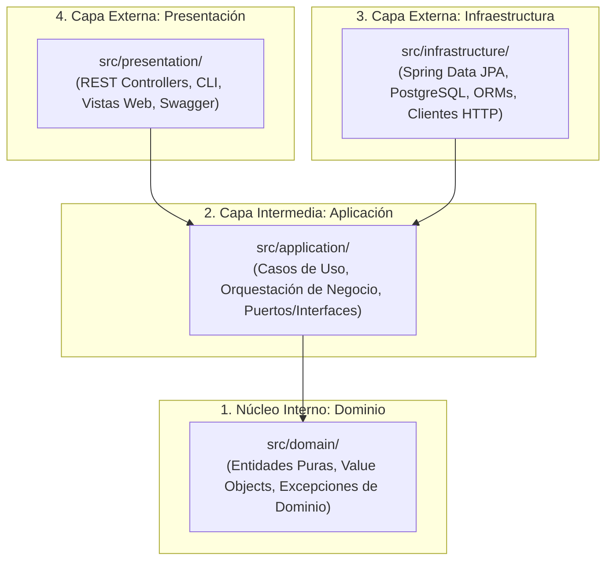
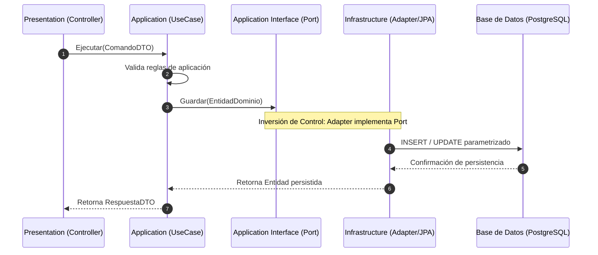
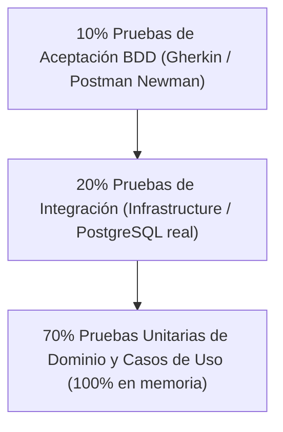

# Guía Maestra: Clean Architecture Políglota en el Framework SDD v6.0

## Marco Arquitectónico, Principios de Diseño, Mapeo Multilenguaje y Gobernanza Agéntica

---

## 1. Resumen Ejecutivo y Fundamentos

En el desarrollo de software moderno —y particularmente en entornos gobernados por Inteligencia Artificial asistida (SDD v6.0)—, el acoplamiento prematuro entre la lógica de negocio y las herramientas tecnológicas (bases de datos, frameworks web, clientes HTTP o bibliotecas de terceros) representa la principal causa de deuda técnica, fragilidad ante migraciones y vulnerabilidades de seguridad.

La **Clean Architecture Políglota** es la materialización de los principios de Arquitectura Limpia (formulados por Robert C. Martin "Uncle Bob"), Arquitectura Hexagonal (*Ports & Adapters* de Alistair Cockburn) y Arquitectura Cebolla (*Onion Architecture* de Jeffrey Palermo), estandarizados para operar de forma unificada e intercambiable a través de **múltiples lenguajes de programación y stacks tecnológicos**.

### Premisa Fundamental

> **«Las reglas del negocio son inmutables frente al medio de entrega»**:
> Una regla que calcula una bonificación médica, valida un RFC o descuenta inventario debe ejecutarse exactamente igual si se consume desde un controlador REST en Spring Boot, un endpoint en FastAPI, una interfaz web en Angular, un CLI en Go o una tarea por lotes en consola. El núcleo de negocio jamás debe conocer detalles de infraestructura.

---

## 2. Los Cuatro Círculos Concéntricos y la Regla de Dependencia

El principio rector de la Clean Architecture establece que **las dependencias de código fuente solo pueden apuntar hacia adentro**:



### Detalle Canónico de Cada Capa

| Capa | Ubicación Física | Qué CONTIENE | Qué TIENE ESTRICTAMENTE PROHIBIDO |
| :--- | :--- | :--- | :--- |
| **1. Dominio** | `src/domain/` | Entidades puras, *Value Objects*, excepciones de negocio, reglas matemáticas e invariantes. | Importar frameworks (Spring, FastAPI, React), librerías de persistencia (JPA, SQLAlchemy), SQL o dependencias externas. |
| **2. Aplicación** | `src/application/` | Casos de uso (interactores), DTOs internos, interfaces de salida (**Puertos** como repositorios o clientes de notificación). | Conocer si la base de datos es PostgreSQL, MongoDB o memoria; conocer detalles HTTP o clases de UI. |
| **3. Infraestructura** | `src/infrastructure/` | Implementación concreta de los puertos (**Adaptadores**): repositorios JPA/SQL, drivers de BD, clientes REST, colas de mensajería. | Contener reglas de validación de negocio; modificar el dominio sin pasar por los casos de uso. |
| **4. Presentación** | `src/presentation/` | Controladores HTTP, contratos OpenAPI/Swagger, vistas frontend (Angular/React), consolas CLI. | Importar la infraestructura directamente; ejecutar consultas SQL o acceder a bases de datos sin invocar a `application/`. |

---

## 3. El Principio de Inversión de Dependencias (DIP) y el Patrón Ports & Adapters

Para que la capa de infraestructura pueda guardar datos sin que la capa de aplicación dependa de ella, se utiliza el **Principio de Inversión de Dependencias (DIP)**:



1. La capa de **Aplicación** define el contrato (**Puerto**): `PacienteRepository.java` o `paciente_repository.py`.
2. La capa de **Infraestructura** implementa dicho contrato (**Adaptador**): `PostgreSqlPacienteRepository.java` o `sql_paciente_repository.py`.
3. En tiempo de ejecución, el contenedor de inyección de dependencias ensambla el adaptador concreto, manteniendo el núcleo 100% aislado.

---

## 4. Comparativa Práctica Políglota: Mismo Caso de Uso en 4 Stacks

A continuación se ilustra la implementación canónica del caso de uso **"Registrar Paciente"** respetando la Clean Architecture en 4 stacks tecnológicos distintos:

### Caso A: Java 21 + Spring Boot 3 + PostgreSQL 17

#### 1. Dominio (`src/main/java/com/hospital/domain/model/Paciente.java`)

```java
package com.hospital.domain.model;

import java.util.Objects;

// Java 21 Record inmutable puro sin dependencias de Spring ni JPA
public record Paciente(String id, String nombre, String rfc, String email) {
    public Paciente {
        Objects.requireNonNull(id, "El identificador no puede ser nulo");
        Objects.requireNonNull(nombre, "El nombre es obligatorio");
        if (!rfc.matches("^[A-ZÑ&]{3,4}\\d{6}[A-V1-9][A-Z1-9][0-9A]$")) {
            throw new IllegalArgumentException("El formato del RFC es inválido: " + rfc);
        }
    }
}
```

#### 2. Aplicación - Puerto (`src/main/java/com/hospital/application/port/out/PacienteRepositoryPort.java`)

```java
package com.hospital.application.port.out;

import com.hospital.domain.model.Paciente;
import java.util.Optional;

public interface PacienteRepositoryPort {
    Paciente guardar(Paciente paciente);
    Optional<Paciente> buscarPorRfc(String rfc);
}
```

#### 3. Aplicación - Caso de Uso (`src/main/java/com/hospital/application/service/RegistrarPacienteService.java`)

```java
package com.hospital.application.service;

import com.hospital.application.port.out.PacienteRepositoryPort;
import com.hospital.domain.model.Paciente;

public class RegistrarPacienteService {
    private final PacienteRepositoryPort pacienteRepository;

    public RegistrarPacienteService(PacienteRepositoryPort pacienteRepository) {
        this.pacienteRepository = pacienteRepository;
    }

    public Paciente ejecutar(String id, String nombre, String rfc, String email) {
        if (pacienteRepository.buscarPorRfc(rfc).isPresent()) {
            throw new IllegalStateException("Ya existe un paciente registrado con el RFC: " + rfc);
        }
        Paciente nuevo = new Paciente(id, nombre, rfc, email);
        return pacienteRepository.guardar(nuevo);
    }
}
```

#### 4. Infraestructura (`src/main/java/com/hospital/infrastructure/adapter/out/persistence/PacientePersistenceAdapter.java`)

```java
package com.hospital.infrastructure.adapter.out.persistence;

import com.hospital.application.port.out.PacienteRepositoryPort;
import com.hospital.domain.model.Paciente;
import org.springframework.stereotype.Component;
import java.util.Optional;

@Component
public class PacientePersistenceAdapter implements PacienteRepositoryPort {
    private final SpringDataPacienteRepository jpaRepository;

    public PacientePersistenceAdapter(SpringDataPacienteRepository jpaRepository) {
        this.jpaRepository = jpaRepository;
    }

    @Override
    public Paciente guardar(Paciente paciente) {
        PacienteJpaEntity entity = new PacienteJpaEntity(paciente.id(), paciente.nombre(), paciente.rfc(), paciente.email());
        PacienteJpaEntity saved = jpaRepository.save(entity);
        return new Paciente(saved.getId(), saved.getNombre(), saved.getRfc(), saved.getEmail());
    }

    @Override
    public Optional<Paciente> buscarPorRfc(String rfc) {
        return jpaRepository.findByRfc(rfc)
            .map(e -> new Paciente(e.getId(), e.getNombre(), e.getRfc(), e.getEmail()));
    }
}
```

---

### Caso B: Python 3.11+ / FastAPI / SQLAlchemy

#### 1. Dominio (`src/domain/paciente.py`)

```python
from dataclasses import dataclass
import re

@dataclass(frozen=True)
class Paciente:
    id: str
    nombre: str
    rfc: str
    email: str

    def __post_init__(self) -> None:
        if not self.nombre.strip():
            raise ValueError("El nombre no puede estar vacío.")
        patron_rfc = r"^[A-ZÑ&]{3,4}\d{6}[A-V1-9][A-Z1-9][0-9A]$"
        if not re.match(patron_rfc, self.rfc):
            raise ValueError(f"Formato de RFC inválido: {self.rfc}")
```

#### 2. Aplicación - Puerto (`src/application/ports.py`)

```python
from typing import Protocol, Optional
from src.domain.paciente import Paciente

class PacienteRepositoryPort(Protocol):
    def guardar(self, paciente: Paciente) -> Paciente: ...
    def buscar_por_rfc(self, rfc: str) -> Optional[Paciente]: ...
```

#### 3. Aplicación - Caso de Uso (`src/application/registrar_paciente.py`)

```python
from typing import Optional
from src.domain.paciente import Paciente
from src.application.ports import PacienteRepositoryPort

class RegistrarPacienteUseCase:
    def __init__(self, repo: PacienteRepositoryPort) -> None:
        self.repo = repo

    def ejecutar(self, id: str, nombre: str, rfc: str, email: str) -> Paciente:
        existente = self.repo.buscar_por_rfc(rfc)
        if existente is not None:
            raise ValueError(f"Ya existe un paciente con el RFC: {rfc}")
        nuevo = Paciente(id=id, nombre=nombre, rfc=rfc, email=email)
        return self.repo.guardar(nuevo)
```

---

### Caso C: TypeScript / Node / Express / Prisma

#### 1. Dominio (`src/domain/Paciente.ts`)

```typescript
export interface PacienteProps {
  readonly id: string;
  readonly nombre: string;
  readonly rfc: string;
  readonly email: string;
}

export class Paciente {
  private constructor(private readonly props: PacienteProps) {
    if (!props.nombre.trim()) throw new Error("El nombre no puede estar vacío.");
    const rfcRegex = /^[A-ZÑ&]{3,4}\d{6}[A-V1-9][A-Z1-9][0-9A]$/;
    if (!rfcRegex.test(props.rfc)) throw new Error(`RFC inválido: ${props.rfc}`);
  }

  public static crear(props: PacienteProps): Paciente {
    return new Paciente(props);
  }

  public get id(): string { return this.props.id; }
  public get nombre(): string { return this.props.nombre; }
  public get rfc(): string { return this.props.rfc; }
  public get email(): string { return this.props.email; }
}
```

#### 2. Aplicación - Puerto (`src/application/IPacienteRepository.ts`)

```typescript
import { Paciente } from "../domain/Paciente";

export interface IPacienteRepository {
  guardar(paciente: Paciente): Promise<Paciente>;
  buscarPorRfc(rfc: string): Promise<Paciente | null>;
}
```

---

### Caso D: C# .NET 8 / ASP.NET Core / Entity Framework Core

#### 1. Dominio (`src/Domain/Entities/Paciente.cs`)

```csharp
namespace Hospital.Domain.Entities;

public sealed record Paciente
{
    public string Id { get; }
    public string Nombre { get; }
    public string Rfc { get; }
    public string Email { get; }

    public Paciente(string id, string nombre, string rfc, string email)
    {
        ArgumentException.ThrowIfNullOrWhiteSpace(id);
        ArgumentException.ThrowIfNullOrWhiteSpace(nombre);
        if (!System.Text.RegularExpressions.Regex.IsMatch(rfc, @"^[A-ZÑ&]{3,4}\d{6}[A-V1-9][A-Z1-9][0-9A]$"))
        {
            throw new ArgumentException($"RFC con formato inválido: {rfc}");
        }

        Id = id;
        Nombre = nombre;
        Rfc = rfc;
        Email = email;
    }
}
```

#### 2. Aplicación - Puerto (`src/Application/Ports/IPacienteRepository.cs`)

```csharp
namespace Hospital.Application.Ports;

using Hospital.Domain.Entities;

public interface IPacienteRepository
{
    Task<Paciente> GuardarAsync(Paciente paciente, CancellationToken ct = default);
    Task<Paciente?> BuscarPorRfcAsync(string rfc, CancellationToken ct = default);
}
```

---

## 5. Matriz de Mapeo y Equivalencias Políglotas

La siguiente tabla resume la correlación de conceptos arquitectónicos en los principales entornos de ejecución:

| Concepto Arquitectónico | Java 21 / Spring | Python / FastAPI | TypeScript / Node | C# .NET 8 | Go 1.22+ |
| :--- | :--- | :--- | :--- | :--- | :--- |
| **Entidad Inmutable** | `record` puro | `@dataclass(frozen=True)` | `readonly class` | `sealed record` | `type struct` no exportado |
| **Puerto de Salida** | `interface` pública | `typing.Protocol` / `ABC` | `interface` exportada | `interface` pública | `type Interface interface` |
| **Inyección de Dependencias** | Spring `@Autowired` / Constructor | FastAPI `Depends()` | Inversión manual / TSyringe | Microsoft `IServiceCollection` | Ensamblado manual en `main.go` |
| **Validación de Capas** | ArchUnit / AST Checker | mypy + AST import checker | Dependency Cruiser / ESLint | NetArchTest / Roslyn | `go vet` + AST checker |

---

## 6. Por qué la Clean Architecture es Crítica en el Desarrollo con Agentes de IA

Cuando un desarrollador interactúa con un modelo de lenguaje de Inteligencia Artificial (LLM) sin barreras arquitectónicas estrictas, el agente suele incurrir en patrones degradantes:

1. **Contaminación Cruzada (*Leaky Abstractions*):** El agente inyecta decoradores HTTP o anotaciones de base de datos dentro de clases de dominio.
2. **Consultas SQL en Vistas (*Spaghetti Code*):** El agente escribe consultas de base de datos directas o lógica de persistencia dentro de componentes visuales (React/Angular/CLI).
3. **Alucinación de Dependencias Externas:** El agente importa paquetes no autorizados para resolver problemas triviales de lógica interna.
4. **Acoplamiento de Pruebas:** Los tests unitarios no pueden ejecutarse sin levantar un contenedor Docker con una base de datos o simular servidores HTTP enteros.

### La Solución en SDD v6.0: Perímetro Cerrado

Bajo el framework SDD v6.0, el modelo opera en una caja de arena gobernada por perfiles:

- **En `domain/`:** Solo tiene acceso a lógica pura y tipos nativos. Cero frameworks.
- **En `application/`:** Solo orquesta flujos y manipula puertos abstractos.
- **En `infrastructure/`:** Implementa los puertos concretos conectando librerías aprobadas en `plan.md`.
- **En `presentation/`:** Traduce DTOs hacia contratos de usuario o vistas accesibles.

---

## 7. Gobernanza Automatizada y Hard Gates en el Arnés SDD

En SDD v6.0, la Clean Architecture no es un acuerdo verbal: **es un candado físico validado por código**.

### Aduana 3 de `spec-gate.ps1`: Pureza de Arquitectura Limpia

Antes de que cualquier funcionalidad pase a estado `DONE`, el script [`spec-gate.ps1`](file:///D:/.antigravity/sdd-projects/harness/spec-gate.ps1) ejecuta la compuerta dura de arquitectura:

1. **Análisis de Árbol de Sintaxis Abstracta (AST):** Analiza cada instrucción `import`, `using` o `require` de los archivos modificados.
2. **Lista Blanca de Dependencias:** Compara los paquetes importados contra la sección `## 4. Allowed Dependencies` aprobada en `plan.md`.
3. **Regla de No Retorno:** Si un archivo dentro de `src/domain/` importa paquetes de `infrastructure/`, `presentation/` o librerías externas de base de datos, **el arnés bloquea inmediatamente el cierre de la funcionalidad**.

### Hook `PreToolUse` y Hook `PostToolUse`

En Google Antigravity IDE:

- [`.agents/hooks.json`](file:///D:/.antigravity/sdd-projects/.agents/hooks.json) activa `pre-tool-enforce.ps1` antes de escribir un archivo para comprobar que pertenezca a la lista blanca de `Allowed Files`.
- `post-tool-check.ps1` examina de inmediato si la última edición del agente rompió la regla de dependencia hacia adentro, alertando en tiempo real al operador humano.

---

## 8. Estrategia de Pruebas: La Pirámide Desacoplada

La Clean Architecture Políglota habilita una pirámide de pruebas sumamente rápida y económica:



- **Pruebas Unitarias (70%):** Validan entidades y casos de uso en microsegundos utilizando implementaciones en memoria de los repositorios (*in-memory fakes*). Cero latencia de red.
- **Pruebas de Integración (20%):** Validan que los adaptadores de infraestructura (`PostgreSqlPacienteRepository`) ejecuten consultas SQL correctas contra bases de datos reales o contenedores de prueba.
- **Pruebas de Aceptación BDD (10%):** Prueban el sistema completo desde la capa de presentación consumiendo endpoints REST mediante colecciones automatizadas (Newman/Postman o Pytest-BDD), garantizando que cada `@AC-x.x` de la especificación se cumpla formalmente.

---

## 9. Conclusión y Beneficios Corporativos

Adoptar **Clean Architecture Políglota** en el framework SDD v6.0 garantiza:

1. **Portabilidad Total:** La lógica de negocio puede migrarse de Python a Go o de Java a C# conservando exactamente los mismos modelos y reglas de aplicación.
2. **Independencia Tecnológica:** La base de datos, el framework web o la nube son simples detalles técnicos que pueden intercambiarse sin alterar una sola línea de lógica del negocio.
3. **Desarrollo Agéntico Confiable:** Los agentes de IA producen código ordenado, testeable y modular, blindando la solución corporativa contra la degradación arquitectónica a largo plazo.
