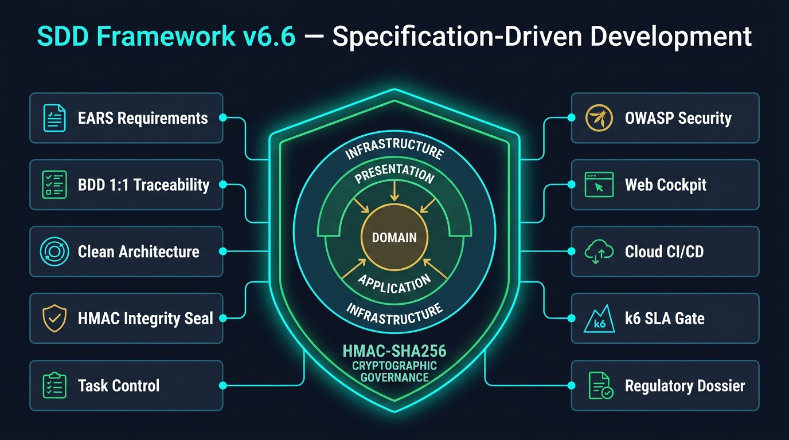
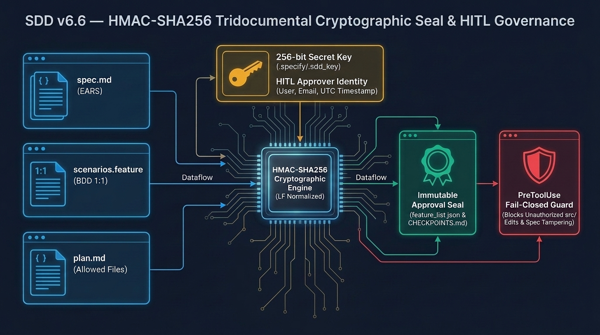
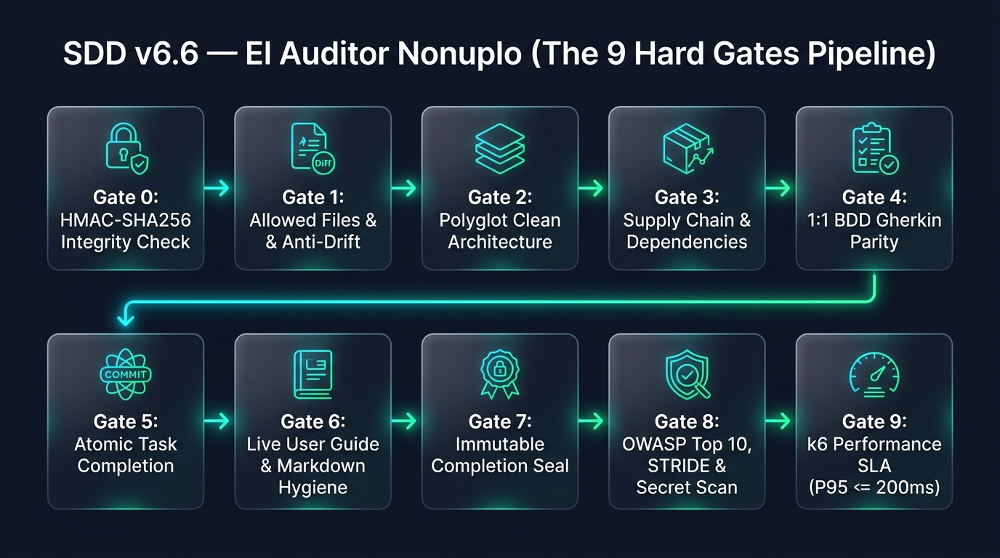
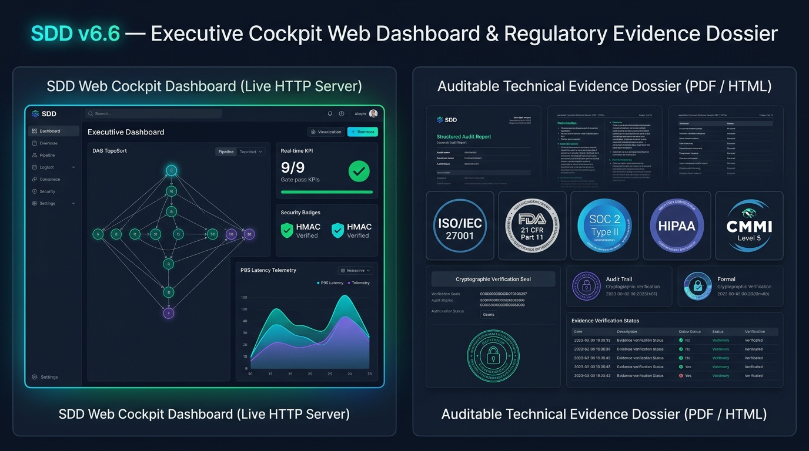

# PRESENTACIÓN EJECUTIVA: FRAMEWORK SDD v6.6

## Specification-Driven Development (Regulatory & Compliance Hardened Edition)

> **Audiencia Objetivo:** Dirección General (CEO/COO), Dirección de Tecnología y Arquitectura (CTO/VP Engineering), Seguridad de la Información (CISO) y Comités de Auditoría y Cumplimiento Regulatorio.
> **Formatos Disponibles:** [PowerPoint (.pptx)](file:///D:/.antigravity/sdd-projects/PRESENTACION_EJECUTIVA_SDD_V66.pptx) | [Presentación Web Interactiva (.html)](file:///D:/.antigravity/sdd-projects/PRESENTACION_EJECUTIVA_SDD_V66.html) | [PDF Widescreen 16:9 (.pdf)](file:///D:/.antigravity/sdd-projects/PRESENTACION_EJECUTIVA_SDD_V66.pdf)

---

### Lámina 1: Portada Ejecutiva — "La Especificación Manda, el Código Obedece y la Criptografía Gobierna"

- **Propósito:** Transformar el desarrollo asistido por agentes de IA de una práctica empírica y riesgosa a una disciplina de ingeniería determinista, matemáticamente trazable y blindada criptográficamente.
- **Indicadores Clave del Ecosistema:**
  - **10 Pilares Sinérgicos** de extremo a extremo.
  - **9+1 Compuertas Duras (El Auditor Nónuplo)** con bloqueo físico (`EXIT 1`).
  - **20 Skills Canónicas** + **3 Hooks Nativos Fail-Closed** en el IDE.
  - **7 Stacks Políglotas** soportados nativamente (Python, TypeScript, C#/.NET, Go, Rust, Flutter y Java Maven/Gradle).

---

### Lámina 2: El Problema — Los 6 Riesgos del Desarrollo con IA sin Gobernanza

1. **Spec Drift (Deriva de Alcance):** Modificación de archivos fuera de alcance, alteración de contratos de API e inyección de dependencias no autorizadas.
2. **Pruebas Falsas (*Fake Tests*):** Suites complacientes (`assert True == True`, bloques `pass`, `@skip`) para simular cobertura del 100%.
3. **Erosión Arquitectónica:** Ruptura de capas de Clean Architecture (consultas SQL en controladores o frameworks dentro del dominio puro).
4. **Brechas OWASP y Fuga de Secretos:** Credenciales hardcodeadas, inyecciones SQL/Command y librerías con CVEs críticas.
5. **Degradación de Latencia y SLAs:** Algoritmos $O(N^2)$ y consultas $N+1$ que colapsan bajo concurrencia en producción.
6. **Fragilidad en Auditorías Regulatorias:** Ausencia de firma humana atribuible (HITL), auto-aprobación del agente y falta de expediente técnico probatorio.

---

### Lámina 3: El Paradigma SDD v6.6 — Contención Matemática y Criptográfica

- **Axioma Rector:** Ninguna línea de código ejecutable puede existir en `src/` sin contar previamente con una especificación formal EARS (`spec.md`), escenarios BDD 1:1 (`scenarios.feature`) y un plan arquitectónico (`plan.md`) sellados con **HMAC-SHA256** por un operador humano identificado (**HITL**).
- **Diferenciadores de la Edición Endurecida v6.6 frente a v6.5:**
  - De SHA-256 sin llave a **HMAC-SHA256 con clave secreta de 256 bits** (`.specify/.sdd_key` o `$env:SDD_HMAC_KEY`).
  - De sellado parcial a **sellado tridocumental** (`spec.md` + `scenarios.feature` + `plan.md`).
  - De aprobación anónima a **atribución nominal HITL** (`approved_by`, `approved_at`, `algorithm`).

---

### Lámina 4: Los 10 Pilares Sinérgicos de SDD v6.6

1. **Pilar 1 — Especificación Viva (EARS & Allowed Files):** 5 cláusulas sintácticas libres de ambigüedad y perímetro cerrado de archivos.
2. **Pilar 2 — BDD Riguroso 1:1:** Paridad exacta entre `AC-1.1..1.4`, escenarios Gherkin `@AC-1.1..1.4` y pruebas automatizadas.
3. **Pilar 3 — Clean Architecture Políglota:** 4 anillos concéntricos (`Domain`, `Application`, `Presentation`, `Infrastructure`).
4. **Pilar 4 — Integridad Criptográfica HMAC-SHA256:** Candado tridocumental inmutable y firma HITL.
5. **Pilar 5 — Control de Tareas y Grafo DAG:** Secuencia constructiva Clean Architecture y dependencias `depends_on`.
6. **Pilar 6 — Ciberseguridad Defensiva:** Modelado STRIDE, Tríada Letal, Fronteras de Confianza (`‖`), SAST y CVEs.
7. **Pilar 7 — Observabilidad Ejecutiva:** Cockpit Web HTML5 con servidor HTTP en vivo y ordenamiento topológico (*TopoSort*).
8. **Pilar 8 — Gobernanza CI/CD Cloud:** Workflows para GitHub Actions y GitLab CI con resúmenes automáticos de Pull Request.
9. **Pilar 9 — Compuerta de Rendimiento SLA (k6):** Validación de latencia $P_{95} \le 200	ext{ ms}$, $P_{99} \le 500	ext{ ms}$ y tasa de error $0\%$.
10. **Pilar 10 — Expediente de Evidencia Técnica PDF:** Compilación vectorial vía Chromium Headless para auditorías internacionales.

---

### Lámina 5: Candado Criptográfico HMAC-SHA256 y Atribución HITL

- **Ecuación del Sello Tridocumental:**
  $$	ext{Seal}_{	ext{HMAC}}(K, M) = 	ext{HMAC-SHA256}_{K}ig(\mathcal{N}(	ext{spec.md}) \parallel 	ext{"---"} \parallel \mathcal{N}(	ext{scenarios.feature}) \parallel 	ext{"---"} \parallel \mathcal{N}(	ext{plan.md})ig)$$
- **Protección contra *Spec & Plan Tampering*:** Cualquier alteración posterior en `plan.md` (por ejemplo, intentar agregar un archivo no autorizado a `## Allowed Files`) invalida el HMAC y detiene inmediatamente el flujo en Gate 0 y en el hook `PreToolUse`.

---

### Lámina 6: Ecosistema Agéntico en el IDE — 3 Hooks Nativos y 20 Skills Canónicas

- **`SessionStart` (`session-start.ps1`):** Detecta el estado del proyecto al abrir el IDE e inicia la entrevista socrática o inyecta el contexto activo.
- **`PreToolUse` (`pre-tool-enforce.ps1`) [Fail-Closed]:** Intercepta llamadas a `write_file` y `edit_file`. Si el archivo destino está en `src/`, verifica en vivo el sello HMAC-SHA256; ante cualquier discrepancia, deniega físicamente la operación (`decision: "deny"`).
- **`PostToolUse` (`post-tool-check.ps1`):** Audita importaciones tras cada edición para impedir violaciones de Clean Architecture.
- **20 Skills Canónicas (`.agents/skills/`):** Agentes especializados gobernados por `sdd-orchestrator` que cubren desde el descubrimiento socrático hasta la emisión del dossier PDF.

---

### Lámina 7: El Auditor Nónuplo (`spec-gate.ps1`) — Las 9+1 Hard Gates

- **Gate 0:** Verificación previa del sello criptográfico HMAC-SHA256 tridocumental.
- **Gate 1:** Allowed Files & Anti-Drift (sin falsos positivos sobre `tests/performance/k6_benchmark.js`).
- **Gate 2:** Paridad y cobertura BDD 1:1 (`@AC-1.1` a `@AC-1.4`).
- **Gate 3:** Pureza de Clean Architecture y control de cadena de suministro de dependencias.
- **Gate 4:** Inmutabilidad del candado de aprobación y atribución de identidad HITL.
- **Gate 5:** Detección Anti-Fake Tests, ejecución real del runner de pruebas y 100% de tareas `[x]`.
- **Gate 6:** Guía de usuario viva en 4 secciones y auto-reparación markdownlint (MD022 / MD047).
- **Gate 7:** UI/UX Pro Max, 5 estados visuales y contraste matemático WCAG 2.1 AA ($\ge 4.5:1$).
- **Gate 8:** Ciberseguridad OWASP Top 10, matriz STRIDE, escaneo de secretos y auditoría de CVEs.
- **Gate 9:** Rendimiento y resiliencia SLA k6 ($P_{95} \le 200	ext{ ms}$, modo dual honesto `CERTIFIED` vs `SKIPPED_LOCAL`).

---

### Lámina 8: Soberanía Tecnológica — Clean Architecture Políglota en 7 Stacks

| Stack | Lenguaje / Ecosistema | Manifiesto | Comando de Pruebas | Compilación / Tipado |
| :--- | :--- | :--- | :--- | :--- |
| **`python`** | Python 3.11+ (FastAPI / Django) | `requirements.txt` | `pytest` | `mypy src` |
| **`typescript`** | TypeScript / Node.js / Angular / React | `package.json` | `npm test` / `vitest` | `npx tsc --noEmit` |
| **`csharp`** | C# / .NET 8+ (ASP.NET Core) | `*.csproj` | `dotnet test` | `dotnet build --no-incremental` |
| **`golang`** | Go 1.22+ | `go.mod` | `go test ./...` | `go vet ./...` |
| **`rust`** | Rust (Cargo) | `Cargo.toml` | `cargo test` | `cargo check` |
| **`flutter`** | Dart / Flutter | `pubspec.yaml` | `flutter test` | `flutter analyze` |
| **`java-maven`** | **Java 21+ (Spring Boot 3 / Maven) [NUEVO v6.6]** | `pom.xml` | `mvn test` | `mvn compile -q` |

---

### Lámina 9: Ciberseguridad Defensiva (STRIDE) y Sinceramiento SLA k6

- **Defensa por Diseño (Aduana 8):**
  - Análisis obligatorio de los 6 vectores **STRIDE** y demarcación de **Fronteras de Confianza (`‖`)** en `plan.md`.
  - Detección automática de la **Tríada Letal** y bloqueo de secretos o código inseguro antes del commit.
- **Transparencia en SLAs de Rendimiento (Aduana 9):**
  - Si `k6` está instalado (CI/CD o estación equipada), ejecuta carga concurrente real y certifica el SLA (`status: "CERTIFIED"`).
  - Si `k6` no está instalado localmente, valida el contrato declarativo y reporta con honestidad `status: "SKIPPED_LOCAL"` y `sla_certified: false` con advertencia `[WARN]`.

---

### Lámina 10: Observabilidad Ejecutiva (Cockpit Web) y Expediente PDF

- **Cockpit Web Dashboard (`sdd.ps1 -Action dashboard -Live`):** Panel interactivo HTML5 con servidor HTTP local que renderiza el grafo DAG ordenado topológicamente (*TopoSort*) y el estado de las 9 compuertas en tiempo real.
- **Dossier de Evidencia Técnica (`sdd.ps1 -Action export-compliance -Format all`):** Compilación vectorial A4 mediante Chromium Headless (`progress/compliance_dossier.pdf`).

---

### Lámina 11: Alineación con Estándares Regulatorios Internacionales

- **ISO/IEC 27001:2022 (Controles A.8.25, A.8.28, A.8.32):** Desarrollo seguro, codificación libre de secretos y gestión formal de cambios.
- **FDA 21 CFR Part 11 (Sec. 11.10, 11.50, 11.70):** Bitácoras de auditoría con estampa de tiempo UTC y manifestación de firma electrónica vinculada por HMAC-SHA256.
- **SOC 2 Type II (CC6.8, CC7.1, CC8.1):** Prevención de alteraciones no autorizadas mediante hook `PreToolUse` Fail-Closed y paridad BDD 1:1.
- **HIPAA Security Rule (45 CFR § 164.312):** Corroboración electrónica de integridad documental y de código.
- **ISO/IEC 25010 & CMMI Nivel 5:** Modularidad arquitectónica, eficiencia de desempeño cuantitativa ($P_{95}$) y prevención causal de defectos.

---

### Lámina 12: Ingeniería de Endurecimiento v6.6 y Verificación con Pester 6

- **12 Recomendaciones Implementadas (P0.1–P0.5, P1.1–P1.4, P2.1–P2.3):** Cierre total de brechas criptográficas, inclusión de `plan.md`, paridad `@AC-1.4`, filtro anti-falso positivo en Gate 1, soporte Java Maven, transparencia `SKIPPED_LOCAL` y modo desatendido.
- **Autoverificación del Framework (`tests/v66-governance.Tests.ps1`):**
  - **Pester 6.2.0:** `6 Passed, 0 Failed, 0 Skipped`.
  - **PSScriptAnalyzer 1.25.0:** `0 Errores` de análisis estático AST.

---

### Lámina 13: Impacto de Negocio y Retorno de Inversión (ROI)

- **`0%` Spec Drift no detectado:** Bloqueo físico inmediato en el IDE y en CI/CD ante cualquier modificación fuera de `Allowed Files`.
- **`100%` Trazabilidad Bidireccional:** Cada línea de código responde a un requisito EARS aprobado por un humano y verificado por una prueba BDD.
- **`-85%` Tiempo en Auditorías:** Generación automatizada del expediente técnico auditable en PDF vectorial con un solo comando.
- **3x Velocidad con Calidad Certificada:** Aprovechamiento seguro de agentes de IA sin acumular deuda técnica ni vulnerabilidades.

---

### Lámina 14: Hoja de Ruta de Adopción en 3 Pasos

1. **Inicializar:** `.\setup-sdd-project-v66.ps1 -ProjectName "MiApp" -DestinationPath "D:\Proyectos" -NoAutoLaunch`
2. **Especificar y Firmar (HITL):** Redactar tríada en `specs/FEAT-001/` y ejecutar `.\harness\sdd.ps1 -Action approve -FeatureId FEAT-001`
3. **Auditar y Emitir Evidencia:** Ejecutar `.\harness\sdd.ps1 -Action complete -FeatureId FEAT-001` y `.\harness\sdd.ps1 -Action export-compliance -Format all -Open`
