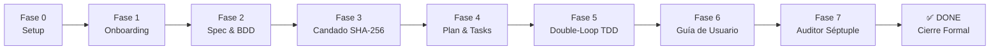

# Presentación Ejecutiva: Framework SDD v5.4

## Specification-Driven Development para Ingeniería de Software con Agentes de IA

---

### Diapositiva 1: Visión General y Propósito

**Título:** Del Caos Agéntico al Desarrollo Determinista
**Subtítulo:** Gobernanza, Arquitectura Limpia y Verificación Matemática con Google Antigravity IDE

* **El Problema:** La generación no controlada de código por LLMs produce *drift* de requisitos, violaciones de arquitectura, tests sintéticos simulados (*fake tests*) y código huérfano sin documentación ni diseño accesible.
* **La Solución SDD v5.4:** Un framework metodológico y técnico donde **ninguna línea de código de producción puede existir en `src/` sin especificación formal previa, verificación matemática y candado criptográfico emitido por un humano**.

```text
┌────────────────────────────────────────────────────────────────────────┐
│                        SDD v5.4: LOS 5 PILARES                         │
├─────────────────┬─────────────────┬─────────────────┬──────────────────┤
│ 1. Spec-First   │ 2. BDD Riguroso │ 3. Clean Arch   │ 4. UI/UX Pro Max │
│    & Anti-Drift │    EARS/Gherkin │    Políglota    │    Matemático    │
├─────────────────┴─────────────────┴─────────────────┴──────────────────┤
│           5. Criptografía Human-in-the-Loop & Gobernanza DAG           │
└────────────────────────────────────────────────────────────────────────┘
```

---

### Diapositiva 2: Los 5 Pilares de SDD v5.4

1. **Spec-First & Anti-Spec Drift:** Cada funcionalidad declara taxativamente `## 5. Allowed Files`. El IDE bloquea físicamente cualquier modificación fuera de esta lista blanca.
2. **BDD Riguroso Bidireccional:** Criterios en sintaxis **EARS** (`AC-x.x`) correlacionados 1:1 con escenarios **Gherkin** (`@AC-x.x`) y suites de test ejecutables.
3. **Clean Architecture Políglota:** Separación matemática de capas (`domain`, `application`, `infrastructure`, `presentation`) con presets automáticos para Python, TypeScript, Go, C# .NET y Rust.
4. **UI/UX Pro Max con Verificación Matemática:** Gobernanza de diseño vía `design-tokens.json`, cálculo estricto de contraste **WCAG 2.1 AA** ($\ge 4.5:1$), los 5 estados obligatorios y detección de *magic hex codes*.
5. **Criptografía Human-in-the-Loop & DAG:** Candado SHA-256 no auto-aprobable por IA, historial inmutable de firmas y dependencias entre features (`depends_on`) gestionadas como grafo acíclico dirigido.

---

### Diapositiva 3: Secuencia Operativa — El Ciclo de 8 Fases



* **Fase 0 (Setup):** Ejecución de `setup-sdd-project-v54.ps1` o `.py`. Scaffolding automático de directorios, templates, hooks nativos y 15 skills.
* **Fase 1 (Onboarding):** Skill `sdd-onboard`. Entrevista socrática de descubrimiento: exactamente 1 pregunta por turno para definir propósito, stack y arquitectura.
* **Fase 2 (Spec & BDD):** Skills `sdd-specify` y `sdd-clarify`. Redacción de `spec.md` (EARS) y `scenarios.feature` (Gherkin).
* **Fase 3 (Candado SHA-256):** Revisión humana del documento y firma criptográfica mediante `harness/sdd.ps1 -Action approve -Reason "<motivo>"`.
* **Fase 4 (Plan & Tasks):** Skills `sdd-plan`, `sdd-design-system` y `sdd-tasks`. Asignación de capas Clean Arch, dependencias permitidas y checklist atómico TDD.
* **Fase 5 (Double-Loop TDD):** Skill `sdd-implement`. Ciclo Red-Green-Refactor. Solo se tocan archivos incluidos en `Allowed Files`.
* **Fase 6 (Guía de Usuario):** Skill `sdd-user-guide`. Documentación obligatoria de 4 secciones sin placeholders (*Quick Start, Core Workflows, Error Handling, FAQ*).
* **Fase 7 (Auditor Séptuple):** `harness/spec-gate.ps1`. 7 compuertas duras automatizadas que verifican integridad total antes del cierre con `sdd.ps1 -Action complete`.

---

### Diapositiva 4: Integración Profunda con Google Antigravity IDE

El framework no depende de instrucciones pasivas; se integra directamente en el motor del agente:

* **15 Skills Canónicas en `.agents/skills/`:**
  * `sdd-orchestrator`: Navegación de fases y gobernanza del ciclo de vida.
  * `sdd-onboard`: Entrevista adaptativa socrática.
  * `sdd-constitution`: Guardián de las leyes inmutables del proyecto.
  * `sdd-specify` & `sdd-clarify`: Redacción y auditoría adversarial de ambigüedades.
  * `sdd-ui-ux`, `sdd-design-system` & `sdd-preview-design`: Inteligencia de diseño, tokens y visor interactivo.
  * `sdd-plan` & `sdd-tasks`: Planificación técnica y tareas atómicas TDD.
  * `sdd-implement`: Implementación disciplinada en bucle doble.
  * `sdd-user-guide`: Generación de manual de usuario sin placeholders.
  * `sdd-validate`: Verificación previa al cierre de feature.
  * `sdd-change-spec`: Gestión formal de cambios con historial de hashes.
  * `sdd-reverse-spec`: Ingeniería inversa para bases de código heredadas (*brownfield*).
* **Hooks Nativos en `.agents/hooks.json`:**
  * **`SessionStart`:** Detecta el estado del backlog y reanuda el trabajo automáticamente.
  * **`PreToolUse`:** Intercepta `write_file` y `edit_file`. Si el agente intenta tocar un archivo no autorizado en `src/`, la herramienta devuelve un bloqueo físico.
  * **`PostToolUse`:** Audita en segundo plano que no se hayan violado las reglas de Clean Architecture.

---

### Diapositiva 5: UI/UX Pro Max & Accesibilidad Matemática

* **Tokens Centralizados:** `.specify/design-system/design-tokens.json` define paleta, escala tipográfica, espaciado y bordes.
* **Calculadora WCAG 2.1 AA:** Calcula el ratio de contraste de luminancia relativa sobre colores de fondo y texto:
  $$\text{Contrast Ratio} = \frac{L_1 + 0.05}{L_2 + 0.05} \ge 4.5:1$$

* **5 Estados Obligatorios:** Ningún componente interactivo se aprueba sin declarar:
  1. *Default* (reposo)
  2. *Hover / Focus* (interacción y foco accesible)
  3. *Loading* (espera asíncrona)
  4. *Empty State* (datos vacíos con llamado a la acción)
  5. *Error State* (mensaje de remediación)
* **Anti Magic Hex Codes:** Detección automática de códigos hexadecimales arbitrarios hardcodeados en `src/presentation/`.
* **Visor Interactivo:** Generación de `design_system_preview.html` con un solo comando:

  ```powershell
  harness/sdd.ps1 -Action preview-design
  ```

---

### Diapositiva 6: El Auditor Séptuple (`spec-gate.ps1`)

Para que una funcionalidad se marque como **COMPLETED**, debe superar las 7 compuertas sin excepción:

| Check | Dimensión | Qué Verifica |
| :---: | :--- | :--- |
| **1** | **Spec Drift** | Compara Git (workspace y commits) contra `## 5. Allowed Files` en `spec.md`. |
| **2** | **BDD 1:1** | Todos los criterios EARS (`AC-x.x`) existen como `@AC-x.x` en `.feature` y tienen tests. |
| **3** | **Clean Architecture** | Inspección de imports. `domain` es 100% puro; dependencias declaradas en `plan.md`. |
| **4** | **Firma Criptográfica** | El hash SHA-256 de `spec.md` coincide con el candado sellado por el operador. |
| **5** | **Anti-Fake Tests** | Detección de `skip`, `pass`, aserciones vacías o `assert True == True` + ejecución real. |
| **6** | **Guía de Usuario** | Presencia obligatoria de 4 secciones completas y ausencia de `TODO`, `TBD` o `placeholder`. |
| **7** | **UI/UX Pro Max** | Cumplimiento estricto de contrastes WCAG 2.1 AA y uso exclusivo de design tokens. |

---

### Diapositiva 7: Cierre Criptográfico y Trazabilidad DAG

* **Grafo de Dependencias (DAG):** En `feature_list.json`, cada funcionalidad puede declarar `depends_on: ["FEAT-001"]`. El arnés impide iniciar tareas bloqueadas por prerequisitos pendientes.
* **Comando de Cierre:**

  ```powershell
  harness/sdd.ps1 -Action complete -FeatureId FEAT-001
  ```

* **Acciones Automáticas al Completar:**
  1. Ejecuta el Auditor Séptuple.
  2. Genera un hash SHA-256 de finalización (`completion_hash`).
  3. Registra el hito inmutable en `CHECKPOINTS.md`.
  4. Auto-genera la **Matriz de Trazabilidad Bidireccional** en `docs/traceability_FEAT-001.md`.
  5. Desbloquea las funcionalidades dependientes en el DAG.

---

### Diapositiva 8: Guía Rápida de Comandos

```powershell
# 1. Inicializar nuevo proyecto
powershell -ExecutionPolicy Bypass -File .\setup-sdd-project-v54.ps1 -ProjectName "SistemaFinanciero" -Stack "python" -GitInit

# 2. Verificar estado del arnés y tests
.\harness\init.ps1

# 3. Consultar backlog y DAG de dependencias
.\harness\sdd.ps1 -Action status

# 4. Aprobar formalmente una especificación (Candado SHA-256)
.\harness\sdd.ps1 -Action approve -FeatureId FEAT-001 -Reason "Criterios EARS y Gherkin validados con el negocio"

# 5. Previsualizar el sistema de diseño en HTML
.\harness\sdd.ps1 -Action preview-design

# 6. Auditar y sellar cierre de feature
.\harness\sdd.ps1 -Action complete -FeatureId FEAT-001
```

---

### Diapositiva 9: Conclusión y Beneficios

* **100% Determinista:** Elimina la dispersión y "creatividad no controlada" de los modelos de lenguaje.
* **Auditable y Enterprise-Ready:** Registro criptográfico de quién aprobó qué requerimiento y en qué momento.
* **Calidad de Código Matemática:** Clean Architecture garantizada por inspección de AST y contratos de interfaz.
* **Experiencia de Usuario sin Sorpresas:** Accesibilidad WCAG 2.1 AA y consistencia de diseño verificada algorítmicamente.
