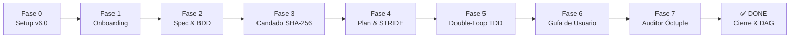

# Presentación Ejecutiva y Técnica: Framework SDD v6.0

## Enterprise Security Edition: Spec-Driven Development + BDD + Clean Architecture + Secure Coding

---

### Diapositiva 1: Visión General y Propósito

**Título:** Del Caos Agéntico al Desarrollo Determinista Blindado
**Subtítulo:** Gobernanza, Arquitectura Limpia, Verificación Matemática y Seguridad OWASP con Google Antigravity IDE

* **El Problema:** La generación de código con Inteligencia Artificial sin supervisión técnica produce desvío de requerimientos (*spec drift*), vulnerabilidades críticas de seguridad (OWASP), código espagueti y pruebas falsas (*fake tests*).
* **El Paradigma SDD v6.0:** Ninguna línea de código de producción puede existir en `src/` sin:
  1. Especificación formal previa (EARS + Gherkin).
  2. Candado criptográfico **SHA-256** aprobado por un humano.
  3. Aislamiento estricto de capas en Clean Architecture.
  4. Accesibilidad matemática verificada (**WCAG 2.1 AA** $\ge 4.5:1$).
  5. **Modelado de amenazas STRIDE y compuerta dura de seguridad OWASP (Nuevo en v6.0).**

```text
┌────────────────────────────────────────────────────────────────────────────────────────┐
│                                  SDD v6.0 PILARES                                      │
├────────────────────┬────────────────────┬────────────────────┬─────────────────────────┤
│ 1. Spec-First      │ 2. BDD Riguroso    │ 3. Clean Arch      │ 4. UI/UX Pro Max        │
│    & Anti-Drift    │    EARS/Gherkin    │    Políglota       │    WCAG 2.1 AA Mat.     │
├────────────────────┴────────────────────┼────────────────────┴─────────────────────────┤
│ 5. Criptografía HITL & Gobernanza DAG   │ 6. Secure Coding & OWASP Hard Gates (NUEVO) │
└─────────────────────────────────────────┴──────────────────────────────────────────────┘
```

---

### Diapositiva 2: Los 6 Pilares de SDD v6.0

1. **Spec-First & Anti-Spec Drift:** Cada funcionalidad declara su lista blanca cerrada `## 5. Allowed Files`. El IDE bloquea físicamente cualquier modificación fuera de esa lista.
2. **BDD Riguroso Bidireccional:** Requisitos redactados en sintaxis **EARS** (`AC-x.x`) correlacionados 1:1 con escenarios **Gherkin** (`@AC-x.x`) y funciones de test.
3. **Clean Architecture Políglota Estricta:** 4 capas concéntricas puras (`domain`, `application`, `infrastructure`, `presentation`). Presets para Python, TypeScript, C# .NET, Go, Flutter, Rust y Java 21 / Spring Boot.
4. **UI/UX Pro Max con Verificación Matemática:** Tokens en `design-tokens.json`, cálculo algorítmico de contraste WCAG AA, los 5 estados obligatorios y cero *magic hex codes*.
5. **Criptografía Human-in-the-Loop & DAG:** Firma SHA-256 obligatoria por un operador humano y grafo de dependencias (`depends_on`) que bloquea tareas no maduras.
6. **Secure Coding & OWASP Hard Gates (NUEVO v6.0):** Modelado de amenazas **STRIDE**, fronteras de confianza (`‖`), detección de la tríada letal, cero credenciales hardcodeadas y compuerta de seguridad en `spec-gate.ps1`.

---

### Diapositiva 3: Topología del Proyecto y Ecosistema v6.0

```text
<RAÍZ_DEL_PROYECTO>/
├── .agents/
│   ├── hooks.json                     # Hooks SessionStart, PreToolUse (bloqueo físico) y PostToolUse
│   └── skills/                        # 16 Skills operativas canónicas (incluye sdd-secure-coding)
├── .specify/
│   ├── memory/constitution.md         # 10 Leyes inmutables del proyecto (incluye Secure Coding by Design)
│   ├── design-system/                 # Tokens semánticos de color, tipografía y estados
│   ├── templates/                     # Plantillas maestras (spec, scenarios, plan con STRIDE, tasks)
│   └── harness-config.json            # Configuración dinámica del stack y linters
├── harness/
│   ├── init.ps1                       # Diagnóstico de salud y ejecución de pruebas
│   ├── verify-security.ps1            # [NUEVO] Escáner de secretos, SAST y auditoría de dependencias
│   ├── sdd.ps1                        # CLI del backlog, candado SHA-256 y matriz de trazabilidad
│   └── spec-gate.ps1                  # [NUEVO] Auditor Óctuple automatizado (8 compuertas duras)
├── src/                               # Clean Architecture concéntrica (domain, application, infra, presentation)
├── tests/                             # Unitarias y de aceptación (Gherkin step definitions)
└── docs/                              # Guías de usuario obligatorias y matrices de trazabilidad
```

---

### Diapositiva 4: El Ciclo de Vida de 8 Fases



* **Fase 0 (Setup):** Scaffolding con `setup-sdd-project-v6.ps1` o `.py` (16 skills, hooks y arnés de seguridad).
* **Fase 1 (Onboarding):** Entrevista socrática adaptativa en 5 fases breves (1 pregunta/turno).
* **Fase 2 (Spec & BDD):** Especificación EARS (`AC-x.x`) y Gherkin (`@AC-x.x`) con lista blanca de archivos.
* **Fase 3 (Candado SHA-256):** Revisión y firma humana inmutable (`harness/sdd.ps1 -Action approve`).
* **Fase 4 (Plan & STRIDE):** Clean Architecture, dependencias y modelado de amenazas en sección 5 de `plan.md`.
* **Fase 5 (Construcción TDD):** Bucle Rojo $\rightarrow$ Verde $\rightarrow$ Refactor bajo interceptor físico `PreToolUse`.
* **Fase 6 (Guía de Usuario):** Documentación final en 4 secciones sin placeholders (`docs/user_guide_*.md`).
* **Fase 7 (Auditor Óctuple):** Validación exhaustiva de las 8 compuertas duras con `spec-gate.ps1`.
* **Cierre Formal:** Generación de `completion_hash`, Matriz de Trazabilidad y desbloqueo del Grafo DAG.

---

### Diapositiva 5: Integración Nativa con Google Antigravity IDE

* **16 Skills Canónicas en `.agents/skills/`:**
  1. `sdd-orchestrator`: Gobernanza de fases y flujo.
  2. `sdd-onboard`: Entrevista adaptativa socrática SDD 2.0.
  3. `sdd-constitution`: Guardián de las 10 leyes inmutables.
  4. `sdd-specify`: Redacción de especificaciones EARS y contratos.
  5. `sdd-clarify`: Detección adversarial de ambigüedades.
  6. `sdd-ui-ux`: Diseño centrado en el usuario y accesibilidad.
  7. `sdd-design-system`: Gestión de tokens semánticos de diseño.
  8. `sdd-preview-design`: Renderizador interactivo HTML del sistema visual.
  9. `sdd-plan`: Planificación técnica, Clean Architecture y dependencias.
  10. `sdd-tasks`: Checklist de tareas atómicas TDD.
  11. `sdd-implement`: Doble bucle TDD/BDD disciplinado.
  12. **`sdd-secure-coding` (NUEVO v6.0):** Threat modeling STRIDE, OWASP Top 10 y hardening de autenticación/secretos.
  13. `sdd-user-guide`: Generación de manual de usuario en 4 secciones.
  14. `sdd-validate`: Pre-auditoría con el Auditor Óctuple.
  15. `sdd-change-spec`: Gestión formal de cambios con versionado de hashes.
  16. `sdd-reverse-spec`: Ingeniería inversa brownfield para código heredado.
* **Hooks Nativos (`.agents/hooks.json`):**
  * `SessionStart`: Detecta el estado del backlog y reactiva el trabajo automáticamente.
  * `PreToolUse`: Intercepta `write_file` y `edit_file`; si el archivo está fuera de `Allowed Files`, **bloquea físicamente la acción**.
  * `PostToolUse`: Auditoría continua y silenciosa de acoplamientos de Clean Architecture.

---

### Diapositiva 6: Secure Coding & Threat Modeling (Pilar 6 en Detalle)

* **Threat Modeling STRIDE en `plan.md`:** Todo módulo que maneje datos externos o infraestructura debe declarar controles para:
  * **Spoofing:** Sesiones seguras en servidor, tokens JWT con algoritmo fijado (**RS256**), rechazo de `alg:none`.
  * **Tampering:** Cálculos en servidor, restricciones DB y validación estricta de esquemas.
  * **Repudiation:** Bitácora estructurada con identificador de usuario y timestamp inmutable.
  * **Information Disclosure:** Allowlist de campos en DTOs y consultas acotadas a pertenencia (`WHERE owner_id = :me`).
  * **Denial of Service:** Rate-limiting y límites de tamaño de carga útil.
  * **Elevation of Privilege:** Autorización *deny-by-default* a nivel de objeto en cada solicitud.
* **Protección de la Tríada Letal:**
  $$\text{Datos Privados} \;+\; \text{Entrada No Confiable} \;+\; \text{Canal de Exfiltración} \;\longrightarrow\; \text{Vulnerabilidad Crítica}$$

* **Escáner Integrado (`harness/verify-security.ps1`):**
  * Secret scanning (gitleaks + escáner heurístico de tokens y credenciales).
  * SAST para inyecciones SQL, llamadas con shell arbitrario, `eval()`, `exec()` o XSS sin sanitizar.
  * Auditoría de dependencias conocidas (CVEs con `pip-audit`, `npm audit`, etc.).

---

### Diapositiva 7: UI/UX Pro Max con Verificación Matemática

* **Tokens Centralizados:** `.specify/design-system/design-tokens.json` estandariza colores, tipografía, espaciado y bordes.
* **Cálculo Algorítmico WCAG 2.1 AA:**
  $$\text{Contraste de Luminancia Relativa} = \frac{L_1 + 0.05}{L_2 + 0.05} \ge 4.5:1$$

* **Los 5 Estados Obligatorios:** Todo componente visual debe declarar formalmente:
  1. *Default* (reposo)
  2. *Hover / Focus* (interacción accesible por teclado)
  3. *Loading* (retroalimentación asíncrona)
  4. *Empty State* (datos vacíos con llamado a la acción)
  5. *Error State* (mensaje amigable con opción de remediación)
* **Cero Magic Hex Codes:** Prohibidos colores hexadecimales hardcodeados en vistas.
* **Previsualizador Standalone:** Genera `progress/design_system_preview.html` con un comando.

---

### Diapositiva 8: El Auditor Óctuple (`spec-gate.ps1`) — 8 Compuertas Duras

Para autorizar el cierre formal de una funcionalidad, debe superar las 8 compuertas con 100% de éxito:

| # | Compuerta | Qué Verifica |
| :-: | :--- | :--- |
| **1** | **Spec Drift & Git** | Workspace y commits auditados estrictamente contra `Allowed Files`. |
| **2** | **Cobertura BDD 1:1** | Todos los criterios EARS (`AC-x.x`) existen en `.feature` y cuentan con pruebas. |
| **3** | **Clean Architecture** | `domain` 100% puro; dependencias de terceros autorizadas en `plan.md`. |
| **4** | **Firma SHA-256** | El hash de `spec.md` coincide con el candado sellado por el operador humano. |
| **5** | **Anti-Fake Tests** | Prohibido `skip`, `pass` o aserciones vacías; ejecución dinámica en verde. |
| **6** | **Guía de Usuario & Markdown** | 4 secciones canónicas completas, cero placeholders y auto-reparación MD022/MD047. |
| **7** | **UI/UX Pro Max** | Cumplimiento de tokens, 5 estados y contraste WCAG 2.1 AA ($\ge 4.5:1$). |
| **8** | **Secure Coding & OWASP (NUEVO)** | **Cero secretos/llaves hardcodeadas, cero inyecciones SQL o `eval()`, y modelado STRIDE verificado.** |

---

### Diapositiva 9: Trazabilidad DAG, Cierre y Auditoría Corporativa

* **Grafo Acíclico Dirigido (DAG):** El backlog modela dependencias con `depends_on`. El arnés impide físicamente avanzar en funcionalidades bloqueadas por requisitos previos no terminados.
* **Comando de Cierre Formal:**

  ```powershell
  .\harness\sdd.ps1 -Action complete -FeatureId FEAT-001
  ```

* **Efectos Automáticos al Completar:**
  1. Supera las 8 compuertas del Auditor Óctuple.
  2. Genera el hash de cierre inmutable (`completion_hash`).
  3. Registra el hito en `CHECKPOINTS.md`.
  4. Auto-genera la **Matriz de Trazabilidad Bidireccional** en `docs/traceability_FEAT-001.md`.
  5. Desbloquea las funcionalidades dependientes en el DAG.

---

### Diapositiva 10: Guía Rápida de Comandos Operativos

```powershell
# 1. Inicializar nuevo proyecto gobernado bajo SDD v6.0
powershell -ExecutionPolicy Bypass -File .\setup-sdd-project-v6.ps1 -ProjectName "SistemaFinanciero" -Stack "python" -GitInit

# 2. Verificar salud general del entorno y tests
.\harness\init.ps1

# 3. Consultar tablero del backlog y dependencias DAG
.\harness\sdd.ps1 -Action status

# 4. Sellar candado criptográfico SHA-256 (Human-in-the-Loop)
.\harness\sdd.ps1 -Action approve -FeatureId FEAT-001 -Reason "Criterios validados con el negocio"

# 5. Ejecutar auditoría de seguridad OWASP y escaneo de secretos
.\harness\sdd.ps1 -Action verify-security

# 6. Previsualizar el sistema de diseño en HTML standalone
.\harness\sdd.ps1 -Action preview-design

# 7. Auditar con el Auditor Óctuple y sellar cierre formal
.\harness\sdd.ps1 -Action complete -FeatureId FEAT-001
```
