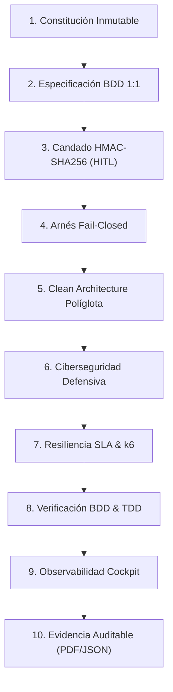
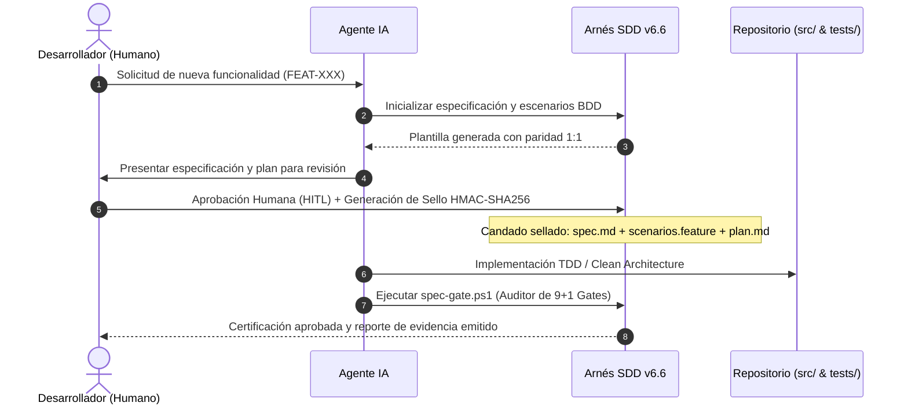

# SDD Framework — Specification-Driven Development

[](DOCUMENTO_MAESTRO_PROYECTO_SDD_V66.md)
[](DOCUMENTO_MAESTRO_PROYECTO_SDD_V66.md)
[](GUIA_MAESTRA_SETUP_SDD_V66.md)
[](DOCUMENTO_MAESTRO_PROYECTO_SDD_V66.md)
[](setup-sdd-project-v66.ps1)

> **Marco de Gobernanza Matemática, Arquitectura Limpia Políglota, Candado Criptográfico HMAC-SHA256, Ciberseguridad Defensiva, Resiliencia SLA k6 y Evidencia Técnica Auditable para el Desarrollo Asistido por Agentes de Inteligencia Artificial.**

---

## 📋 Tabla de Contenidos

1. [Resumen Ejecutivo](#-resumen-ejecutivo)
2. [Los 10 Pilares Sinérgicos de SDD v6.6](#-los-10-pilares-sinérgicos-de-sdd-v66)
3. [Flujo de Trabajo y Ciclo de Vida Agéntico](#-flujo-de-trabajo-y-ciclo-de-vida-agéntico)
4. [Estructura del Repositorio y Entregables](#-estructura-del-repositorio-y-entregables)
5. [Inicio Rápido (Quickstart)](#-inicio-rápido-quickstart)
6. [Las 9+1 Hard Gates del Auditor (`spec-gate.ps1`)](#-las-91-hard-gates-del-auditor-spec-gateps1)
7. [Documentación y Ecosistema de Recursos](#-documentación-y-ecosistema-de-recursos)
8. [Verificación Formal y Pruebas Automatizadas](#-verificación-formal-y-pruebas-automatizadas)
9. [Alineación Regulatoria y Cumplimiento](#-alineación-regulatoria-y-cumplimiento)
10. [Créditos y Licencia](#-créditos-y-licencia)

---

## 🎯 Resumen Ejecutivo

El desarrollo de software asistido por Modelos de Lenguaje (LLMs) y agentes de codificación ofrece una aceleración sin precedentes, pero introduce riesgos críticos:
- **Alucinaciones y Spec Drift**: Desviación inadvertida de los requerimientos y alcances.
- **Pruebas Falsas (*Fake Tests*)**: Mocks vacíos o aserciones triviales para aparentar aprobación.
- **Erosión Arquitectónica**: Código acoplado y mezclas entre infraestructura y dominio.
- **Vulnerabilidades y Fugas**: Exposición de secretos, inyecciones de código y dependencias comprometidas.

**SDD (Specification-Driven Development) v6.6** resuelve esta crisis mediante un **arnés de contención determinista**, gobernanza basada en **Human-in-the-Loop (HITL)** estricto y un candado criptográfico **HMAC-SHA256** que sella especificaciones, escenarios BDD y planes de ejecución antes de permitir una sola línea de código en producción.

---

## 🏛️ Los 10 Pilares Sinérgicos de SDD v6.6



1. **Constitución Inmutable**: Reglas operativas no negociables en `.specify/memory/constitution.md`.
2. **Especificación BDD 1:1 Formal**: Paridad total entre criterios de aceptación (`@AC-X.Y`) y escenarios Gherkin ejecutables.
3. **Candado Criptográfico HMAC-SHA256**: Sellado conjunto de `spec.md`, `scenarios.feature` y `plan.md` con firma digital HITL obligatoria.
4. **Hooks Nativos Fail-Closed**: Bloqueo físico en tiempo real de escrituras no autorizadas (`pre-tool-enforce.ps1`).
5. **Clean Architecture Políglota**: Dominio aislado sin dependencias externas (Java/Maven, Python, Node.js, .NET, Go).
6. **Ciberseguridad Defensiva**: Auditoría estática anti-hardcoding, análisis de dependencias vulnerables y sanitización OWASP.
7. **Resiliencia SLA & Benchmarking k6**: Medición de percentiles P95/P99 con umbrales estrictos (<200 ms).
8. **Doble Bucle de Pruebas**: TDD estricto para lógica de dominio + BDD para aceptación de negocio.
9. **Cockpit Ejecutivo y Observabilidad**: Dashboard web interactivo con grafo DAG SVG autoescalable y métricas en vivo.
10. **Expediente de Evidencia Regulatoria**: Generación determinista de artefactos certificados listos para auditorías externas.

---

## 🔄 Flujo de Trabajo y Ciclo de Vida Agéntico



---

## 📂 Estructura del Repositorio y Entregables

```
sdd-projects/
├── DOCUMENTO_MAESTRO_PROYECTO_SDD_V66.md     # Libro Blanco Maestro v6.6 (MD canónico)
├── DOCUMENTO_MAESTRO_PROYECTO_SDD_V66.html    # Libro Blanco compilado en HTML5 interactivo
├── DOCUMENTO_MAESTRO_PROYECTO_SDD_V66.pdf     # Libro Blanco en PDF vectorial
├── GUIA_MAESTRA_SETUP_SDD_V66.md             # Guía paso a paso de inicialización
├── GUIA_MAESTRA_SETUP_SDD_V66.html           # Guía de inicialización en HTML5
├── GUIA_MAESTRA_SETUP_SDD_V66.pdf            # Guía de inicialización en PDF
├── PRESENTACION_EJECUTIVA_SDD_V66.pptx       # Presentación corporativa (14 slides ejecutivas)
├── PRESENTACION_EJECUTIVA_SDD_V66.html       # Slides interactivas para navegador
├── PRESENTACION_EJECUTIVA_SDD_V66.pdf        # Slides en PDF formato 16:9
├── PRESENTACION_EJECUTIVA_SDD_V66.md         # Libreto y estructura de diapositivas
├── GUIA_CLEAN_ARCHITECTURE_POLIGLOTA.md       # Guía de arquitectura limpia para múltiples stacks
├── GUIA_PREPARACION_ONBOARDING_DESARROLLADOR.md # Guía para entrevistas técnicas de onboarding
├── DICCIONARIO_TERMINOS_SDD.md               # Glosario A-Z y diccionario conceptual (50 términos)
├── INFOGRAFIA_PROCEDIMIENTO_SDD.md           # Procedimiento paso a paso en formato visual
├── setup-sdd-project-v66.ps1                 # Scaffolding automatizado para PowerShell
├── setup-sdd-project-v66.py                  # Scaffolding automatizado para Python
├── docs/                                     # Diagramas, blueprints y recursos gráficos
│   └── assets/                               # Imágenes vectoriales y arquitectura
├── tests/                                    # Suites de verificación formal
│   └── v66-governance.Tests.ps1              # Pruebas de gobernanza en Pester 6
├── tools/                                    # Herramientas de soporte (Pester, PScriptAnalyzer)
└── archive/                                  # Versiones históricas archivadas (v4.x a v6.5)
```

---

## 🚀 Inicio Rápido (Quickstart)

### Requisitos Previos

- **PowerShell 5.1+** o **PowerShell 7+** (disponible en Windows, macOS y Linux) o **Python 3.10+**.
- **Git 2.30+** configurado con `user.name` y `user.email`.
- Opcional: **Google Chrome** o **Microsoft Edge** para renderizado headless de reportes PDF.

### Creación de un Nuevo Proyecto SDD

#### Opción A: Mediante PowerShell (Recomendada en Windows)

```powershell
# Crear un proyecto con stack Python
.\setup-sdd-project-v66.ps1 -ProjectName "mi-sistema-critico" -Stack "python" -Interactive

# O para proyectos empresariales Java (Maven)
.\setup-sdd-project-v66.ps1 -ProjectName "pagos-spei" -Stack "java-maven" -Interactive
```

#### Opción B: Mediante Python (Multiplataforma)

```bash
python setup-sdd-project-v66.py --project-name "mi-sistema-critico" --stack "python" --interactive
```

### Operaciones Básicas en el Proyecto Creado

```powershell
cd mi-sistema-critico

# 1. Crear una nueva funcionalidad
.\harness\sdd.ps1 -Action create -FeatureId "FEAT-101" -FeatureName "Autenticacion Multi-Factor"

# 2. Aprobar formalmente la especificación (Human-in-the-Loop)
.\harness\sdd.ps1 -Action approve -FeatureId "FEAT-101"

# 3. Auditar la funcionalidad con las 9+1 Hard Gates
.\harness\sdd.ps1 -Action gate -FeatureId "FEAT-101"

# 4. Lanzar el Cockpit Ejecutivo de Observabilidad
.\harness\sdd.ps1 -Action dashboard

# 5. Exportar el expediente técnico de cumplimiento regulatorio
.\harness\sdd.ps1 -Action export-compliance -FeatureId "FEAT-101"
```

---

## 🛡️ Las 9+1 Hard Gates del Auditor (`spec-gate.ps1`)

| Gate | Nombre | Criterio de Aprobación |
| :---: | :--- | :--- |
| **0** | **HMAC-SHA256 Cryptographic Lock** | La firma criptográfica coincide con `spec.md`, `scenarios.feature` y `plan.md`. |
| **1** | **Spec Drift & Scope Containment** | Ningún archivo fuera de `Allowed Files` en `plan.md` ha sido modificado. |
| **2** | **BDD Acceptance Scenarios** | 100% de escenarios Gherkin ejecutados y pasando sin decoradores `@skip`. |
| **3** | **TDD Unit Testing & Coverage** | Pruebas unitarias de dominio con cobertura mínima exigida (≥ 80%). |
| **4** | **Clean Architecture Integrity** | Capa de dominio pura sin dependencias de infraestructura o presentación. |
| **5** | **Zero Fake Tests Detection** | Detección estricta de aserciones vacías, pruebas complacientes y mocks falsos. |
| **6** | **Security & Secret Scanning** | Cero llaves, contraseñas o tokens en texto plano y cero vulnerabilidades OWASP. |
| **7** | **Static Analysis & Linting** | Cero violaciones críticas de estilo y análisis estático en el código fuente. |
| **8** | **Audit Trail & Documentation** | Trazabilidad completa de cambios, diagramas actualizados y bitácora firmada. |
| **9** | **k6 SLA & Resiliency Benchmark** | Percentiles de latencia P95/P99 validados (<200 ms) y tasa de error < 1%. |

---

## 📚 Documentación y Ecosistema de Recursos

- **[Libro Blanco Maestro v6.6 (Markdown)](DOCUMENTO_MAESTRO_PROYECTO_SDD_V66.md)**: Especificación formal completa de 14 capítulos y fundamentos matemáticos.
- **[Guía Maestra de Setup (Markdown)](GUIA_MAESTRA_SETUP_SDD_V66.md)**: Manual operativo de despliegue y configuración de proyectos.
- **[Guía Clean Architecture Políglota](GUIA_CLEAN_ARCHITECTURE_POLIGLOTA.md)**: Patrones de implementación para Java, Python, TypeScript, .NET y Go.
- **[Guía de Onboarding para Desarrolladores](GUIA_PREPARACION_ONBOARDING_DESARROLLADOR.md)**: Manual de preparación para entrevistas técnicas y adopción del estándar.
- **[Diccionario y Glosario Exhaustivo](DICCIONARIO_TERMINOS_SDD.md)**: 50 definiciones categorizadas y tabla de referencia rápida A-Z.
- **[Presentación Ejecutiva (PowerPoint)](PRESENTACION_EJECUTIVA_SDD_V66.pptx)**: Deck corporativo de 14 diapositivas de alto impacto visual.

---

## 🧪 Verificación Formal y Pruebas Automatizadas

El framework incluye una suite de pruebas automatizadas en **Pester 6** para validar la integridad de todas las compuertas de gobernanza y el candado criptográfico:

```powershell
# Ejecutar suite de pruebas de gobernanza
Invoke-Pester -Path .\tests\v66-governance.Tests.ps1 -Output Detailed
```

---

## 🔒 Alineación Regulatoria y Cumplimiento

SDD v6.6 está diseñado para satisfacer los requisitos más exigentes de auditoría técnica internacional:

- **ISO/IEC 27001 (A.12.1.2 / A.14.2)**: Gestión formal de cambios y seguridad en el ciclo de vida del software.
- **FDA 21 CFR Part 11**: Firmas electrónicas inmutables, registro de auditoría (*audit trail*) y control de integridad.
- **SOC 2 (Trust Services Criteria - Security & Confidentiality)**: Trazabilidad HITL de todas las modificaciones en el código.
- **HIPAA Security Rule (45 CFR § 164.312)**: Aislamiento arquitectónico y protección de datos sensibles.

---

## 👥 Créditos y Autores

- **Autor:** Salvador Velasco ([@svelascotellez](https://github.com/svelascotellez)) & Antigravity (Google DeepMind Team).
- **Versión Oficial:** 6.6 (*Regulatory & Compliance Hardened Edition*).
- **Publicación:** Noviembre de 2026.
- **Repositorio Oficial:** [svelascotellez/ssd-projects](https://github.com/svelascotellez/ssd-projects)
