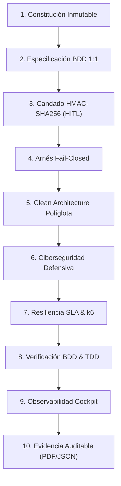
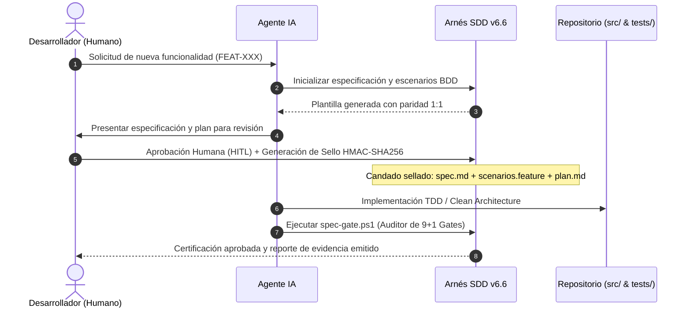

# SDD Framework — Specification-Driven Development

[](https://github.com/svelascotellez/ssd-projects/actions/workflows/ci.yml)
[](DOCUMENTO_MAESTRO_PROYECTO_SDD_V66.md)
[](LICENSE)
[](SECURITY.md)
[](DOCUMENTO_MAESTRO_PROYECTO_SDD_V66.md)
[](.devcontainer/devcontainer.json)
[](setup-sdd-project-v66.ps1)

> **Marco de Gobernanza Matemática, Arquitectura Limpia Políglota, Candado Criptográfico HMAC-SHA256, Ciberseguridad Defensiva, Resiliencia SLA k6 y Evidencia Técnica Auditable para el Desarrollo Asistido por Agentes de Inteligencia Artificial.**

---

## 📋 Tabla de Contenidos

1. [Resumen Ejecutivo](#-resumen-ejecutivo)
2. [Los 10 Pilares Sinérgicos de SDD v6.6](#-los-10-pilares-sinérgicos-de-sdd-v66)
3. [Flujo de Trabajo y Ciclo de Vida Agéntico](#-flujo-de-trabajo-y-ciclo-de-vida-agéntico)
4. [Ecosistema de Skills Agénticas](#-ecosistema-de-skills-agénticas)
5. [Estructura del Repositorio y Entregables](#-estructura-del-repositorio-y-entregables)
6. [Inicio Rápido (Quickstart)](#-inicio-rápido-quickstart)
7. [Las 9+1 Hard Gates del Auditor (`spec-gate.ps1`)](#-las-91-hard-gates-del-auditor-spec-gateps1)
8. [Documentación y Ecosistema de Recursos](#-documentación-y-ecosistema-de-recursos)
9. [Verificación Formal y Pruebas Automatizadas](#-verificación-formal-y-pruebas-automatizadas)
10. [Alineación Regulatoria y Cumplimiento](#-alineación-regulatoria-y-cumplimiento)
11. [Créditos, Licencia y Seguridad](#-créditos-licencia-y-seguridad)

---

## 🎯 Resumen Ejecutivo

El desarrollo de software asistido por Modelos de Lenguaje (LLMs) y agentes de codificación ofrece una aceleración sin precedentes, pero introduce riesgos críticos:

- **Alucinaciones y Spec Drift**: Desviación inadvertida de los requerimientos y alcances.
- **Pruebas Falsas (*Fake Tests*)**: Mocks vacíos o aserciones triviales para aparentar aprobación.
- **Erosión Arquitectónica**: Código acoplado y mezclas entre infraestructura y dominio.
- **Vulnerabilidades y Fugas**: Exposición de secretos, inyecciones de código y dependencias comprometidas.

**SDD (Specification-Driven Development) v6.6** resuelve esta crisis mediante un **arnés de contención determinista**, gobernanza basada en **Human-in-the-Loop (HITL)** estricto y un candado criptográfico **HMAC-SHA256** que sella especificaciones, escenarios BDD y planes de ejecución antes de permitir una sola línea de código en producción.

---

## 🏛️ Los 10 Pilares Sinérgicos de SDD v6.6



1. **Constitución Inmutable**: Reglas operativas no negociables en `.specify/memory/constitution.md`.
2. **Especificación BDD 1:1 Formal**: Paridad total entre criterios de aceptación (`@AC-X.Y`) y escenarios Gherkin ejecutables.
3. **Candado Criptográfico HMAC-SHA256**: Sellado conjunto de `spec.md`, `scenarios.feature` y `plan.md` con firma digital HITL obligatoria.
4. **Hooks Nativos Fail-Closed**: Bloqueo físico en tiempo real de escrituras no autorizadas (`pre-tool-enforce.ps1`).
5. **Clean Architecture Políglota**: Dominio aislado sin dependencias externas (Java/Maven, Python, Node.js, .NET, Go, Rust).
6. **Ciberseguridad Defensiva**: Auditoría estática anti-hardcoding, análisis de dependencias vulnerables y sanitización OWASP.
7. **Resiliencia SLA & Benchmarking k6**: Medición de percentiles P95/P99 con umbrales estrictos (<200 ms).
8. **Doble Bucle de Pruebas**: TDD estricto para lógica de dominio + BDD para aceptación de negocio.
9. **Cockpit Ejecutivo y Observabilidad**: Dashboard web interactivo con grafo DAG SVG autoescalable y métricas en vivo.
10. **Expediente de Evidencia Regulatoria**: Generación determinista de artefactos certificados listos para auditorías externas.

---

## 🔄 Flujo de Trabajo y Ciclo de Vida Agéntico



---

## 📂 Estructura del Repositorio y Entregables

```
ssd-projects/
├── DOCUMENTO_MAESTRO_PROYECTO_SDD_V66.md     # Libro Blanco Maestro v6.6 (MD canónico)
├── DOCUMENTO_MAESTRO_PROYECTO_SDD_V66.html    # Libro Blanco compilado en HTML5 interactivo
├── DOCUMENTO_MAESTRO_PROYECTO_SDD_V66.pdf     # Libro Blanco en PDF vectorial
├── GUIA_MAESTRA_SETUP_SDD_V66.md             # Guía paso a paso de inicialización
├── GUIA_MAESTRA_SETUP_SDD_V66.html           # Guía de inicialización en HTML5
├── GUIA_MAESTRA_SETUP_SDD_V66.pdf            # Guía de inicialización en PDF
├── PRESENTACION_EJECUTIVA_SDD_V66.pptx       # Presentación corporativa (14 slides ejecutivas)
├── PRESENTACION_EJECUTIVA_SDD_V66.html       # Slides interactivas para navegador
├── PRESENTACION_EJECUTIVA_SDD_V66.pdf        # Slides en PDF formato 16:9
├── PRESENTACION_EJECUTIVA_SDD_V66.md         # Libreto y estructura de diapositivas
├── GUIA_CLEAN_ARCHITECTURE_POLIGLOTA.md       # Guía de arquitectura limpia para múltiples stacks
├── GUIA_PREPARACION_ONBOARDING_DESARROLLADOR.md # Guía para entrevistas técnicas de onboarding
├── DICCIONARIO_TERMINOS_SDD.md               # Glosario A-Z y diccionario conceptual (50 términos)
├── INFOGRAFIA_PROCEDIMIENTO_SDD.md           # Procedimiento paso a paso en formato visual
├── setup-sdd-project-v66.ps1                 # Scaffolding automatizado para PowerShell
├── setup-sdd-project-v66.py                  # Scaffolding automatizado para Python
├── install.ps1                               # Instalador one-liner para PowerShell
├── install.sh                                # Instalador one-liner para Linux/macOS
├── pyproject.toml                            # Configuración de paquete Python
├── SddFramework.psd1                         # Manifiesto de módulo PowerShell
├── LICENSE                                   # Licencia oficial MIT
├── SECURITY.md                               # Política y proceso de reporte de vulnerabilidades
├── CONTRIBUTING.md                           # Guía de contribución y estándares
├── .github/workflows/ci.yml                  # Pipeline CI/CD para GitHub Actions
├── .devcontainer/                            # Entorno Docker reproducible en VS Code / Codespaces
├── docs/                                     # Diagramas, blueprints y recursos gráficos
├── tests/                                    # Suites de verificación formal (Pester 6)
├── tools/                                    # CLIs multiplataforma y constructores (sdd_cli.py, sdd.sh)
└── archive/                                  # Versiones históricas archivadas (v4.x a v6.5)
```

---

## 🚀 Inicio Rápido (Quickstart)

### 1. Instalación Rápida (One-Liner)

#### Windows (PowerShell)

```powershell
irm https://raw.githubusercontent.com/svelascotellez/ssd-projects/main/install.ps1 | iex
```

#### Linux / macOS / Docker (Bash)

```bash
curl -fsSL https://raw.githubusercontent.com/svelascotellez/ssd-projects/main/install.sh | bash
```

### 2. Creación de un Nuevo Proyecto SDD

#### Mediante PowerShell

```powershell
# Crear un proyecto con stack Python
.\setup-sdd-project-v66.ps1 -ProjectName "mi-sistema-critico" -Stack "python" -Interactive

# O para proyectos empresariales Java (Maven)
.\setup-sdd-project-v66.ps1 -ProjectName "pagos-spei" -Stack "java-maven" -Interactive
```

#### Mediante Python (Multiplataforma)

```bash
python setup-sdd-project-v66.py --project-name "mi-sistema-critico" --stack "python" --interactive
```

### 3. Operaciones Básicas en el Proyecto Creado

```powershell
cd mi-sistema-critico

# 1. Crear una nueva funcionalidad formal
.\harness\sdd.ps1 -Action create -FeatureId "FEAT-001" -FeatureName "Autenticacion Segura"

# 2. Aprobar formalmente tras inspeccionar spec y plan (Sello HMAC-SHA256 HITL)
.\harness\sdd.ps1 -Action approve -FeatureId "FEAT-001" -Approver "lider.tecnico"

# 3. Abrir el Cockpit Ejecutivo de Observabilidad en tiempo real
.\harness\sdd.ps1 -Action dashboard -Live

# 4. Ejecutar el Auditor Nónuplo de Gobernanza
.\harness\spec-gate.ps1 -FeatureId "FEAT-001"
```

---

## 🛡️ Las 9+1 Hard Gates del Auditor (`spec-gate.ps1`)

| Hard Gate | Nombre Formal | Criterio de Aprobación Inflexible |
| :---: | :--- | :--- |
| **Gate 0** | **HMAC-SHA256 Pre-Check** | Coincidencia criptográfica del hash tridocumental (`spec.md` + `scenarios.feature` + `plan.md`) contra `.specify/.sdd_key`. |
| **Gate 1** | **Allowed Files & Anti-Drift** | Ningún archivo modificado en `src/` o `tests/` fuera de la lista `## 4. Allowed Files` de `plan.md`. Cero falsos positivos en scripts de scaffold. |
| **Gate 2** | **Paridad BDD 1:1** | Cobertura exacta de cada `@AC-X.Y` en `scenarios.feature` reflejada en los tests correspondientes. |
| **Gate 3** | **Clean Architecture Pure** | Cero importaciones o referencias impuras hacia capas de infraestructura desde el núcleo de dominio. |
| **Gate 4** | **Anti-Fake Tests** | Cero pruebas vacías, aserciones triviales (`assert True`), `pass` o decoradores `@pytest.mark.skip` no justificados. |
| **Gate 5** | **Guía de Usuario Canónica** | Existencia y completitud de `docs/user_guide_<id>.md` con las 4 secciones estándar sin texto *placeholder*. |
| **Gate 6** | **UI/UX Pro Max & WCAG** | Contraste de color algorítmico $\ge 4.5:1$ (WCAG 2.1 AA) y validación de los 5 estados obligatorios de componentes. |
| **Gate 7** | **Inmutabilidad y Audit Trail** | Registro cronológico inviolable en `CHECKPOINTS.md` con atribución formal de usuario y fecha ISO 8601. |
| **Gate 8** | **Ciberseguridad y SAST** | Cero vulnerabilidades críticas/altas (CVEs), cero secretos hardcodeados y sanitización contra inyecciones OWASP. |
| **Gate 9** | **Resiliencia SLA (k6)** | Percentiles de latencia en carga sostenida con $P_{95} \le 200\text{ ms}$ y tasa de errores $< 1\%$. |

---

## 📚 Documentación y Ecosistema de Recursos

- **[Documento Maestro v6.6 (Libro Blanco)](DOCUMENTO_MAESTRO_PROYECTO_SDD_V66.md)**: Fundamentos teóricos, arquitectura formal y evidencia de auditoría.
- **[Guía Maestra de Setup (Markdown)](GUIA_MAESTRA_SETUP_SDD_V66.md)**: Manual operativo de despliegue y configuración de proyectos.
- **[Guía Clean Architecture Políglota](GUIA_CLEAN_ARCHITECTURE_POLIGLOTA.md)**: Patrones de implementación para Java, Python, TypeScript, .NET, Go y Rust.
- **[Guía de Onboarding para Desarrolladores](GUIA_PREPARACION_ONBOARDING_DESARROLLADOR.md)**: Manual de preparación para entrevistas técnicas y adopción del estándar.
- **[Diccionario y Glosario Exhaustivo](DICCIONARIO_TERMINOS_SDD.md)**: 50 definiciones categorizadas y tabla de referencia rápida A-Z.
- **[Presentación Ejecutiva (PowerPoint)](PRESENTACION_EJECUTIVA_SDD_V66.pptx)**: Deck corporativo de 14 diapositivas de alto impacto visual.

---

## 🧪 Verificación Formal y Pruebas Automatizadas

El framework incluye una suite de pruebas automatizadas en **Pester 6** para validar la integridad de todas las compuertas de gobernanza y la matriz políglota:

```powershell
# Ejecutar suite de pruebas de gobernanza
Invoke-Pester -Path .\tests\v66-governance.Tests.ps1 -Output Detailed
```

---

## 🔒 Alineación Regulatoria y Cumplimiento

SDD v6.6 está diseñado para satisfacer los requisitos más exigentes de auditoría técnica internacional:

- **ISO/IEC 27001 (A.12.1.2 / A.14.2)**: Gestión formal de cambios y seguridad en el ciclo de vida del software.
- **FDA 21 CFR Part 11**: Firmas electrónicas inmutables, registro de auditoría (*audit trail*) y control de integridad.
- **SOC 2 (Trust Services Criteria - Security & Confidentiality)**: Trazabilidad HITL de todas las modificaciones en el código.
- **HIPAA Security Rule (45 CFR § 164.312)**: Aislamiento arquitectónico y protección de datos sensibles.

---

## 👥 Créditos, Licencia y Seguridad

- **Autor:** Salvador Velasco ([@svelascotellez](https://github.com/svelascotellez)) & Antigravity (Google DeepMind Team).
- **Versión Oficial:** 6.6.0 (*Regulatory & Compliance Hardened Edition*).
- **Licencia:** Distribuido bajo la Licencia MIT. Consulta [LICENSE](LICENSE) para más detalles.
- **Seguridad:** Para reportar vulnerabilidades criptográficas o de contención, consulta [SECURITY.md](SECURITY.md).
- **Contribuciones:** Lee nuestra [Guía de Contribución](CONTRIBUTING.md) antes de enviar Pull Requests.
- **Repositorio Oficial:** [svelascotellez/ssd-projects](https://github.com/svelascotellez/ssd-projects)
