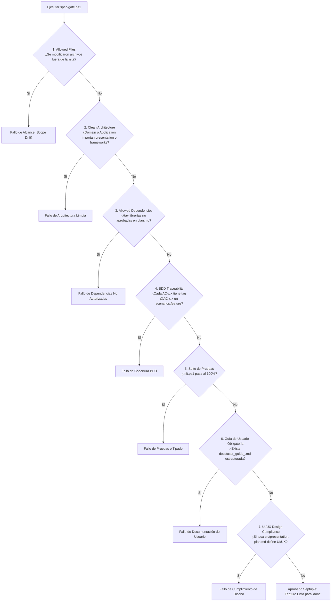
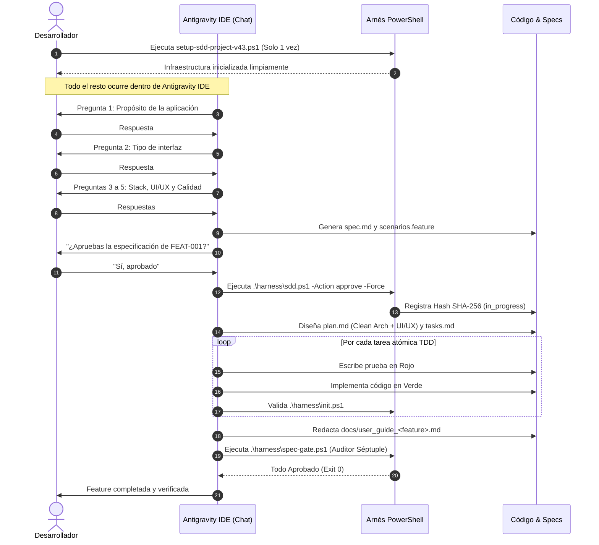

# Documento Técnico: Arquitectura y Funcionamiento de `setup-sdd-project-v43.ps1`

## 1. Visión General y Filosofía de Diseño

El script `setup-sdd-project-v43.ps1` es el inicializador de infraestructura para proyectos basados en **Spec-Driven Development (SDD)**, **Behavior-Driven Development (BDD)** y **Clean Architecture** (Arquitectura Limpia) optimizado para entornos **Windows** (PowerShell 5.1 y PowerShell 7+) y la plataforma **Google Antigravity IDE**.

### Principios Fundamentales

1. **La Spec es la Única Fuente de la Verdad:** Ningún archivo de producción se crea ni se modifica sin un requerimiento formal en `specs/<feature>/spec.md` y escenarios ejecutables en `specs/<feature>/scenarios.feature`.
2. **Candado Criptográfico SHA-256 (Human-in-the-Loop):** Nadie (ni la IA ni el desarrollador) puede iniciar la implementación técnica de una funcionalidad sin la aprobación humana formal registrada como hash criptográfico inmutable.
3. **Auditoría Séptuple Automática (`spec-gate.ps1`):** Compuerta de calidad estricta que audita alcance, Clean Architecture, dependencias, BDD, pruebas, Guía de Usuario obligatoria y cumplimiento UI/UX antes de permitir el cierre de cualquier tarea.
4. **UI/UX Pro Max (Design-System First):** Aislamiento total de la capa de interfaz en `src/presentation/`, gobernada por tokens de diseño (`design-tokens.json`), estados obligatorios de componentes y accesibilidad WCAG 2.1 AA.
5. **Cero Fricción en Antigravity IDE:** La infraestructura se genera limpiamente y el diálogo de desarrollo (entrevista, aclaraciones, decisiones de diseño) ocurre de forma natural y paso a paso (1 pregunta por turno) dentro de la ventana de chat del IDE.

---

## 2. Mapa de Directorios Generado

Al ejecutarse en la raíz de cualquier proyecto nuevo o existente, el script crea de forma no destructiva la siguiente estructura:

```text
<RAÍZ_DEL_PROYECTO>/
│
├── .agents/
│   └── skills/                         # Habilidades operativas del Agente de IA
│       ├── sdd-onboard.md              # Entrevista inicial de descubrimiento (1 pregunta/turno)
│       ├── sdd-constitution.md         # Gobernanza y leyes inmutables del proyecto
│       ├── sdd-specify.md              # Redacción EARS y Gherkin con Allowed Files
│       ├── sdd-clarify.md              # Auditoría adversarial de ambigüedades
│       ├── sdd-ui-ux.md                # Inteligencia de diseño visual y accesibilidad
│       ├── sdd-plan.md                 # Diseño técnico Clean Architecture y UI/UX Spec
│       ├── sdd-tasks.md                # Desglose en tareas atómicas TDD + Guía de Usuario
│       ├── sdd-implement.md            # Ciclo Double-Loop (Rojo -> Verde -> Verificación)
│       ├── sdd-user-guide.md           # Redacción de la Guía de Usuario obligatoria
│       ├── sdd-validate.md             # Ejecución de la compuerta Auditor Séptuple
│       ├── sdd-change-spec.md          # Control estricto de cambios (Anti-Spec-Drift)
│       └── sdd-reverse-spec.md         # Ingeniería inversa brownfield para código heredado
│
├── .specify/                           # Configuración y memoria del framework
│   ├── memory/
│   │   └── constitution.md             # Leyes inmutables de calidad y arquitectura
│   ├── design-system/
│   │   └── design-tokens.json          # Arquetipo visual, paleta, tipografía y estados
│   ├── templates/                      # Plantillas canónicas de artefactos
│   │   ├── spec.template.md            # Especificación funcional EARS + Allowed Files
│   │   ├── scenarios.template.feature  # Escenarios BDD Gherkin con tags @AC-x.x
│   │   ├── plan.template.md            # Plan técnico: Clean Arch + UI/UX Specification
│   │   ├── tasks.template.md           # Checklist de tareas TDD atómicas
│   │   ├── user_guide.template.md      # Plantilla obligatoria de Guía de Usuario
│   │   └── impl_report.template.md     # Reporte de evidencia de implementación TDD
│   └── harness-config.json             # Configuración políglota de linter, tests y reglas
│
├── harness/                            # Scripts de verificación, gobierno y compuertas
│   ├── init.ps1                        # Validador de salud, imports prohibidos y tests
│   ├── sdd.ps1                         # Orquestador del ciclo SDD y Candado Criptográfico
│   └── spec-gate.ps1                   # Auditor Séptuple de cierre de funcionalidad
│
├── specs/                              # Especificaciones de funcionalidades (ej. 001-core/)
├── docs/                               # Guías de usuario finales (user_guide_<feature>.md)
├── progress/                           # Trazabilidad de implementación TDD (impl_<id>.md)
│
├── src/                                # Código fuente bajo Clean Architecture estricta
│   ├── domain/                         # Entidades, agregados y reglas de negocio puras
│   ├── application/                    # Casos de uso, interfaces y orquestación
│   ├── infrastructure/                 # Adaptadores externos, base de datos, API clients
│   └── presentation/                   # Componentes de UI, controladores y vistas visuales
│
├── tests/                              # Suite de pruebas automatizadas
│   ├── unit/                           # Pruebas unitarias aisladas de dominio y aplicación
│   └── acceptance/                     # Step definitions BDD (ej. pytest-bdd, cucumber)
│
├── .git/hooks/
│   └── pre-commit                      # Hook Git que bloquea commits si init.ps1 falla
│
├── AGENTS.md                           # Contrato operativo y restricciones del Agente
├── anti-gravity.md                     # Directrices específicas para Google Antigravity IDE
├── feature_list.json                   # Registro y estado del backlog con hashes SHA-256
└── CHECKPOINTS.md                      # Libro contable inmutable de auditoría humana
```

---

## 3. Componentes Clave y Mecanismos de Calidad

### 3.1. Configuración Políglota (`.specify/harness-config.json`)

Permite adaptar el arnés a cualquier stack tecnológico (Python, TypeScript, Go, Rust, C#, etc.) definiendo:

* `stack`: Nombre del stack principal.
* `source_dir` y `test_dir`: Carpetas de código y pruebas.
* `typecheck_cmd`: Comando de análisis estático (ej. `mypy src --ignore-missing-imports`).
* `test_cmd`: Comando del test runner (ej. `pytest -q tests`).
* `forbidden_domain_imports`: Lista negra de librerías que `src/domain` y `src/application` tienen prohibido importar (frameworks web como FastAPI/Django, librerías HTTP como requests/httpx, ORMs como SQLAlchemy, y frameworks visuales como PyQt, tkinter, streamlit, flet, gradio).

### 3.2. Sistema de Diseño (`.specify/design-system/design-tokens.json`)

Gobernanza visual bajo el enfoque **Design-System First**:

* **Arquetipo visual:** `modern_clean_saas`, `minimalist`, `bento_grid`, etc.
* **Paleta cromática:** Colores primarios, secundarios, fondos, superficies, bordes y estados semánticos (`success`, `warning`, `error`).
* **Escala tipográfica y de espaciado:** Proporciones estándar y consistentes.
* **5 Estados Obligatorios de Componentes:** Todo elemento interactivo debe especificar su comportamiento en:
  1. `default`: Estado base de reposo.
  2. `hover_focus`: Indicadores visuales de navegación con ratón y teclado.
  3. `loading_skeleton`: Retroalimentación visual durante operaciones asíncronas.
  4. `empty`: Estado vacío explicativo cuando no hay datos.
  5. `error`: Mensaje de error accesible y recuperable.

---

## 4. El Arnés de Gobierno (`harness/`)

### 4.1. `harness/init.ps1` (Validador de Salud)

Se ejecuta antes de cualquier operación y dentro del hook de pre-commit de Git:

1. Comprueba que `feature_list.json` sea un JSON válido.
2. Audita que **máximo una sola funcionalidad** esté en estado `in_progress` simultáneamente (enfoque y flujo mono-tarea).
3. **Verificación Anti-Tampering:** Si hay una funcionalidad en `in_progress`, computa el hash SHA-256 actual de `spec.md` + `scenarios.feature` y lo compara con el `approval_hash`. Si alguien modificó la especificación sin re-aprobarla formalmente, el arnés bloquea la ejecución.
4. **Aislamiento de Capas:** Verifica que ningún archivo en `src/domain/` ni `src/application/` importe librerías prohibidas o la capa de presentación.
5. **Ejecución de Tipado y Pruebas:** Corre los comandos de `typecheck_cmd` y `test_cmd`. Si devuelven código distinto de `0`, aborta con error.

### 4.2. `harness/sdd.ps1` (Orquestador del Ciclo)

Gestiona el avance por estados del backlog:

* `-Action status`: Muestra la lista de funcionalidades y su estado (`pending`, `spec_ready`, `in_progress`, `review`, `done`) con los hashes SHA-256.
* `-Action next`: Determina la funcionalidad activa y guía el siguiente paso o invoca la aprobación formal.
* `-Action approve [-FeatureId <id>] [-Force]`:
  - Calcula el hash SHA-256 de `spec.md` + `scenarios.feature`.
  - Registra el hash y timestamp en `feature_list.json`.
  - Añade un registro firmado al final de `CHECKPOINTS.md`.
  - Transiciona la funcionalidad a `in_progress`.
  - Soporta el flag `-Force` para ser invocado automáticamente por el agente de Antigravity IDE tras recibir la confirmación del usuario en el chat.
* `-Action verify`: Ejecuta `init.ps1`.

### 4.3. `harness/spec-gate.ps1` (El Auditor Séptuple)

Auditoría final exhaustiva e innegociable antes de dar por terminada una funcionalidad:



---

## 5. Habilidades Agénticas (`.agents/skills/`)

| Skill | Nombre | Propósito en el Flujo |
|---|---|---|
| `sdd-onboard` | SDD Onboard | Entrevista interactiva inicial (1 pregunta por turno) para descubrir el propósito, interfaz, stack, UI/UX y registrar `FEAT-001`. |
| `sdd-constitution` | SDD Constitution | Administra las reglas inmutables de calidad y sincroniza `constitution.md` con `harness-config.json`. |
| `sdd-specify` | SDD Specify | Redacta `spec.md` con sintaxis EARS y delimitación de `Allowed Files`, más `scenarios.feature` en Gherkin (`# language: es`). |
| `sdd-clarify` | SDD Clarify | Auditoría adversarial previa a la implementación para descubrir contradicciones o casos no cubiertos. |
| `sdd-ui-ux` | SDD UI/UX Pro Max | Aplica tokens de diseño, arquetipos visuales, accesibilidad WCAG 2.1 AA y los 5 estados obligatorios de componentes. |
| `sdd-plan` | SDD Plan | Genera `plan.md` definiendo Clean Architecture (incluyendo `src/presentation/` si aplica), sección de UI/UX Design System y `Allowed Dependencies`. |
| `sdd-tasks` | SDD Tasks | Descompone `plan.md` en tareas atómicas TDD (20-30 min) e incluye la tarea obligatoria de redacción de la Guía de Usuario. |
| `sdd-implement` | SDD Implement | Ejecuta Double-Loop TDD: paso BDD en rojo $\rightarrow$ test unitario en rojo $\rightarrow$ código mínimo en verde $\rightarrow$ refactorización. Genera `progress/impl_<id>.md`. |
| `sdd-user-guide` | SDD User Guide | Redacta la Guía de Usuario en `docs/user_guide_<feature>.md` orientada al usuario final a partir de los escenarios BDD. |
| `sdd-validate` | SDD Validate | Ejecuta `spec-gate.ps1` (Auditor Séptuple) y confirma que todos los criterios se cumplen antes de marcar la funcionalidad como `done`. |
| `sdd-change-spec` | SDD Change Spec | Control de cambios estricto: cualquier cambio de comportamiento exige actualizar primero `spec.md` y re-aprobar el hash SHA-256. |
| `sdd-reverse-spec` | SDD Reverse Spec | Analiza código heredado (*brownfield*) y redacta especificaciones retrospectivas antes de refactorizar. |

---

## 6. Flujo de Trabajo en Antigravity IDE (Paso a Paso)

El ciclo de desarrollo en `v4.3` está diseñado para ser **conversacional, continuo e interactivo dentro de Antigravity IDE**:



---

## 7. Compatibilidad y Resiliencia en Windows

1. **Codificación `UTF-8 con BOM` (`utf-8-sig`):** Todos los archivos generados usan codificación con BOM explícito, garantizando que PowerShell 5.1 (estándar en Windows 10/11) interprete acentos, caracteres especiales y cadenas JSON sin corromperse.
2. **Resiliencia de Objetos JSON en PS 5.1:** Utiliza `Add-Member -Force` y desenrollado seguro de arreglos (`@($items)`) para evitar que PowerShell convierta arreglos de un solo elemento en objetos planos, preservando la estructura válida de `feature_list.json`.
3. **Aislamiento de Terminal:** El script no bloquea la consola con pausas opacas (`Read-Host` masivos); toda la interacción de preguntas y respuestas se realiza de forma natural y transparente en el chat de Antigravity IDE.
